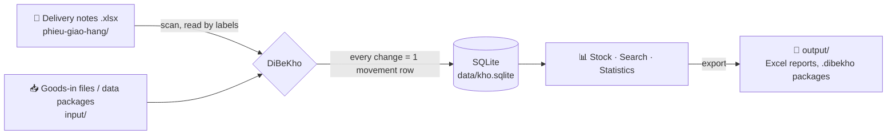

<div align="center">


# DiBeKho

**English** · [Tiếng Việt](README.vi.md)

**Automatic stock tracking from Excel delivery notes: runs on your own computer, no internet needed, zero running cost.**

[](https://github.com/Friendzoner49/DiBeKho/releases/latest/download/DiBeKho-windows-setup.exe)
[](https://github.com/Friendzoner49/DiBeKho/releases/latest/download/DiBeKho-mac-arm64.dmg)
[](https://www.python.org/)
[](https://doc.qt.io/qtforpython-6/)
[](https://www.sqlite.org/)


</div>

---

## About

DiBeKho is a desktop app for a small business that sells waterproofing materials. The business writes **delivery notes in Excel** every day and used to update its stock sheet by hand.

With DiBeKho you just drop the note files into a folder. The app reads them, reduces stock, records orders and customers, and builds the statistics. No retyping and no server.

> **No prices are stored.** The app is only about *quantities*: what is left, who bought what, and what sells best.

The user interface is available in **Vietnamese** (default) and **English**. The Vietnamese folder names (`phieu-giao-hang`, `input`, …) stay the same in both languages.

## Features

| | |
|---|---|
| 📂 **Reads delivery notes automatically** | Reads every `.xlsx` file in the folder and its subfolders. Finds the labels on the note even when cells shift. Each note counts once, even if the file is renamed or moved. |
| 🧠 **Learns product names** | A name on the note differs from the catalog? The app suggests the closest product (by Chinese name, model code and packing) and remembers your choice for later notes. |
| ✂️ **Drops fee lines** | Shipping and service fees are recognised and dropped with one click, so stock stays right. |
| ↩️ **Undo a wrong choice** | Read a note again, or "forget" a name match and choose again. Old history is kept. |
| 🛡️ **Safe with files** | Deleting a note file never changes stock; the app offers *restore*, *cancel the note* or *ignore*. If a note is edited, the app asks whether to use the new version. |
| 📥 **Goods in** | The app makes an Excel template; fill in the quantities and drop it into `input/`. |
| 🔢 **Stock count** | Enter what you counted and the app records the difference. The first count is the opening stock. |
| 🔎 **Search everything** | Products, customers, phone numbers, note numbers, notes. Works without Vietnamese accents and with Chinese input. |
| 📊 **Statistics and Excel export** | By day, month, quarter, year or any range; all items or selected products, categories, customers. Opening, in, out, closing stock, best sellers and a chart. |
| 👥 **Orders and customers** | Open any order and its original file. For each customer, see what they buy most. |
| 🔁 **Move to another computer** | Export all data to one `.dibekho` file and continue on another machine. |
| 💾 **Automatic backups** | One per day, last 14 kept; restore with one click. |
| 🌐 **Vietnamese and English** | Switch in Settings. Chinese can be typed in every field. |

## Screenshots

<table>
  <tr>
    <td width="50%"><br><b>To do:</b> match unknown names, drop shipping fees</td>
    <td width="50%"><br><b>Search:</b> accent-insensitive search across everything</td>
  </tr>
  <tr>
    <td><br><b>Statistics:</b> in, out and stock per period, Excel export</td>
    <td><br><b>Customer:</b> products bought most, all orders</td>
  </tr>
</table>

<sub>Screenshots use invented demo data (<code>scripts/readme_screenshots.py</code>), never real customer data.</sub>

## How it works



All data lives in **one working folder**, `Documents/DiBeKho` by default:

```
DiBeKho/
├── phieu-giao-hang/   ← delivery notes go here (any subfolders you like)
├── input/             ← goods-in files, or a data package from another computer
│   └── da-xu-ly/      ← processed files are moved here by the app
├── output/            ← Excel reports, goods-in template, data packages
├── sao-luu/           ← automatic backups
└── data/              ← database and copies of the original notes (do not edit)
```

**Ledger rule:** the app never overwrites a stock number. Every change (delivery, goods in, stock count, cancellation) is a *movement* row, and **stock = the sum of movements**. Every figure can be traced back to its source. Cancelling a note adds reverse movements; history is never deleted.

## Install

Click the **Windows** or **macOS** badge at the top to download the latest version, or see all versions under [**Releases**](https://github.com/Friendzoner49/DiBeKho/releases). The repository is private, so you must be signed in to GitHub with access to it.

| | How to install | First start |
|---|---|---|
| **macOS** (Apple Silicon, macOS 13+) | Open `DiBeKho-mac-arm64.dmg` and drag **DiBeKho** into **Applications** | Blocked because the app is not notarised: *System Settings → Privacy & Security → **Open Anyway***. Allow access to Documents. |
| **Windows** 10/11 | Run `DiBeKho-windows-setup.exe` | If SmartScreen warns: *More info → **Run anyway*** |

To update, install the new version over the old one. Your data in `Documents/DiBeKho` is kept.

**Uninstall:**
- **Windows:** *Settings → Apps → DiBeKho → Uninstall*. The uninstaller asks whether to delete the data folder too.
- **macOS:** in the app, *Settings → Uninstall…*. The app removes itself from Applications when it closes.

## Development

You need [**uv**](https://docs.astral.sh/uv/). It downloads Python 3.13 and every library into the project's `.venv/` and leaves the system Python alone.

```bash
uv sync                 # set up the environment
uv run dibekho          # run the app from source
uv run pytest -q        # run the tests
uv run ruff check src tests --select F,E9
```

### Build

| Platform | Command | Result |
|---|---|---|
| Windows | `powershell -ExecutionPolicy Bypass -File packaging\build_windows.ps1` | `dist/DiBeKho-x.y.z-windows-setup.exe` (needs [Inno Setup 6](https://jrsoftware.org/isinfo.php)); without it, a `-portable.zip` |
| macOS | `bash packaging/build_mac.sh` | `dist/DiBeKho-x.y.z-mac-arm64.dmg` |
| GitHub | Push a `v*` tag (e.g. `git tag v0.1.1 && git push origin v0.1.1`) | Both of the above, published to **Releases** (the download badges point there) |

PyInstaller cannot cross-compile: the macOS build must run on a Mac (or on GitHub Actions' Mac runners). Every build script runs the tests first, then `DiBeKho --self-test` on the packaged app. Details (in Vietnamese): [docs/chay-thu-va-build.md](docs/chay-thu-va-build.md).

### Source layout

```
src/dibekho/
├── app.py          # entry point, first-run dialog, --self-test
├── db/             # SQLite connection, migrations/NNN_*.sql
├── core/           # business logic: stock, folder scanning, catalog, statistics, transfer, backups
├── excel/          # read delivery notes, catalog and goods-in files; write reports
├── ui/             # PySide6 user interface, one file per screen
└── i18n/           # vi.json, en.json
tests/              # pytest: Excel readers, stock logic, transfer, every screen opens
packaging/          # PyInstaller spec, Windows/macOS build scripts, Inno Setup
scripts/            # helper tools (README screenshots, reference workbook)
```

`core/`, `excel/` and `db/` **do not import Qt**, so all business logic is tested with pytest without opening a window. Project decisions and working rules are in [CLAUDE.md](CLAUDE.md) (Vietnamese).

## Data and privacy

- Data stays on the user's computer. The app sends nothing to the internet.
- Real customer Excel files (names, phone numbers) are **never committed**: `samples/` and `*.xlsx` in the repository root are in `.gitignore`. Tests use invented notes; tests that need the real files skip themselves when the files are absent.

---

<div align="center">
<sub>Built with Python + PySide6 · your data stays on your computer</sub>
</div>
