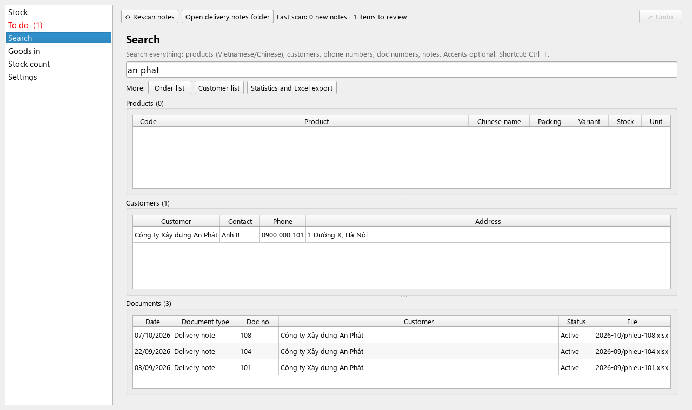
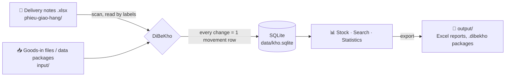

<div align="center">


# DiBeKho

**English** · [Tiếng Việt](README.vi.md) · [中文](README.zh.md)

**Automatic stock tracking from Excel delivery notes: runs on your own computer, no internet needed, zero running cost.**

[](https://github.com/Friendzoner49/DiBeKho/releases/latest/download/DiBeKho-windows-setup.exe)
[](https://github.com/Friendzoner49/DiBeKho/releases/latest/download/DiBeKho-mac-arm64.dmg)
[](https://www.python.org/)
[](https://doc.qt.io/qtforpython-6/)
[](https://www.sqlite.org/)


</div>

---

## About

DiBeKho is a desktop app for a small business that sells waterproofing materials. The business writes **delivery notes in Excel** every day and used to update its stock sheet by hand.

With DiBeKho you just drop the note files into a folder. The app reads them, reduces stock, records orders and customers, and builds the statistics. No retyping and no server.

> **No prices are stored.** The app is only about *quantities*: what is left, who bought what, and what sells best.

The user interface is available in **Vietnamese** (default), **English** and **Chinese (Simplified)**. The Vietnamese folder names (`phieu-giao-hang`, `input`, …) stay the same in every language.

## Features

| | |
|---|---|
| 📂 **Reads delivery notes automatically** | Reads every `.xlsx` file in the folder and its subfolders. Finds the labels on the note even when cells shift. Each note counts once, even if the file is renamed or moved. Fully recorded notes move to `phieu-giao-hang/da-xu-ly/`, so the folder shows what is still to do. |
| 🧠 **Learns product names** | A name on the note differs from the catalog? The app suggests the closest product (by Chinese name, model code and packing) and remembers your choice for later notes. |
| ✂️ **Drops fee lines** | Shipping and service fees are recognised and dropped with one click, so stock stays right. |
| ↩️ **Undo a wrong choice** | Read a note again, or "forget" a name match and choose again. Old history is kept. |
| 🛡️ **Safe with files** | Deleting a note file never changes stock; the app offers *restore*, *cancel the note* or *ignore*. If a note is edited, the app asks whether to use the new version. |
| 📥 **Goods in** | The app makes an Excel template; fill in the quantities and drop it into `input/`. |
| 🔢 **Stock count** | Enter what you counted and the app records the difference. The first count is the opening stock. |
| 🔎 **Search everything** | Products, customers, phone numbers, note numbers, notes. Works without Vietnamese accents and with Chinese input. |
| 📊 **Statistics and Excel export** | By day, month, quarter, year or any range; all items or selected products, categories, customers. Opening, in, out, closing stock, best sellers and a chart. |
| 👥 **Orders and customers** | Open any order and its original file. For each customer, see what they buy most. |
| 🔁 **Move to another computer** | Export all data to one `.dibekho` file and continue on another machine. |
| 📑 **Master data in Excel** | Export the product catalog and customer list to Excel, and import it on another computer with the same codes. |
| 💾 **Automatic backups** | One per day, last 14 kept; restore with one click. |
| 🧹 **Reset** | Start over: reset stock and read every note again (products kept), or delete all data. A backup is made first. |
| 🌐 **Vietnamese, English and Chinese** | Switch in Settings. Chinese can be typed in every field. |

## Screenshots

<table>
  <tr>
    <td width="50%"><br><b>To do:</b> match unknown names, drop shipping fees</td>
    <td width="50%"><br><b>Search:</b> accent-insensitive search across everything</td>
  </tr>
  <tr>
    <td><br><b>Statistics:</b> in, out and stock per period, Excel export</td>
    <td><br><b>Customer:</b> products bought most, all orders</td>
  </tr>
</table>

<sub>Screenshots use invented demo data (<code>scripts/readme_screenshots.py</code>), never real customer data.</sub>

## How it works



All data lives in **one working folder**, `Documents/DiBeKho` by default:

```
DiBeKho/
├── phieu-giao-hang/   ← delivery notes go here (any subfolders you like)
│   └── da-xu-ly/      ← fully recorded notes are moved here by the app
├── input/             ← goods-in files, or a data package from another computer
│   └── da-xu-ly/      ← processed files are moved here by the app
├── output/            ← Excel reports, goods-in template, data packages
├── sao-luu/           ← automatic backups
└── data/              ← database and copies of the original notes (do not edit)
```

**Ledger rule:** the app never overwrites a stock number. Every change (delivery, goods in, stock count, cancellation) is a *movement* row, and **stock = the sum of movements**. Every figure can be traced back to its source. Cancelling a note adds reverse movements; history is never deleted.

## Install

Click the **Windows** or **macOS** badge at the top to download the latest version, or see all versions under [**Releases**](https://github.com/Friendzoner49/DiBeKho/releases). The repository is private, so you must be signed in to GitHub with access to it.

| | How to install | First start |
|---|---|---|
| **macOS** (Apple Silicon, macOS 13+) | Open `DiBeKho-mac-arm64.dmg` and drag **DiBeKho** into **Applications** | Blocked because the app is not notarised: *System Settings → Privacy & Security → **Open Anyway***. Allow access to Documents. |
| **Windows** 10/11 | Run `DiBeKho-windows-setup.exe` | If SmartScreen warns: *More info → **Run anyway*** |

**Mac still shows "Move to Trash / Done" every time?** Open **Terminal**, paste the command below and press Enter (once after each install). It only removes the "downloaded from the internet" mark from DiBeKho:

```
xattr -dr com.apple.quarantine /Applications/DiBeKho.app
```

To update, install the new version over the old one. Your data in `Documents/DiBeKho` is kept.

**Uninstall:**
- **Windows:** *Settings → Apps → DiBeKho → Uninstall*. The uninstaller asks whether to delete the data folder too.
- **macOS:** in the app, *Settings → Uninstall…*. The app removes itself from Applications when it closes.

## User guide

Button names below are those of the English interface; the Vietnamese ones are in [README.vi.md](README.vi.md#hướng-dẫn-sử-dụng).

### 1. First start

Choose the language and the **working folder** (default `Documents/DiBeKho`), then click **Start**. Avoid a folder inside OneDrive, iCloud or Google Drive: syncing can damage the open database. The language can be changed later in **Settings → General**. There, **Text and button size** scales the whole interface (default 120%, choose 100–150%; close and reopen the app to apply).

### 2. Load the product catalog (once)

1. On **Stock**, click **Import catalog from Excel…** and pick the monthly stock sheet.
2. Check the preview: double-click a cell to fix it, untick rows you do not want. Rows already in the catalog are greyed out.
3. Keep **Use the stock in the file (column F) as the app's stock, as of** ticked and pick the date: the stock in the sheet's *remaining stock* column (F) becomes the app's stock on that date, as a stock count (column G is ignored). If the file has another layout and the app cannot find that column, it first asks you to **choose the stock column** (each column is shown with its title and a few sample values); the stock is always taken from the same row as the product. Untick the box to load only the products.
4. Click **Import selected rows**. Importing the same file again only adds the new products; tick existing rows to update their stock from a newer sheet.

Single products can also be added in **Settings → Products → Add product**. Select a row and press **Edit product…** (or double-click) to change its name, type/colour or group; **Delete product** only deletes a product that no document uses, otherwise the app offers to mark it *inactive* (hidden from lists, old documents unchanged). Long names: drag a column border wider, or hover a cell to read the full name.

### 3. Opening stock

Open **Stock count**, pick the date, type the counted quantity of each product and click **Save count**. The first count is the opening stock; later counts record only the difference between the count and the app.

### 4. Every day: delivery notes

1. Copy the day's delivery notes (`.xlsx`) into `phieu-giao-hang/` (**Open delivery notes folder** opens it). Subfolders such as one per month are fine.
2. Click **⟳ Rescan notes** (or press **F5**). The app also scans every time it starts.
3. Notes whose product names are all known are read straight away and stock goes down.
4. If **To do** shows a number, some lines need your decision. They are **grouped by order**, with every line of the order (lines with ✓ are already recognised), so you can compare with the paper note. Under **Is product** the 2–3 closest products come first:

| On the line | Do this |
|---|---|
| A product from the catalog | Pick one of the suggestions; if it is not there, choose **🔍 Choose another product…** and type a few letters (Vietnamese, Chinese, code) |
| A product not in the catalog yet | Choose **＋ Create new product**, and type the quantity already in stock (before this note) under **Opening stock**; the note is then subtracted from it |
| A shipping or service fee | Choose **✕ Not goods** (fee lines are usually pre-selected) |
| Not sure | Leave **⏸ Later (keep waiting)**: the other lines of the note are recorded; this one waits and joins the same order once decided |

When the same name is in several orders, choosing it in one sets the others too. Scrolling with the mouse wheel never changes a choice.

Then click **Apply and read notes again**, check the summary and confirm. The app remembers every choice, so the same name is recognised on later notes.

> A note that is fully recorded is moved to `phieu-giao-hang/da-xu-ly/` (same subfolders), so the notes left in `phieu-giao-hang/` are the ones still waiting. If a note needs a decision again (e.g. after **Forget and read again**), it moves back out. `input/da-xu-ly/` holds processed goods-in files and data packages.

### 5. Goods in (1–2 times per quarter)

1. **Goods in → Create goods-in template** (products in code order: SP001, SP002…), open the file, fill in the arrival date and the quantities, save it.
2. Copy the file into `input/` (**Open input folder**).
3. In **To do**, click **Review & import**, check the list and click **Confirm goods in**. Stock goes up and the file moves to `input/da-xu-ly/`.

Instead of steps 2–3 you can click **Choose a file to import…** on **Goods in** and pick the file wherever it is, even in `input/da-xu-ly/`. The same button also takes the monthly catalog sheet. A catalog sheet dropped into `input/` is recognised too (**Import catalog from Excel…** in **To do**). A file the app cannot use is never moved: **Hide** only removes it from the list.

### 6. Looking things up

- **Stock**: red rows = negative stock (a goods-in or a stock count is missing); yellow rows = at or below the **Low-stock alert at** level (set it per product in **Settings → Products**, double-click the product). Double-click a product for its full history.
- **Search** (**Ctrl+F**): one box for products, customers, phone numbers, note numbers and notes; accents are optional and Chinese works. The buttons under it open the **Order list**, the **Customer list** and **Statistics and Excel export**.
- **An order**: customer, lines, notes, **Open original file**, **Read note again**, **Cancel document**.
- **A customer**: all their orders and the products they buy most.

### 7. Statistics and Excel export

In **Search → Statistics and Excel export** choose the period (day, month, quarter, year or a range), optionally split it by day or month, and narrow it to some products, categories or customers. The table shows opening stock, in, out, stock-count adjustments and closing stock, plus best sellers and a chart. **Export to Excel…** lets you pick the sheets and saves the file in `output/`.

### 8. Fixing mistakes

| Situation | What to do |
|---|---|
| Just did something wrong (Apply, Forget and read again, edit/delete a product, stock count, goods in, an import…) | Press **↶ Undo** at the top right: the data goes back exactly as before that action. Press again to go back step by step (the last 20 steps are kept) |
| Picked the wrong product, or dropped a line by mistake, some time ago | **Settings → Products → Learned names on notes**: choices are grouped by order; click an order to see its lines, then **Forget and read again…** on the wrong one. The notes with that line come back to **To do** to choose again |
| A note should be read again with today's catalog | Open the order, **Read note again** |
| A note was entered by mistake | Open the order, **Cancel document** (stock is given back, history kept). Deleting the file does **not** cancel it |
| A note file was deleted from the folder | **To do** offers **Restore file**, **Cancel document** or **Ignore** |
| A note file was edited after it was read | **To do** offers **Use new version** or **Keep old version** |

### 9. Moving to another computer

Only one computer works at a time.

1. On the computer in use: **Settings → Data transfer and backups → Export data**. A `.dibekho` file appears in `output/`.
2. Send the file (USB, Zalo, e-mail…) and put it into `input/` on the other computer.
3. There, open **To do → Import data**. The current data on that computer is backed up first and then replaced.

**Master data (Excel):** **Settings → Data transfer and backups → Export master data…** writes the product catalog (codes, names, packing, variant, unit, category, date added, low-stock alert, active) and the customer list (name, phone, contact, address, number of orders) to one Excel file in `output/`. Use it to check the app against your own records, or load it on another computer with **Import master data…**: the same products (same codes) and customers appear there. A third sheet, **Stock**, lists every product like the monthly stock sheet: code, product, category, type/colour and current stock. You may correct the stock there: **Import master data…** sets the app's stock to exactly those numbers (recorded as a stock count today). The file can also be dropped into `input/` and imported from **To do**. A row copied for another variant keeps being its own product even if its code was copied too (the app gives it a new code and says so). The **Stock** sheet is the reference: rows with the same name but another category or type/colour are different products, and on import each product takes the category and type/colour written there. In an older file whose Stock sheet has no code column, the app finds the product of each stock row from what the row says (name, Chinese name, packing, category, type/colour — not the row order), and shows it first in **Check the stock before importing**; yellow rows need a look (the **Problem / change** column says why, and which products will change), and you can choose the right product for any row. The file holds no orders; to move everything, use **Export data** above.

### 10. Backups

The app backs up once a day when it starts and keeps the last 14 copies in `sao-luu/`. **Settings → Data transfer and backups** has **Back up now** and **Restore selected**.

### 11. Starting over

**Settings → General → Reset data** (the app always makes a backup first, so a reset can be undone with **Restore selected**):

| Button | Kept | Deleted |
|---|---|---|
| **Reset stock (keep products)…** | Product catalog, learned names on notes, dropped lines | Every delivery note, goods in, stock count and customer: stock goes back to 0. The notes in `phieu-giao-hang/da-xu-ly/` move back to `phieu-giao-hang/` and are read again right away |
| **Delete all data…** | Only the settings (language, size, working folder) | Everything: the app is as freshly installed. Notes move back to `phieu-giao-hang/` and wait in **To do** |

Your own files (delivery notes, `input/`, `output/`, backups) are never deleted.

## Development

You need [**uv**](https://docs.astral.sh/uv/). It downloads Python 3.13 and every library into the project's `.venv/` and leaves the system Python alone.

```bash
uv sync                 # set up the environment
uv run dibekho          # run the app from source
uv run pytest -q        # run the tests
uv run ruff check src tests --select F,E9
```

### Build

| Platform | Command | Result |
|---|---|---|
| Windows | `powershell -ExecutionPolicy Bypass -File packaging\build_windows.ps1` | `dist/DiBeKho-x.y.z-windows-setup.exe` (needs [Inno Setup 6](https://jrsoftware.org/isinfo.php)); without it, a `-portable.zip` |
| macOS | `bash packaging/build_mac.sh` | `dist/DiBeKho-x.y.z-mac-arm64.dmg` |
| GitHub | Push a `v*` tag (e.g. `git tag v0.1.1 && git push origin v0.1.1`) | Both of the above, published to **Releases** (the download badges point there) |

PyInstaller cannot cross-compile: the macOS build must run on a Mac (or on GitHub Actions' Mac runners). Every build script runs the tests first, then `DiBeKho --self-test` on the packaged app. Details (in Vietnamese): [docs/chay-thu-va-build.md](docs/chay-thu-va-build.md).

### Source layout

```
src/dibekho/
├── app.py          # entry point, first-run dialog, --self-test
├── db/             # SQLite connection, migrations/NNN_*.sql
├── core/           # business logic: stock, folder scanning, catalog, statistics, transfer, backups
├── excel/          # read delivery notes, catalog and goods-in files; write reports
├── ui/             # PySide6 user interface, one file per screen
└── i18n/           # vi.json, en.json, zh.json
tests/              # pytest: Excel readers, stock logic, transfer, every screen opens
packaging/          # PyInstaller spec, Windows/macOS build scripts, Inno Setup
scripts/            # helper tools (README screenshots, reference workbook)
```

`core/`, `excel/` and `db/` **do not import Qt**, so all business logic is tested with pytest without opening a window. Project decisions and working rules are in [CLAUDE.md](CLAUDE.md) (Vietnamese).

## Data and privacy

- Data stays on the user's computer. The app sends nothing to the internet.
- Real customer Excel files (names, phone numbers) are **never committed**: `samples/` and `*.xlsx` in the repository root are in `.gitignore`. Tests use invented notes; tests that need the real files skip themselves when the files are absent.

---

<div align="center">
<sub>Built with Python + PySide6 · your data stays on your computer</sub>
</div>
