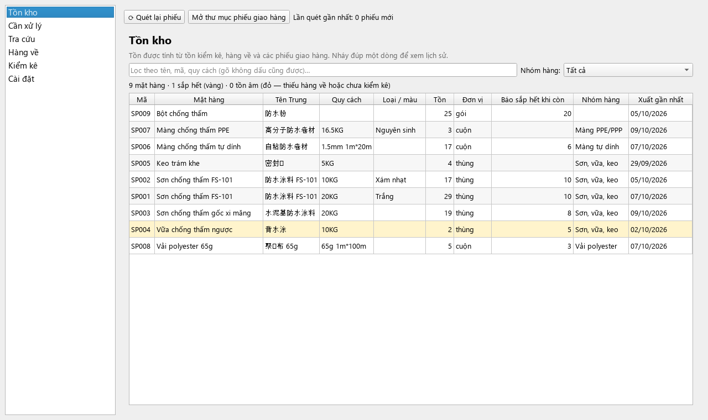
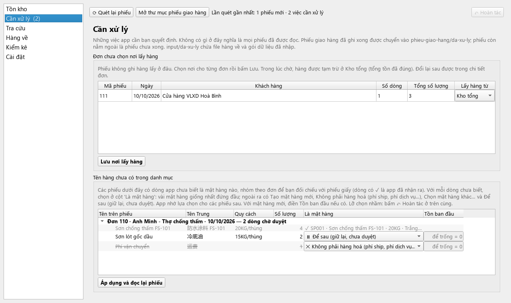
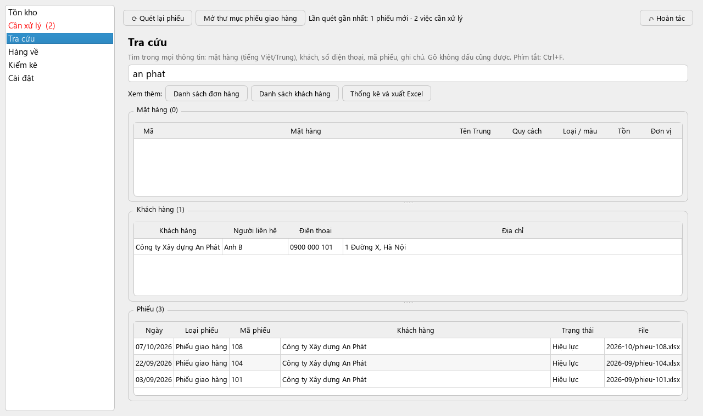
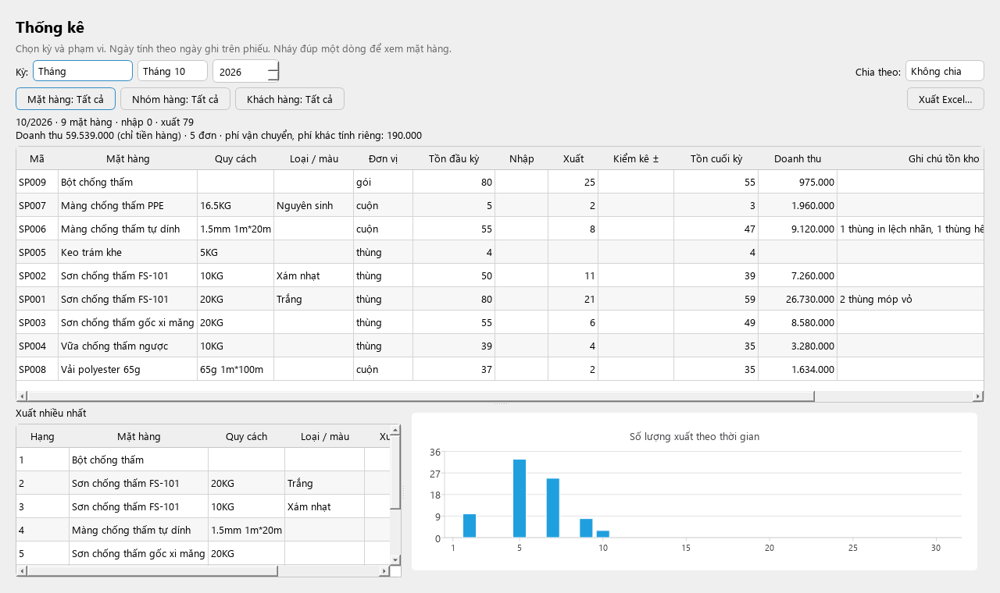
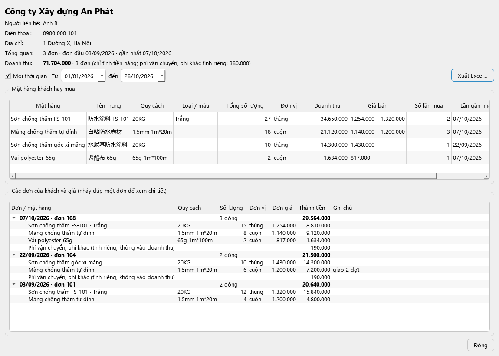
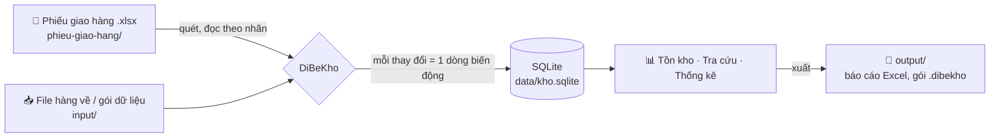

<div align="center">


# DiBeKho

[English](README.md) · **Tiếng Việt**

**Theo dõi tồn kho tự động từ các file phiếu giao hàng Excel: chạy ngay trên máy, không cần internet, chi phí 0₫.**

[](https://github.com/Friendzoner49/DiBeKho/releases/latest/download/DiBeKho-windows-setup.exe)
[](https://github.com/Friendzoner49/DiBeKho/releases/latest/download/DiBeKho-mac-arm64.dmg)
[](https://www.python.org/)
[](https://doc.qt.io/qtforpython-6/)
[](https://www.sqlite.org/)



</div>

---

## Giới thiệu

DiBeKho là app desktop dành cho doanh nghiệp nhỏ bán vật liệu chống thấm. Ngày nào doanh nghiệp cũng tạo **phiếu giao hàng bằng Excel**, và trước đây họ phải tự trừ tồn kho bằng tay.

Với DiBeKho, bạn chỉ cần bỏ file phiếu vào một thư mục. App tự đọc phiếu, trừ tồn, ghi lại đơn hàng và khách hàng, rồi lập thống kê. Không cần nhập lại dữ liệu và không cần máy chủ.

> **Không lưu giá tiền.** App chỉ quan tâm đến *số lượng*: hàng nào còn bao nhiêu, ai mua gì, bán chạy mặt hàng nào.

## Tính năng

| | |
|---|---|
| 📂 **Đọc phiếu giao hàng tự động** | Đọc mọi file `.xlsx` trong thư mục, kể cả thư mục con. Nhận ra nhãn trên phiếu dù vị trí ô bị lệch. Mỗi phiếu chỉ được tính một lần, dù đổi tên hay chuyển chỗ file. |
| 🧠 **Tự học tên hàng** | Tên trên phiếu khác tên trong danh mục? App gợi ý mặt hàng khớp nhất (dựa vào tên tiếng Trung, mã model, quy cách) và nhớ lựa chọn của bạn cho các phiếu sau. |
| ✂️ **Bỏ dòng phí** | Phí ship, phí dịch vụ… được nhận ra và bỏ qua chỉ với một cú bấm, không làm sai tồn kho. |
| ↩️ **Sửa được khi chọn nhầm** | Đọc lại một phiếu, hoặc "quên" một lựa chọn ghép tên rồi chọn lại. Lịch sử cũ vẫn được giữ. |
| 🛡️ **An toàn với file** | Lỡ xoá file phiếu thì tồn kho không đổi, và app cho chọn *khôi phục*, *huỷ phiếu* hoặc *bỏ qua*. Sửa phiếu thì app hỏi dùng bản mới hay giữ bản cũ. |
| 📥 **Nhập hàng về** | App tạo sẵn file Excel mẫu, bạn chỉ điền số lượng rồi bỏ vào thư mục `input/`. |
| 🔢 **Kiểm kê** | Nhập số đếm thực tế, app ghi phần chênh lệch. Lần kiểm kê đầu tiên chính là tồn đầu kỳ. |
| 🔎 **Tra cứu mọi thứ** | Tìm mặt hàng, khách, số điện thoại, mã phiếu, ghi chú. Gõ không dấu hoặc tiếng Trung đều được. |
| 📊 **Thống kê và xuất Excel** | Theo ngày, tháng, quý, năm hoặc khoảng tự chọn; tất cả hoặc chọn riêng mặt hàng, nhóm hàng, khách. Có tồn đầu, nhập, xuất, tồn cuối, top bán chạy và biểu đồ. |
| 👥 **Đơn hàng và khách hàng** | Xem chi tiết từng đơn và mở được file gốc. Với mỗi khách, xem họ hay mua những mặt hàng nào. |
| 🔁 **Chuyển máy** | Xuất toàn bộ dữ liệu thành một file `.dibekho` để máy khác làm tiếp. |
| 📑 **Dữ liệu gốc bằng Excel** | Xuất danh mục mặt hàng và danh sách khách ra Excel, nạp sang máy khác với đúng mã cũ. |
| 💾 **Sao lưu tự động** | Mỗi ngày một bản, giữ 14 bản gần nhất; khôi phục bằng một cú bấm. |
| 🌐 **Tiếng Việt và tiếng Anh** | Đổi trong Cài đặt. Gõ được tiếng Trung ở mọi ô nhập. |

## Ảnh màn hình

<table>
  <tr>
    <td width="50%"><br><b>Cần xử lý:</b> ghép tên hàng lạ, bỏ dòng phí ship</td>
    <td width="50%"><br><b>Tra cứu:</b> tìm không dấu trong mọi thông tin</td>
  </tr>
  <tr>
    <td><br><b>Thống kê:</b> nhập, xuất, tồn theo kỳ, xuất ra Excel</td>
    <td><br><b>Chi tiết khách:</b> mặt hàng hay mua, các đơn đã đặt</td>
  </tr>
</table>

<sub>Ảnh dùng dữ liệu giả lập (<code>scripts/readme_screenshots.py</code>), không phải dữ liệu khách hàng thật.</sub>

## Cách hoạt động



Toàn bộ dữ liệu nằm trong **một thư mục làm việc**, mặc định là `Documents/DiBeKho`:

```
DiBeKho/
├── phieu-giao-hang/   ← bỏ file phiếu giao hàng vào đây (chia thư mục con tuỳ ý)
├── input/             ← file hàng về, hoặc gói dữ liệu từ máy khác
│   └── da-xu-ly/      ← app tự chuyển file đã xử lý vào đây
├── output/            ← báo cáo Excel, file mẫu hàng về, gói dữ liệu
├── sao-luu/           ← bản sao lưu tự động
└── data/              ← database và bản sao file phiếu gốc (không sửa tay)
```

**Nguyên tắc sổ cái:** app không bao giờ sửa trực tiếp con số tồn kho. Mọi thay đổi (giao hàng, hàng về, kiểm kê, huỷ phiếu) là một dòng *biến động*, và **tồn = tổng các biến động**. Nhờ vậy mọi con số đều truy được nguồn gốc. Huỷ phiếu là ghi thêm biến động ngược, không xoá lịch sử.

## Cài đặt (người dùng)

Bấm nút **Windows** hoặc **macOS** ở đầu trang để tải (luôn là bản mới nhất), hoặc xem mọi bản ở mục [**Releases**](https://github.com/Friendzoner49/DiBeKho/releases). Repo đang để private nên cần đăng nhập GitHub có quyền xem repo mới tải được.

| | Cách cài | Lần đầu mở |
|---|---|---|
| **macOS** (Apple Silicon, macOS 13+) | Mở `DiBeKho-x.y.z-mac-arm64.dmg`, kéo **DiBeKho** vào **Applications** | Bị chặn vì app chưa ký số: *Cài đặt hệ thống → Quyền riêng tư & Bảo mật → **Vẫn mở***. Cho phép truy cập Documents. |
| **Windows** 10/11 | Chạy `DiBeKho-x.y.z-windows-setup.exe` (hoặc giải nén bản portable) | Nếu SmartScreen cảnh báo: *Thông tin thêm → **Vẫn chạy*** |

Cập nhật bản mới: cài đè lên bản cũ. Dữ liệu trong `Documents/DiBeKho` được giữ nguyên.

**Gỡ cài đặt:**
- **Windows:** *Settings → Apps → DiBeKho → Uninstall*. Trình gỡ sẽ hỏi có xoá thư mục dữ liệu không.
- **macOS:** trong app vào *Cài đặt → Gỡ app…*. App tự xoá khỏi Applications khi đóng lại.

## Hướng dẫn sử dụng

### 1. Mở app lần đầu

Chọn ngôn ngữ và **thư mục làm việc** (mặc định `Documents/DiBeKho`), rồi bấm **Bắt đầu**. Không nên chọn thư mục nằm trong OneDrive, iCloud hoặc Google Drive: đồng bộ đám mây có thể làm hỏng database đang mở. Đổi ngôn ngữ sau này ở **Cài đặt → Chung**.

### 2. Nạp danh mục mặt hàng (làm một lần)

1. Ở màn hình **Tồn kho**, bấm **Nhập danh mục từ Excel…** và chọn file thống kê tháng.
2. Xem bảng xem trước: nháy đúp vào ô để sửa, bỏ tick những dòng không cần. Dòng đã có trong danh mục hiện màu xám.
3. Bấm **Nhập các dòng đã chọn**. Nhập lại cùng file nhiều lần chỉ thêm mặt hàng mới.

Thêm từng mặt hàng lẻ ở **Cài đặt → Danh mục mặt hàng → Thêm mặt hàng**.

### 3. Tồn đầu kỳ

Vào **Kiểm kê**, chọn ngày, gõ số đếm thực tế của từng mặt hàng rồi bấm **Lưu kiểm kê**. Lần kiểm kê đầu tiên chính là tồn đầu; các lần sau app chỉ ghi phần chênh lệch giữa số đếm và số trên app.

### 4. Hằng ngày: phiếu giao hàng

1. Chép các phiếu giao hàng (`.xlsx`) trong ngày vào `phieu-giao-hang/` (nút **Mở thư mục phiếu giao hàng** mở thư mục này). Chia thư mục con, ví dụ theo tháng, cũng được.
2. Bấm **⟳ Quét lại phiếu** (hoặc phím **F5**). App cũng tự quét mỗi lần mở.
3. Phiếu có đủ tên hàng đã biết được đọc ngay và tồn giảm.
4. Nếu mục **Cần xử lý** hiện con số, có dòng hàng cần bạn quyết định:

| Dòng trên phiếu là | Làm thế này |
|---|---|
| Mặt hàng có trong danh mục | Chọn ở cột **Là mặt hàng**; gõ vài chữ (tiếng Việt hoặc tiếng Trung) để tìm |
| Mặt hàng chưa có trong danh mục | Để **＋ Tạo mặt hàng mới** |
| Phí ship, phí dịch vụ | Bấm **✕ Bỏ dòng** (dòng phí thường đã được chọn sẵn) |
| Chưa chắc | Chọn **⏸ Để sau**: các dòng khác của phiếu vẫn được ghi; dòng này chờ và được thêm vào đúng đơn đó khi bạn duyệt |

Sau đó bấm **Áp dụng và đọc lại phiếu**, xem bảng tóm tắt rồi xác nhận. App nhớ mọi lựa chọn, nên lần sau gặp đúng tên đó sẽ tự nhận ra.

> Phiếu giao hàng luôn nằm nguyên chỗ bạn để. `input/da-xu-ly/` chỉ chứa file hàng về và gói dữ liệu đã nhập.

### 5. Hàng về (1–2 lần mỗi quý)

1. **Hàng về → Tạo file mẫu hàng về**, mở file, điền ngày về và số lượng, lưu lại.
2. Chép file vào `input/` (nút **Mở thư mục input**).
3. Ở **Cần xử lý**, bấm **Xem và nhập**, kiểm tra danh sách rồi bấm **Xác nhận nhập hàng về**. Tồn tăng và file được chuyển sang `input/da-xu-ly/`.

Thay cho bước 2–3, có thể bấm **Chọn file để nhập…** ở **Hàng về** và chọn thẳng file ở bất kỳ đâu, kể cả trong `input/da-xu-ly/`. Nút này cũng nhận file danh mục (thống kê tháng). File danh mục bỏ vào `input/` cũng được nhận ra (**Nhập danh mục từ Excel…** trong **Cần xử lý**). File app không dùng được sẽ không bao giờ bị di chuyển: **Ẩn** chỉ bỏ nó khỏi danh sách.

### 6. Tra cứu

- **Tồn kho**: dòng đỏ = tồn âm (thiếu phiếu hàng về hoặc chưa kiểm kê); dòng vàng = bằng hoặc dưới mức **Báo sắp hết khi còn** (đặt cho từng mặt hàng ở **Cài đặt → Danh mục mặt hàng**, nháy đúp vào mặt hàng). Nháy đúp một mặt hàng để xem toàn bộ lịch sử.
- **Tra cứu** (**Ctrl+F**): một ô tìm mặt hàng, khách, số điện thoại, mã phiếu, ghi chú; gõ không dấu hoặc tiếng Trung đều được. Các nút bên dưới mở **Danh sách đơn hàng**, **Danh sách khách hàng** và **Thống kê và xuất Excel**.
- **Một đơn hàng**: khách, các dòng hàng, ghi chú, **Mở file gốc**, **Đọc lại phiếu**, **Huỷ phiếu**.
- **Một khách hàng**: mọi đơn của khách và những mặt hàng khách hay mua.

### 7. Thống kê và xuất Excel

Ở **Tra cứu → Thống kê và xuất Excel**, chọn kỳ (ngày, tháng, quý, năm hoặc khoảng tự chọn), có thể chia theo ngày hoặc tháng, và thu hẹp theo mặt hàng, nhóm hàng hoặc khách. Bảng hiện tồn đầu, nhập, xuất, điều chỉnh kiểm kê, tồn cuối, kèm top bán chạy và biểu đồ. **Xuất Excel…** cho chọn các trang cần xuất và lưu file vào `output/`.

### 8. Sửa khi làm nhầm

| Tình huống | Cách làm |
|---|---|
| Chọn nhầm mặt hàng, hoặc lỡ bỏ nhầm một dòng | **Cài đặt → Danh mục mặt hàng → Tên trên phiếu đã học**, chọn dòng, **Quên và đọc lại…**. Các phiếu liên quan hiện lại ở **Cần xử lý** |
| Muốn đọc lại một phiếu theo danh mục hiện tại | Mở đơn hàng, **Đọc lại phiếu** |
| Phiếu bị nhập nhầm | Mở đơn hàng, **Huỷ phiếu** (tồn được hoàn lại, lịch sử vẫn giữ). Xoá file **không** phải là huỷ phiếu |
| Lỡ xoá file phiếu khỏi thư mục | **Cần xử lý** cho chọn **Khôi phục file**, **Huỷ phiếu** hoặc **Bỏ qua** |
| File phiếu bị sửa sau khi đã đọc | **Cần xử lý** cho chọn **Dùng bản mới** hoặc **Giữ bản cũ** |

### 9. Chuyển sang máy khác

Mỗi lúc chỉ một máy làm việc.

1. Ở máy đang dùng: **Cài đặt → Chuyển dữ liệu và sao lưu → Xuất dữ liệu**. File `.dibekho` xuất hiện trong `output/`.
2. Gửi file (USB, Zalo, email…) và chép vào `input/` của máy kia.
3. Ở máy kia, vào **Cần xử lý → Nhập dữ liệu**. Dữ liệu hiện có trên máy đó được sao lưu trước, rồi mới bị thay thế.

**Dữ liệu gốc (Excel):** **Cài đặt → Chuyển dữ liệu và sao lưu → Xuất dữ liệu gốc…** ghi danh mục mặt hàng (mã, tên, quy cách, loại/màu, đơn vị, nhóm hàng, ngày nhập, mức báo sắp hết, đang dùng) và danh sách khách hàng (tên, điện thoại, người liên hệ, địa chỉ, số đơn) ra một file Excel trong `output/`. Dùng để đối chiếu với sổ sách, hoặc nạp sang máy khác bằng **Nhập dữ liệu gốc…**: máy đó sẽ có đúng các mặt hàng (giữ nguyên mã) và khách hàng như trong file. File không chứa tồn kho và đơn hàng; muốn chuyển toàn bộ, dùng **Xuất dữ liệu** ở trên.

### 10. Sao lưu

App tự sao lưu mỗi ngày một lần khi mở và giữ 14 bản gần nhất trong `sao-luu/`. Trong **Cài đặt → Chuyển dữ liệu và sao lưu** có **Sao lưu ngay** và **Khôi phục bản đã chọn**.

## Phát triển

Cần [**uv**](https://docs.astral.sh/uv/). uv tự tải Python 3.13 và mọi thư viện vào `.venv/` của dự án, không đụng tới Python của hệ thống.

```bash
uv sync                 # cài môi trường
uv run dibekho          # chạy app từ mã nguồn
uv run pytest -q        # chạy test
uv run ruff check src tests --select F,E9
```

### Build

| Nền tảng | Lệnh | Kết quả |
|---|---|---|
| Windows | `powershell -ExecutionPolicy Bypass -File packaging\build_windows.ps1` | `dist/DiBeKho-x.y.z-windows-setup.exe` (cần [Inno Setup 6](https://jrsoftware.org/isinfo.php)), nếu không có thì ra bản `-portable.zip` |
| macOS | `bash packaging/build_mac.sh` | `dist/DiBeKho-x.y.z-mac-arm64.dmg` |
| GitHub | Đẩy tag `v*` (vd. `git tag v0.1.1 && git push origin v0.1.1`) | Cả hai bản trên, tự đăng lên **Releases** (nút tải ở đầu README trỏ vào đây) |

PyInstaller không build chéo được: bản Mac phải build trên Mac (hoặc trên máy Mac của GitHub Actions). Mỗi script build đều chạy test trước, sau đó chạy `DiBeKho --self-test` trên bản đã đóng gói. Chi tiết xem [docs/chay-thu-va-build.md](docs/chay-thu-va-build.md).

### Cấu trúc mã nguồn

```
src/dibekho/
├── app.py          # điểm khởi động, màn hình chào lần đầu, --self-test
├── db/             # kết nối SQLite, migrations/NNN_*.sql
├── core/           # nghiệp vụ: tồn kho, quét thư mục, danh mục, thống kê, chuyển dữ liệu, sao lưu
├── excel/          # đọc phiếu giao hàng, danh mục, file hàng về; xuất báo cáo
├── ui/             # giao diện PySide6, mỗi màn hình một file
└── i18n/           # vi.json, en.json
tests/              # pytest: bộ đọc Excel, logic tồn, chuyển dữ liệu, mở mọi màn hình
packaging/          # PyInstaller spec, script build Windows/macOS, Inno Setup
scripts/            # công cụ phụ (tạo ảnh cho README)
```

`core/`, `excel/` và `db/` **không import Qt**, nên toàn bộ nghiệp vụ được test bằng pytest mà không cần mở cửa sổ. Quy ước làm việc và mọi quyết định thiết kế nằm trong [CLAUDE.md](CLAUDE.md).

## Dữ liệu và quyền riêng tư

- Dữ liệu chỉ nằm trên máy người dùng. App không gửi gì lên internet.
- File Excel thật của khách hàng (có tên, số điện thoại) **không bao giờ được commit**: `samples/` và các file `*.xlsx` ở thư mục gốc đã nằm trong `.gitignore`. Test dùng phiếu giả lập; các test cần file thật sẽ tự bỏ qua khi không có file.

---

<div align="center">
<sub>Làm bằng Python + PySide6 · dữ liệu nằm trên máy của bạn</sub>
</div>
