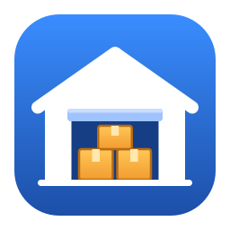
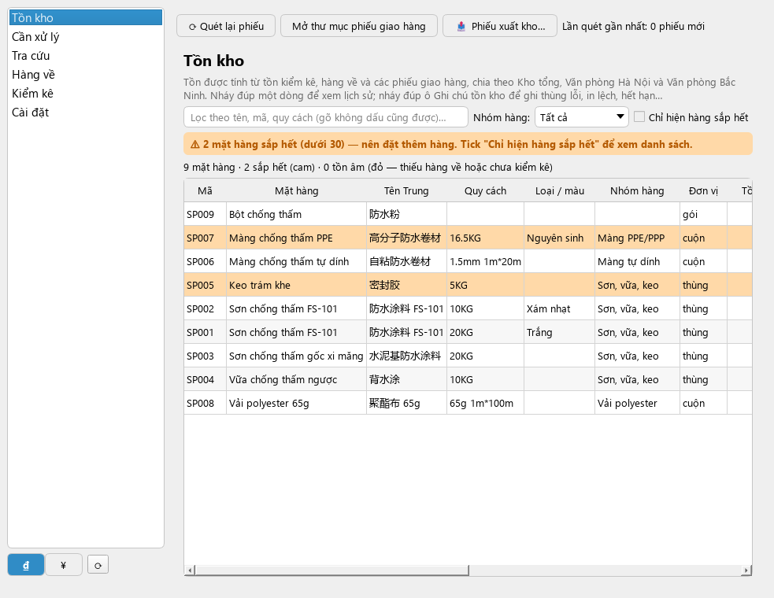
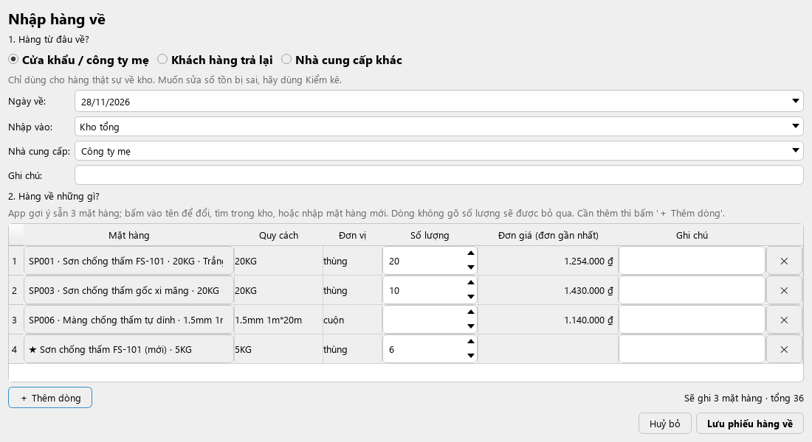
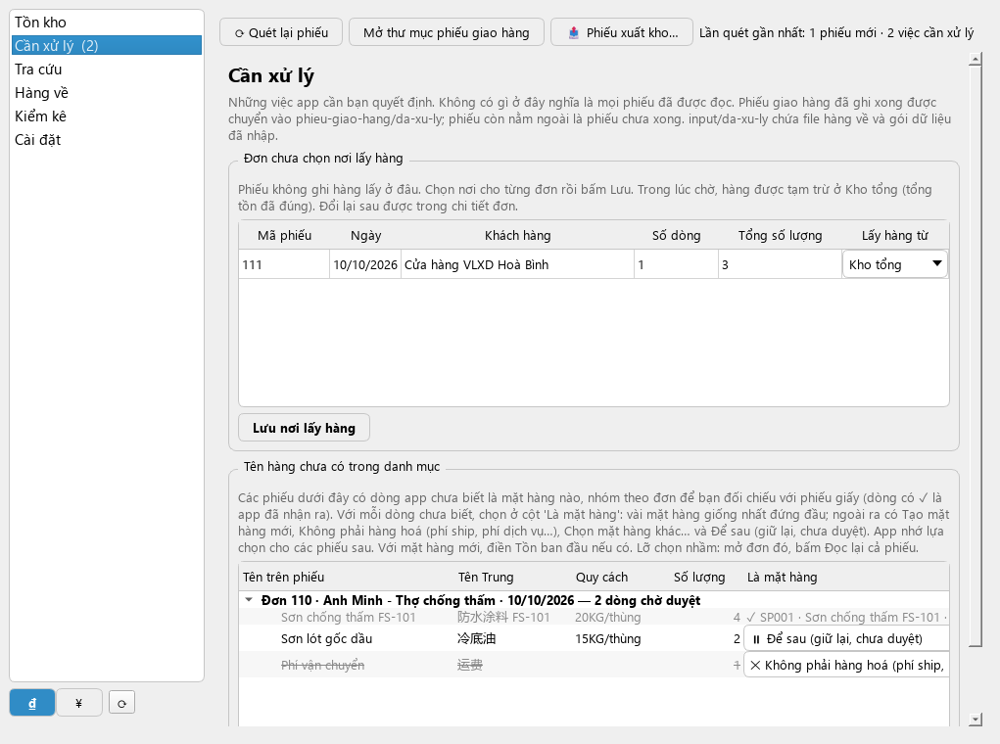
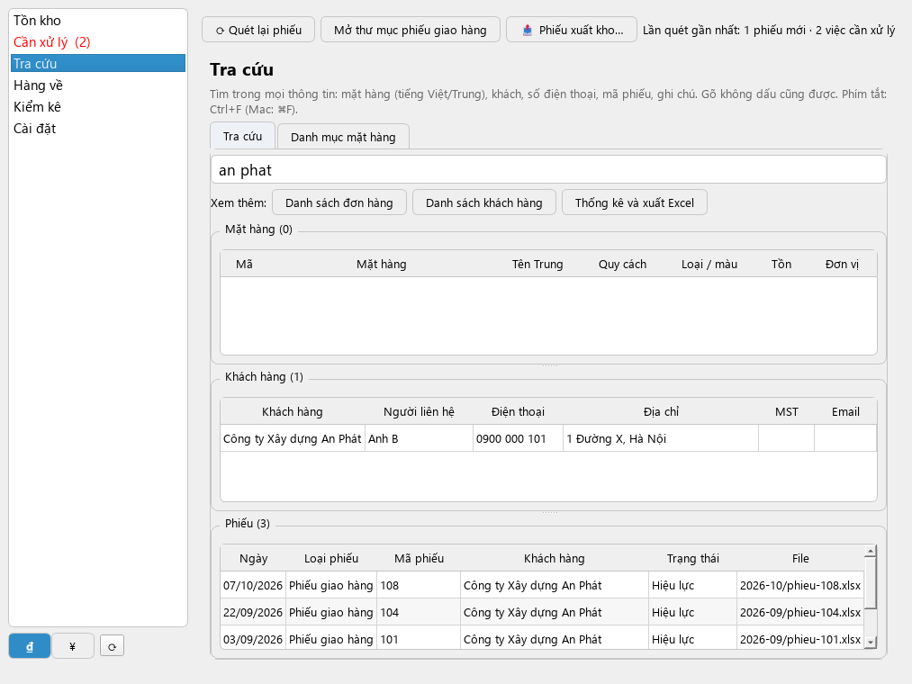
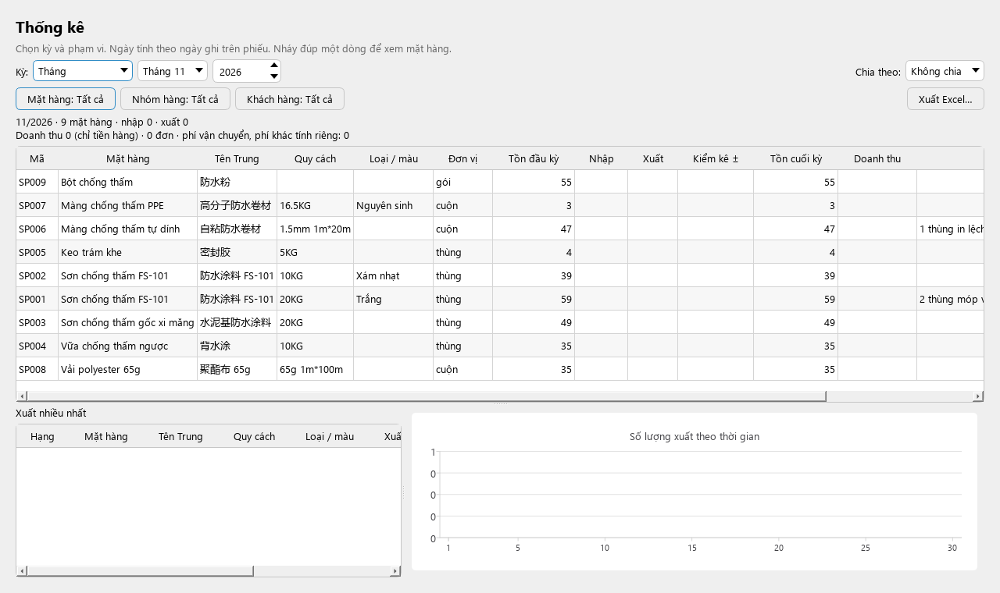
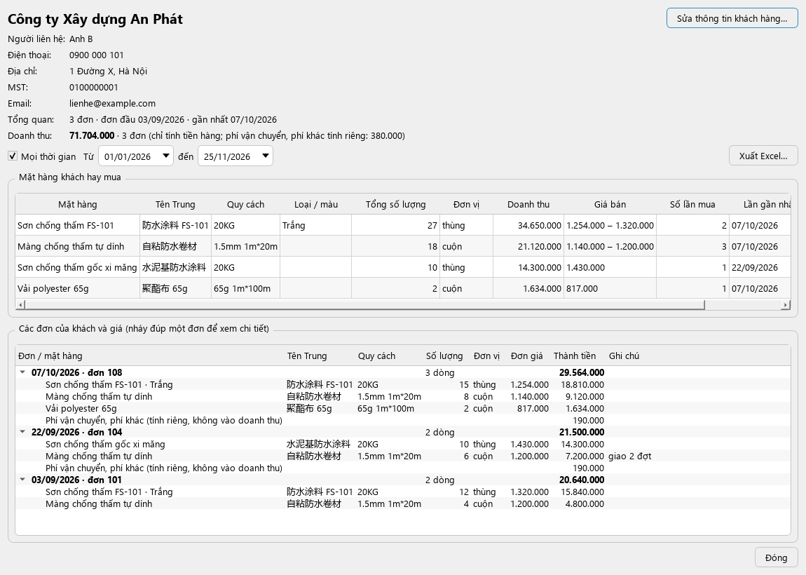
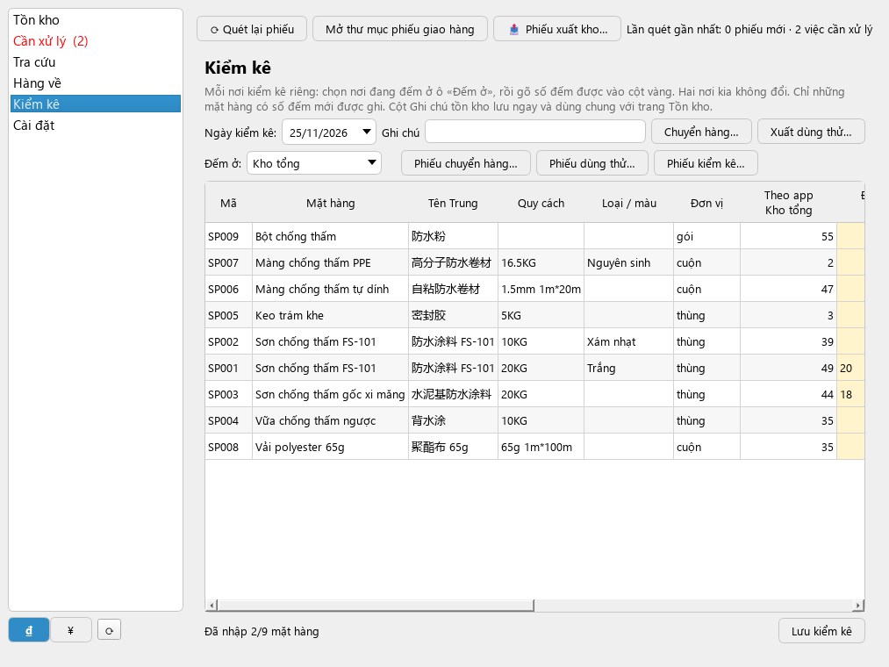
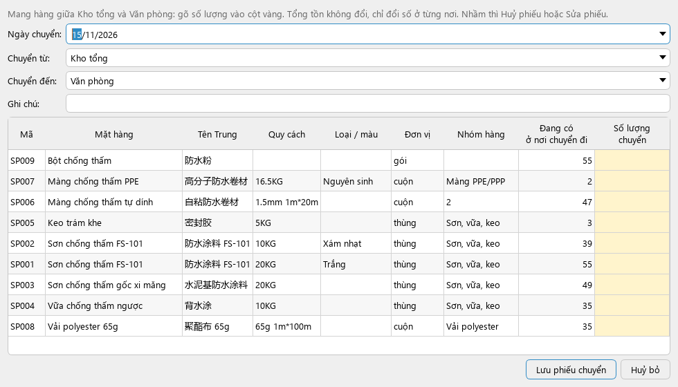

<div align="center">



# DiBeKho

[English](README.md) · **Tiếng Việt** · [中文](README.zh.md) · [Русский](README.ru.md)

**Theo dõi tồn kho tự động từ các file phiếu giao hàng Excel: app trên máy, dữ liệu chung trên Cloud (giống trang web), chi phí 0₫.**

[](https://github.com/Friendzoner49/DiBeKho/releases/latest/download/DiBeKho-windows-setup.exe)
[](https://github.com/Friendzoner49/DiBeKho/releases/latest/download/DiBeKho-Swift-mac-arm64.dmg)

📖 **[Hướng dẫn sử dụng chi tiết (từng bước, có ảnh)](docs/huong-dan-su-dung.md)**



</div>

---

**Mục lục:** [Làm được gì](#dibekho-làm-được-gì) · [Tải và cài đặt](#tải-và-cài-đặt) · [Ngày đầu tiên](#ngày-đầu-tiên) · [Hướng dẫn sử dụng](#hướng-dẫn-sử-dụng) · [Khi làm nhầm hoặc gặp lỗi](#khi-làm-nhầm-hoặc-gặp-lỗi) · [Câu hỏi thường gặp](#câu-hỏi-thường-gặp) · [Người phát triển](#dành-cho-người-phát-triển)

## DiBeKho làm được gì

Bạn bỏ file phiếu giao hàng Excel vào một thư mục. App tự đọc phiếu, trừ tồn kho, ghi lại đơn hàng và khách hàng. Không phải gõ lại số liệu.

- 📦 **Xem tồn kho** từng mặt hàng, chia theo **Kho tổng**, **Văn phòng Hà Nội** và **Văn phòng Bắc Ninh**; hàng dưới 30 tô cam kèm ghi "Sắp hết — nên đặt hàng", tồn âm tô đỏ; **ghi chú** cho từng mặt hàng (thùng lỗi, in lệch, hết hạn…).
- 📥 **Nhập hàng về** trong một cửa sổ: từ cửa khẩu / công ty mẹ, hoặc khách trả lại.
- 📤 **Phiếu xuất kho:** chọn khách và hàng, lấy ở Kho tổng, Văn phòng Hà Nội, Văn phòng Bắc Ninh hoặc nhiều nơi; app trừ tồn ngay và tạo file Excel giống phiếu giao hàng. Khách chưa chốt: **Lưu nháp** (không trừ tồn, không tính doanh thu), khách chốt thì **Xuất từ phiếu nháp…** ([chi tiết](docs/huong-dan-su-dung.md#35-phiếu-xuất-kho)).
- 💱 **Xem tiền bằng VND hoặc nhân dân tệ:** công tắc **₫ | ¥** ở góc trái dưới đổi mọi số tiền sang nhân dân tệ theo tỷ giá thị trường hôm nay (file thống kê vẫn ghi VND; **Phiếu xuất kho** làm khi công tắc ở ¥ thì gõ giá và ghi file bằng ¥). Phiếu ghi giá bằng tệ được nhận là đơn tệ: doanh thu tệ cộng riêng, kèm số quy đổi xấp xỉ ra ₫ trong ngoặc; trong Đơn hàng, đơn tệ nằm ở cột riêng **Tiền hàng (CNY)**.
- 🔢 **Kiểm kê** từng nơi (Kho tổng, Văn phòng Hà Nội, Văn phòng Bắc Ninh): gõ số đếm thực tế, app ghi phần chênh lệch. **Chuyển hàng** giữa các nơi.
- 🔎 **Tra cứu** mặt hàng, khách, số điện thoại, mã phiếu; gõ không dấu hay tiếng Trung đều được.
- 💰 **Doanh thu theo khách:** tiền hàng (phí vận chuyển tính riêng), mặt hàng khách hay mua, từng đơn với đơn giá và thành tiền, lọc theo khoảng thời gian.
- 📊 **Thống kê** theo ngày, tháng, quý, năm và **xuất ra Excel**.
- 👥 **Tài khoản chủ và nhân viên:** mở app là đăng nhập; thay đổi của nhân viên chờ chủ duyệt.
- 💾 **Sao lưu tự động** mỗi ngày; **chuyển dữ liệu** sang máy khác bằng một file.
- 🌐 Giao diện **tiếng Việt, tiếng Anh, tiếng Trung**.

> App đọc **giá bán** (đơn giá, thành tiền, phí vận chuyển) ghi trên phiếu giao hàng để tính doanh thu. **Doanh thu chỉ tính tiền hàng**; phí vận chuyển, phí khác được ghi riêng. App không có giá nhập nên không tính lãi. Dữ liệu chung nằm trên Cloud của cửa hàng (bản chuẩn, giống trang web); mỗi máy giữ một bản để làm việc cả khi mất mạng.

## Tải và cài đặt

### Cần có

| | Yêu cầu |
|---|---|
| **Windows** | Windows 10 hoặc 11, bản 64-bit |
| **Mac** | Máy dùng **chip Apple** (M1, M2, M3, M4…), macOS 13 trở lên. Máy Mac chip Intel **không** chạy được |

### Các bản tải về

Mọi bản đều nằm ở trang [**Tải về (Releases)**](https://github.com/Friendzoner49/DiBeKho/releases/latest). Chọn một:

| Máy | File | Dùng khi |
|---|---|---|
| Windows | [**Bộ cài** `DiBeKho-windows-setup.exe`](https://github.com/Friendzoner49/DiBeKho/releases/latest/download/DiBeKho-windows-setup.exe) | Mặc định (nút **Windows** ở đầu trang) |
| Windows | [Bộ cài nén `DiBeKho-windows-setup.zip`](https://github.com/Friendzoner49/DiBeKho/releases/latest/download/DiBeKho-windows-setup.zip) | Trình duyệt chặn file `.exe` (xem bên dưới). Bên trong là đúng bộ cài trên |
| Mac | [`DiBeKho-Swift-mac-arm64.dmg`](https://github.com/Friendzoner49/DiBeKho/releases/latest/download/DiBeKho-Swift-mac-arm64.dmg) | Mac chip Apple (nút **macOS** ở đầu trang). Bản cũ viết bằng Python cho Mac (đến v0.6.2) vẫn ở [trang Release v0.6.2](https://github.com/Friendzoner49/DiBeKho/releases/tag/v0.6.2) |

### Windows

1. Bấm nút **Windows** ở đầu trang. Máy tải bộ cài `DiBeKho-windows-setup.exe`. Nếu trình duyệt báo file "thường không được tải xuống" và huỷ tải: tải bản **`.zip`** trong bảng trên, mở nó rồi nháy đúp vào `DiBeKho-windows-setup.exe` bên trong.
2. Mở bộ cài vừa tải. Nếu Windows hiện khung xanh "Windows đã bảo vệ PC của bạn": bấm **Thông tin thêm** → **Vẫn chạy**. (App chưa mua chữ ký số nên Windows cảnh báo; app không có hại.)
3. Bấm **Next** cho tới **Finish**. Không cần quyền quản trị.
4. Mở **DiBeKho** từ menu Start hoặc biểu tượng trên màn hình.

### Mac

Bản cho Mac là **DiBeKho Swift**, viết riêng cho Mac: mở nhanh, nhẹ, màn hình và tên nút giống bản Windows. Dùng chung thư mục `Tài liệu/DiBeKho`, gói `.dibekho` và Cloud với bản Windows và bản Python cho Mac cũ, nên chuyển sang không mất dữ liệu.

1. Bấm nút **macOS** ở đầu trang. Máy tải file `DiBeKho-Swift-mac-arm64.dmg`.
2. Mở file `.dmg`, **kéo biểu tượng DiBeKho Swift vào thư mục Applications**.
3. Mở **DiBeKho Swift** trong Applications. Lần đầu macOS chặn vì app chưa được Apple chứng nhận:
   - Mở **Cài đặt hệ thống → Quyền riêng tư & Bảo mật**, kéo xuống dưới, bấm **Vẫn mở**, rồi nhập mật khẩu máy.
   - Khi app hỏi quyền truy cập thư mục **Tài liệu (Documents)**, bấm **Cho phép**.
4. **Mac cứ báo "Chuyển vào Thùng rác / Xong" và không có nút Vẫn mở?** Mở **Terminal** (tìm bằng Spotlight), dán lệnh dưới rồi bấm Enter. Lệnh chỉ bỏ dấu "tải từ internet" khỏi DiBeKho Swift. Làm lại một lần sau mỗi lần cài bản mới.

   ```
   xattr -dr com.apple.quarantine "/Applications/DiBeKho Swift.app"
   ```

### Cập nhật bản mới

**Từ bản 0.5.7 app tự báo khi có bản mới**: mở app vài giây là app kiểm tra; có bản mới thì hỏi **Cập nhật ngay?** → **Có**. Windows: app tự tải, tự đóng, cài đè rồi mở lại. Mac: app tải và mở cửa sổ cài đặt, bạn kéo DiBeKho Swift vào Applications, chọn **Thay thế**. Tắt/bật hoặc kiểm tra bằng tay: **Cài đặt → Chung → Bản mới**.

Bản cũ hơn 0.5.7 (hoặc muốn tự làm): tải bản mới như trên rồi **cài đè** lên bản cũ (Mac: kéo vào Applications, chọn **Thay thế**). Dữ liệu trong `Tài liệu/DiBeKho` giữ nguyên, không mất gì.

> Mọi máy cùng dùng dữ liệu chung nên **cài cùng bản mới nhất** (cả máy chủ lẫn máy nhân viên). Gói dữ liệu `.dibekho`: bản mới mở được gói của bản cũ (app tự chuyển đổi), bản cũ không mở được gói của bản mới.

### Gỡ cài đặt

- **Windows:** *Cài đặt → Ứng dụng → DiBeKho → Gỡ cài đặt*. Trình gỡ hỏi có xoá luôn thư mục dữ liệu không (mặc định: không xoá).
- **Mac:** trong app vào **Cài đặt → Gỡ app…**. App tự xoá khỏi Applications sau khi đóng.

## Ngày đầu tiên

Làm 4 bước này một lần, theo thứ tự.

> **Cửa hàng đã dùng DiBeKho ở máy khác** (máy thứ hai, máy nhân viên, máy mới thay máy cũ)? Chỉ cần **bước 1**: đăng nhập xong, app tự tải toàn bộ dữ liệu chung từ Cloud về, bỏ qua bước 2 và 3. Bước 2–3 chỉ dành cho **máy của chủ khi bắt đầu lần đầu**: Cloud còn trống thì máy chủ phải đăng nhập trước, dữ liệu trên máy chủ trở thành dữ liệu chung.

**1. Mở app.** Chọn ngôn ngữ và **thư mục làm việc** (để mặc định `Tài liệu/DiBeKho` là được), bấm **Bắt đầu**. Không chọn thư mục nằm trong OneDrive, iCloud hay Google Drive: đồng bộ đám mây có thể làm hỏng dữ liệu. Sau đó **đăng nhập** bằng tài khoản và mật khẩu chủ cấp: app tự nối với dữ liệu chung.

**2. Nạp danh mục mặt hàng** từ file thống kê tồn kho hằng tháng (Excel):
1. Ở màn hình **Tồn kho**, bấm **Nhập danh mục từ Excel…** và chọn file.
2. Xem bảng xem trước. Nháy đúp vào ô để sửa; bỏ tick dòng không cần.
3. Giữ tick **Ghi số tồn kho trong file (cột F) làm tồn kho của app, tính đến ngày**, chọn ngày. Số tồn trong file trở thành tồn kho trên app. Nếu app không tìm thấy cột tồn, app sẽ hỏi bạn chọn cột nào.
4. Bấm **Nhập các dòng đã chọn**.

**3. Kiểm tra số tồn đầu.** Nếu chưa có số tồn ở bước 2: vào **Kiểm kê**, chọn ngày, gõ số đếm thực tế từng mặt hàng, bấm **Lưu kiểm kê**.

**4. Đọc phiếu giao hàng đầu tiên:** xem mục [Phiếu giao hàng hằng ngày](#1-phiếu-giao-hàng-hằng-ngày) ngay dưới đây.

## Hướng dẫn sử dụng

> 📖 Bản đầy đủ từng bước, có ảnh cho mọi màn hình: **[Hướng dẫn sử dụng chi tiết](docs/huong-dan-su-dung.md)**. Dưới đây là bản tóm tắt.

### 1. Phiếu giao hàng hằng ngày

1. Chép các file phiếu giao hàng (`.xlsx`) trong ngày vào thư mục `phieu-giao-hang/` (nút **Mở thư mục phiếu giao hàng** mở đúng thư mục này). Chia thư mục con theo tháng cũng được.
2. Bấm **⟳ Quét lại phiếu** (hoặc phím **F5**). Mỗi lần mở, app cũng tự quét.
3. Phiếu có tên hàng app đã biết được đọc ngay, tồn giảm. Phiếu ghi xong được chuyển vào `phieu-giao-hang/da-xu-ly/`: phiếu còn nằm ngoài là phiếu chưa xong.
4. Nếu mục **Cần xử lý** bên trái hiện con số, có dòng hàng app chưa nhận ra. Các dòng được nhóm theo đơn, hiện đủ mọi dòng của đơn (dòng có ✓ là đã nhận ra) để bạn so với phiếu giấy. Ở cột **Là mặt hàng**, chọn:

| Dòng trên phiếu là | Chọn |
|---|---|
| Mặt hàng đã có | Một mặt hàng trong gợi ý; không thấy thì **🔍 Chọn mặt hàng khác…** rồi gõ vài chữ để tìm |
| Mặt hàng mới | **＋ Tạo mặt hàng mới**, gõ số đang có trong kho (trước phiếu này) vào ô **Tồn ban đầu** |
| Phí ship, phí dịch vụ | **✕ Không phải hàng hoá** (thường đã chọn sẵn) |
| Chưa chắc | **⏸ Để sau (giữ lại, chưa duyệt)**: các dòng khác vẫn được ghi, dòng này chờ |

5. Bấm **Áp dụng và đọc lại phiếu**, xem bảng tóm tắt rồi đồng ý. App nhớ lựa chọn: lần sau gặp đúng tên đó sẽ tự nhận ra.

> Lăn chuột để cuộn trang **không** làm đổi lựa chọn hay con số. Cùng một tên hàng có ở nhiều đơn thì chọn ở một đơn, các đơn kia theo luôn.

6. Phiếu không ghi hàng lấy ở đâu, nên mỗi đơn mới hiện trong **Cần xử lý → Đơn chưa chọn nơi lấy hàng**. Chọn **Kho tổng**, **Văn phòng Hà Nội** hoặc **Văn phòng Bắc Ninh** cho từng đơn rồi bấm **Lưu nơi lấy hàng**. Trong lúc chờ, hàng được tạm trừ ở Kho tổng (tổng tồn đã đúng). Chọn nhầm thì đổi lại ở ô **Lấy hàng từ** trong chi tiết đơn.

### 2. Hàng về



1. Vào **Hàng về**, bấm **＋ Nhập hàng về…**.
2. Chọn hàng từ đâu về:
   - **Cửa khẩu / công ty mẹ**: gõ tên nhà cung cấp, hoặc chọn tên đã dùng lần trước.
   - **Khách hàng trả lại**: chọn khách, và mã đơn khách trả nếu biết.
3. App gợi ý sẵn 3 mặt hàng. Gõ **số lượng** cho từng dòng; dòng để trống số lượng sẽ bị bỏ qua.
   - Đổi mặt hàng: bấm vào tên mặt hàng → **🔍 Chọn mặt hàng trong kho…** (gõ vài từ bất kỳ, ví dụ `fs101 xam 10kg`) hoặc **★ Mặt hàng mới (chưa có trong kho)…**.
   - Gõ xong số lượng, bấm **Enter** để xuống dòng dưới (Enter không lưu phiếu).
   - Cần thêm dòng: bấm **＋ Thêm dòng**.
4. Chọn **Nhập vào**: Kho tổng, Văn phòng Hà Nội hoặc Văn phòng Bắc Ninh.
5. Bấm **Lưu phiếu hàng về**, đọc lại bảng tóm tắt rồi đồng ý. Tồn tăng, phiếu có mã (HV001, HV002…) và một file Excel của phiếu được lưu trong `output/hang-ve/`.

Nhập nhầm? Chọn phiếu trong danh sách rồi bấm **Sửa phiếu đã chọn…**. Phiếu cũ vẫn còn trong lịch sử với trạng thái "đã thay".

Lỡ đóng cửa sổ khi chưa lưu? Phiếu được giữ lại: bấm **＋ Nhập hàng về…** lần sau để nhập tiếp. Muốn sửa số tồn bị sai thì dùng **Kiểm kê**, không dùng Hàng về.

File hàng về dạng cũ (file mẫu đã điền) vẫn nhập được bằng nút **Chọn file để nhập…**.

### 3. Kiểm kê

Vào **Kiểm kê**, chọn ngày và nơi đang đếm ở ô **Đếm ở:**, gõ số đếm thực tế vào cột vàng **Đếm được: <nơi đó>**, bấm **Lưu kiểm kê**. Mỗi nơi đếm riêng; mặt hàng để trống thì giữ nguyên. App chỉ ghi phần chênh lệch giữa số đếm và số trên app, nên lịch sử vẫn rõ ràng. Có cột **Tên Trung** để phân biệt mặt hàng trùng tên mà không nhớ mã SP.

- **Chuyển hàng…**: mang hàng giữa các nơi (Kho tổng, Văn phòng Hà Nội, Văn phòng Bắc Ninh). Chọn nơi chuyển đi, nơi nhận, gõ số lượng (cột Tên Trung, Nhóm hàng giúp phân biệt mặt hàng giống nhau; 2 cột số lượng tự ghim bên phải) rồi bấm **Lưu phiếu chuyển**. Tổng tồn không đổi, chỉ đổi số ở từng nơi (phiếu CH001, CH002…).
- Cột **Ghi chú tồn kho** (giống ở trang Tồn kho): nháy đúp để ghi, ví dụ "3 thùng in lệch, 2 thùng hết hạn 12/2026". Ghi chú được lưu ngay, đi theo gói dữ liệu sang máy khác và có trong file Excel.
- Nút **Phiếu chuyển hàng…** và **Phiếu kiểm kê…** liệt kê các lần đã làm trước đó; nháy đúp để xem, phiếu chuyển hàng còn **Sửa…** được (mở lại để sửa mặt hàng/số lượng, phiếu cũ vẫn giữ trong lịch sử).

### 4. Tra cứu

- **Tồn kho:** cột **Kho tổng**, **Văn phòng Hà Nội**, **Văn phòng Bắc Ninh** và tổng (cột **Tồn** tự dính vào mép trái khi kéo bảng sang ngang, để vẫn thấy tổng tồn). Dòng **đỏ** = tồn âm (thiếu phiếu hàng về hoặc chưa kiểm kê); dòng **cam** = dưới mức báo động (mặc định **30**, đổi ở **Tra cứu → Danh mục mặt hàng → Báo động khi tồn dưới**). Tick **Chỉ hiện hàng sắp hết** để có danh sách cần đặt. Nháy đúp ô **Ghi chú tồn kho** để ghi chú; nháy đúp chỗ khác để xem lịch sử nhập, xuất và số ở từng nơi.
- **Tra cứu** (phím **Ctrl+F**, trên Mac **⌘F**): một ô tìm cho mặt hàng, khách, số điện thoại, mã phiếu, ghi chú. Các nút bên dưới mở **Danh sách đơn hàng**, **Danh sách khách hàng**, **Thống kê và xuất Excel**.
- **Danh sách đơn hàng**: tiền hàng của đơn tiền Việt và đơn tệ nằm ở hai cột riêng **Tiền hàng (VND)** và **Tiền hàng (CNY)**; ô lọc **Loại tiền** để xem riêng từng loại.
- Mở **một đơn hàng**: khách, các dòng hàng với **Đơn giá** và **Thành tiền**, tiền hàng + phí khác = tổng tiền, **Mở file gốc**, **Đọc lại cả phiếu** (nhấn chuột phải vào tên đơn ở danh sách đơn hàng để làm nhanh cho cả đơn), **Huỷ phiếu**.
- **Tải file gốc từ Cloud** (trong đơn, hoặc chọn nhiều đơn ở danh sách): lấy file gốc về máy này, có thanh tiến trình.
- Mở **một khách hàng**: **Doanh thu**, các mặt hàng khách hay mua (doanh thu, giá bán), và **từng đơn với giá đầy đủ bên dưới**. Bỏ tick **Mọi thời gian** rồi chọn **Từ … đến …** để xem khách mua gì, giá bao nhiêu trong khoảng thời gian đó. Bấm **Xuất Excel…** để lưu đúng nội dung đó (từng đơn với giá, các mặt hàng đã mua) ra file trong `output/`.
- Giá lấy từ cột đơn giá / thành tiền trên phiếu. Phiếu không ghi giá thì ô đó để trống (—) và không tính vào doanh thu.

### 5. Thống kê và xuất Excel

**Tra cứu → Thống kê và xuất Excel**: chọn kỳ (ngày, tháng, quý, năm, hoặc từ ngày – đến ngày) và mặt hàng, nhóm hàng, khách cần xem. Bảng hiện tồn đầu, nhập, xuất, tồn cuối, **doanh thu** và ghi chú tồn kho, kèm mặt hàng bán chạy và biểu đồ; dòng trên bảng ghi doanh thu của kỳ (chỉ tiền hàng) và phí vận chuyển, phí khác tính riêng. Bấm **Xuất Excel…** để lưu file vào thư mục `output/` (có cột đơn giá, thành tiền, doanh thu, nơi, ghi chú).

### 6. Danh mục mặt hàng

**Tra cứu → Danh mục mặt hàng** (tab thứ hai của trang Tra cứu, chiếm cả trang để thấy được nhiều dòng):
- **Thêm mặt hàng**, **Sửa mặt hàng…** (hoặc nháy đúp một dòng): tên, quy cách, loại/màu, nhóm hàng.
- **Gộp mặt hàng trùng…**: nếu một mặt hàng lỡ gõ thành hai dòng, bấm chọn một dòng, bấm nút này rồi chọn dòng còn lại. Mọi phiếu, số tồn và tên đã học chuyển sang mặt hàng có mã nhỏ hơn, mặt hàng kia biến mất. Gộp rồi không tách lại được, nên xem kỹ trước khi bấm.
- **Xoá mặt hàng** chỉ xoá được mặt hàng chưa có trong phiếu nào. Mặt hàng đã dùng thì chuyển sang *Ngừng dùng* (ẩn khỏi danh sách, phiếu cũ giữ nguyên). Mã của mặt hàng đã xoá không bao giờ cấp lại.
- Tên dài: kéo mép tiêu đề cột cho rộng ra, hoặc rê chuột lên ô để xem đủ tên.

### 7. Chuyển sang máy khác

**Thêm máy hoặc đổi máy:** cài app trên máy mới và **đăng nhập**. App tự tải toàn bộ dữ liệu chung từ Cloud về; không cần chép file. Nhiều máy cùng làm việc một lúc được, thay đổi tự gửi lên Cloud khoảng mỗi phút.

**Gói dữ liệu `.dibekho`** (một file chứa toàn bộ dữ liệu, dùng để lưu trữ hoặc nạp dữ liệu cũ vào):
1. **Cài đặt → Chuyển dữ liệu và sao lưu → Xuất dữ liệu**. Một file `.dibekho` xuất hiện trong `output/`.
2. Nạp gói: chép file vào thư mục `input/`, rồi **Cần xử lý → Nhập dữ liệu**. ⚠ Việc này **thay toàn bộ dữ liệu chung cho mọi máy**: chỉ tài khoản chủ làm được, app hỏi trước, sao lưu trước và cần có mạng.

**Dữ liệu gốc bằng Excel** (danh mục mặt hàng, khách hàng, số tồn; **không** có đơn hàng):
- **Cài đặt → Chuyển dữ liệu và sao lưu → Xuất dữ liệu gốc…** tạo một file Excel 3 trang: Mặt hàng, Khách hàng, Tồn kho.
- Sửa số tồn trong trang **Tồn kho** nếu cần, rồi **Nhập dữ liệu gốc…** (ở máy này hoặc máy khác): mặt hàng giữ nguyên mã, số tồn trên app bằng đúng số trong file.
- Khi app chưa chắc dòng tồn nào thuộc mặt hàng nào, app hiện hộp **Kiểm tra số tồn trước khi nhập**: dòng tô vàng cần bạn xem lại và chọn đúng mặt hàng.

### 8. Sao lưu

App tự sao lưu mỗi ngày khi mở, giữ 10 bản gần nhất trong thư mục `sao-luu/` và tự xoá bản quá 30 ngày. Trong **Cài đặt → Chuyển dữ liệu và sao lưu** có **Sao lưu ngay**, **Khôi phục bản đã chọn** và **Khôi phục mặt hàng đã xoá…** (lỡ xoá nhầm một mặt hàng). Máy của chủ còn gửi bản sao lưu lên Cloud mỗi khi tắt app (**Cài đặt → Cloud → Khôi phục từ Cloud…**). Khôi phục một bản sao lưu là thay dữ liệu chung cho mọi máy (chỉ tài khoản chủ).

**Cài đặt → Chung → Thông tin công ty**: sửa tên và địa chỉ công ty in trên Phiếu xuất kho, rồi bấm **Lưu thông tin công ty**.

### 9. Làm lại từ đầu

**Cài đặt → Chung → Đặt lại dữ liệu** (app luôn sao lưu trước; chỉ tài khoản chủ, và áp dụng cho **mọi máy** dùng dữ liệu chung):
- **Đặt lại tồn kho (giữ mặt hàng)…**: giữ danh mục và tên đã học; xoá phiếu, hàng về, kiểm kê, khách; đọc lại mọi phiếu ngay.
- **Xoá toàn bộ dữ liệu…**: app như vừa cài (chỉ giữ ngôn ngữ, cỡ chữ, thư mục làm việc).

File của bạn (phiếu giao hàng, `input/`, `output/`, sao lưu) không bao giờ bị xoá.

## Khi làm nhầm hoặc gặp lỗi

| Tình huống | Cách làm |
|---|---|
| Vừa chọn nhầm mặt hàng cho một đơn | Mở đơn → **Đọc lại cả phiếu** (chỉ đơn đó được đọc lại) |
| Chọn nhầm mặt hàng cho một dòng phiếu từ lâu | **Cài đặt → Tên trên phiếu đã học**: bấm vào đơn, bấm **Quên và đọc lại…** ở dòng sai. Phiếu hiện lại ở **Cần xử lý** để chọn lại |
| Một phiếu nhập nhầm | Mở đơn hàng, bấm **Huỷ phiếu** (tồn được trả lại, lịch sử vẫn giữ). Xoá file **không** phải cách huỷ phiếu |
| Lỡ xoá file phiếu khỏi thư mục | Tồn không đổi. **Cần xử lý** cho chọn **Khôi phục file**, **Huỷ phiếu** hoặc **Bỏ qua** |
| Lỡ xoá nhầm một mặt hàng | **Cài đặt → Chuyển dữ liệu và sao lưu → Khôi phục mặt hàng đã xoá…** |
| File phiếu bị sửa sau khi đã đọc | **Cần xử lý** cho chọn **Dùng bản mới** hoặc **Giữ bản cũ**. Nếu app ghi "có thể là ĐƠN KHÁC trùng mã" (khác khách hoặc ngày cách xa), bấm **Nhập thành đơn riêng** |
| Cần xử lý có mục **Đơn đọc sau lần kiểm kê** | Lúc đếm, hàng của đơn đã ra khỏi kho: **Giữ số đã kiểm kê**. Hàng lấy ra sau lúc đếm: **Trừ thêm đơn này** |
| Cần xử lý báo "không đọc được số lượng" hoặc "File Excel đời cũ (.xls)" | Sửa ô Số lượng chỉ còn số (1500 hoặc 2,5), hoặc mở file bằng Excel và **Lưu thành** .xlsx, rồi bấm **⟳ Quét lại phiếu** |
| Mở app báo "Không thấy dữ liệu của DiBeKho" | Cắm lại ổ USB / ổ mạng chứa thư mục làm việc, hoặc đổi lại tên thư mục, rồi mở lại app. Chỉ bấm **Tạo dữ liệu mới** khi muốn bắt đầu lại từ đầu |
| Mở app báo "DiBeKho đang mở rồi" | App đã mở ở cửa sổ khác: tìm trên thanh tác vụ (Windows) hoặc Dock (Mac) |
| Muốn quay về hẳn một ngày trước | **Cài đặt → Chuyển dữ liệu và sao lưu**, chọn bản sao lưu, **Khôi phục bản đã chọn** (thay dữ liệu cho mọi máy, chỉ tài khoản chủ) |
| Phiếu ghi giá bằng nhân dân tệ nhưng đơn nằm ở cột **Tiền hàng (VND)** | Đợi khoảng một phút sau lần đăng nhập đầu (app tải phiếu gốc từ Cloud) rồi bấm **⟳ Quét lại phiếu**. Vẫn chưa đổi: mở app trên máy của chủ (máy có file phiếu gốc); app ở đó tự sửa và gửi lên Cloud cho mọi máy |
| Mở app báo chưa kết nối được Cloud | Lần đầu đăng nhập trên một máy cần có mạng: kiểm tra mạng (tắt/bật VPN) rồi bấm **Đăng nhập** lại. Đã đăng nhập rồi thì mất mạng vẫn làm việc được, có mạng lại app tự gửi |

## Câu hỏi thường gặp

**Bỏ cùng một phiếu vào hai lần có bị trừ hai lần không?** Không. App nhận ra phiếu theo nội dung file, kể cả khi đổi tên hay chuyển sang thư mục khác.

**Sửa file phiếu sau khi app đã đọc thì sao?** App hỏi dùng bản mới hay giữ bản cũ, không tự đổi số.

**Tồn kho bị âm?** App không chặn, vì phiếu ghi việc đã xảy ra. Tồn âm thường do thiếu phiếu hàng về hoặc chưa kiểm kê.

**Đổi ngôn ngữ?** **Cài đặt → Chung → Ngôn ngữ**.

**Phiếu ghi giá bằng nhân dân tệ thì sao?** App tự nhận ra (ô giá định dạng CNY/¥, hoặc dòng tổng tiền bằng chữ ghi "nhân dân tệ"): số tiền giữ nguyên bằng tệ, kèm số quy đổi xấp xỉ ra ₫ theo tỷ giá lúc đọc phiếu, ví dụ `¥4.800 (≈ 17.280.000 ₫)`. Doanh thu tệ không bao giờ cộng chung với tiền Việt.

**Nhiều máy (và điện thoại, trình duyệt) dùng chung một bộ dữ liệu được không?** Được: mọi máy đăng nhập cùng dùng dữ liệu chung trên Cloud. Tài khoản nhân viên làm việc bình thường, thay đổi chờ chủ duyệt ở **Cần xử lý**. Cách dùng: [Hướng dẫn chi tiết, mục 15](docs/huong-dan-su-dung.md#15-tài-khoản-và-dữ-liệu-chung-trên-cloud).

**App có gửi dữ liệu của tôi đi đâu không?** App gửi **nhật ký sử dụng đã che tên** (nút đã bấm, màn hình, lỗi; không có tên khách, tên file, số điện thoại, chữ bạn gõ) lên Cloud của cửa hàng để người phát triển sửa lỗi. Tắt ở **Cài đặt → Cloud**.

**Trình duyệt Edge báo "DiBeKho-windows-setup.exe thường không được tải xuống" và huỷ tải?** Edge cảnh báo vì bộ cài chưa có chữ ký số (app an toàn). Cách nhanh nhất: tải bản **`.zip`** trong bảng [Các bản tải về](#các-bản-tải-về), mở nó rồi nháy đúp vào bộ cài bên trong. Hoặc giữ file đã bị chặn: trong danh sách tải xuống của Edge, rê chuột lên file → bấm nút **…** → chọn giữ lại (*Keep*) → **Hiển thị thêm** (*Show more*) → vẫn giữ lại (*Keep anyway*).

**Chữ và nút quá nhỏ hoặc quá to?** **Cài đặt → Chung → Cỡ chữ và nút** (100–150%), tắt và mở lại app.

**Dữ liệu nằm ở đâu?** Toàn bộ trong một thư mục, mặc định `Tài liệu/DiBeKho`:

```
DiBeKho/
├── phieu-giao-hang/   ← bỏ file phiếu giao hàng vào đây
│   └── da-xu-ly/      ← phiếu đã ghi xong
├── input/             ← file hàng về cũ, hoặc gói dữ liệu từ máy khác
│   └── da-xu-ly/      ← file đã nhập xong
├── output/            ← báo cáo Excel, phiếu hàng về (hang-ve/), gói dữ liệu
├── sao-luu/           ← bản sao lưu tự động
└── data/              ← dữ liệu của app (không sửa tay)
```

## Ảnh màn hình

<table>
  <tr>
    <td width="50%"><br><b>Cần xử lý:</b> ghép tên hàng lạ, bỏ dòng phí ship</td>
    <td width="50%"><br><b>Tra cứu:</b> tìm không dấu trong mọi thông tin</td>
  </tr>
  <tr>
    <td><br><b>Thống kê:</b> nhập, xuất, tồn theo kỳ, xuất ra Excel</td>
    <td><br><b>Chi tiết khách:</b> doanh thu, mặt hàng hay mua, từng đơn kèm giá</td>
  </tr>
  <tr>
    <td><br><b>Kiểm kê:</b> đếm từng nơi: Kho tổng, Văn phòng Hà Nội, Văn phòng Bắc Ninh</td>
    <td><br><b>Chuyển hàng:</b> giữa Kho tổng và các văn phòng</td>
  </tr>
</table>

<sub>Ảnh dùng dữ liệu giả lập, không phải dữ liệu khách hàng thật.</sub>

## Dành cho người phát triển

[](https://www.python.org/)
[](https://doc.qt.io/qtforpython-6/)
[](https://www.sqlite.org/)

Cần [**uv**](https://docs.astral.sh/uv/) (tự tải Python 3.13 và thư viện vào `.venv/` của dự án).

```bash
uv sync                 # cài môi trường
uv run dibekho          # chạy app từ mã nguồn
uv run pytest -q        # chạy test
uv run ruff check src tests --select F,E9
```

- **Build và phát hành:** đẩy tag `v*` lên GitHub → GitHub Actions build bản Mac + Windows và đăng lên **Releases**. Build trên máy mình: [docs/chay-thu-va-build.md](docs/chay-thu-va-build.md).
- **Mã nguồn:** `src/dibekho/` gồm `db/` (SQLite, migrations), `core/` (nghiệp vụ), `excel/` (đọc/ghi Excel), `ui/` (PySide6), `i18n/`. `core/`, `excel/`, `db/` không import Qt nên test được bằng pytest không cần cửa sổ.
- **Nguyên tắc:** tồn = tổng các dòng biến động, không bao giờ sửa trực tiếp; huỷ phiếu = ghi biến động ngược.
- **Giấy phép:** đổi phiên bản thư viện thì chạy `uv run python scripts/make_licenses.py` (có test kiểm tra phiên bản).
- **Quyền riêng tư:** file Excel thật của khách và gói `.dibekho` không bao giờ được commit (`samples/`, `*.xlsx` ở thư mục gốc, `*.dibekho` nằm trong `.gitignore`).

## Giấy phép

DiBeKho là phần mềm mã nguồn mở theo [giấy phép MIT](LICENSE): được tự do dùng, sao chép, sửa và chia sẻ, chỉ cần giữ dòng ghi bản quyền.

App có kèm phần mềm của bên thứ ba theo giấy phép riêng, quan trọng nhất là **Qt for Python (PySide6) theo GNU LGPL v3**, cùng openpyxl (MIT) và Python (PSF). Danh sách và toàn văn giấy phép có trong app (**Cài đặt → Chung → Giấy phép mã nguồn mở…**) và trong [src/dibekho/licenses/LICENSES.txt](src/dibekho/licenses/LICENSES.txt).
