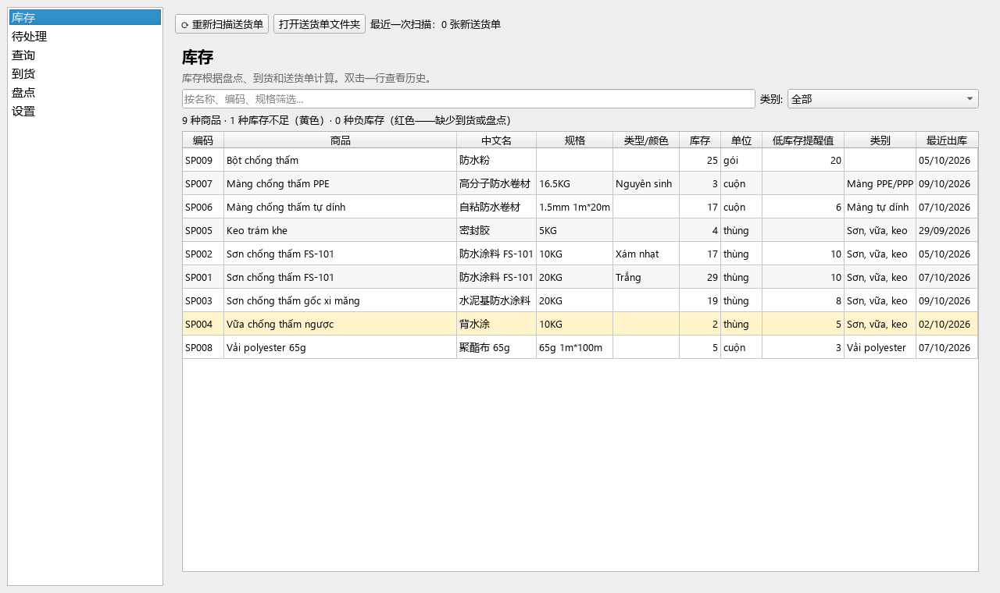
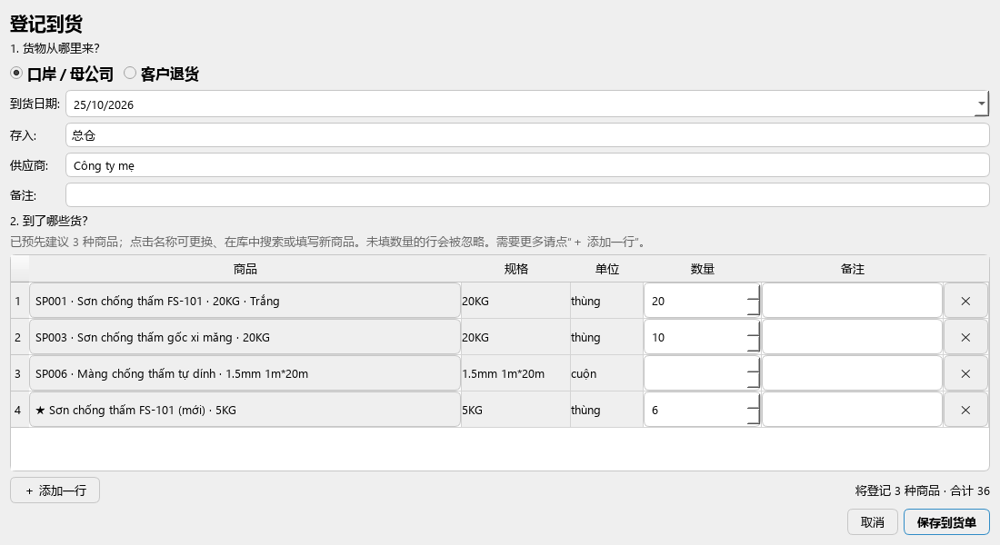
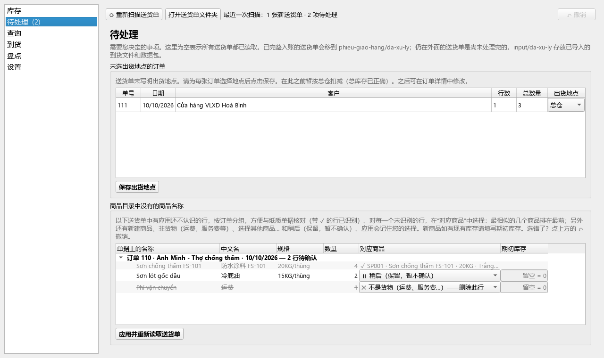
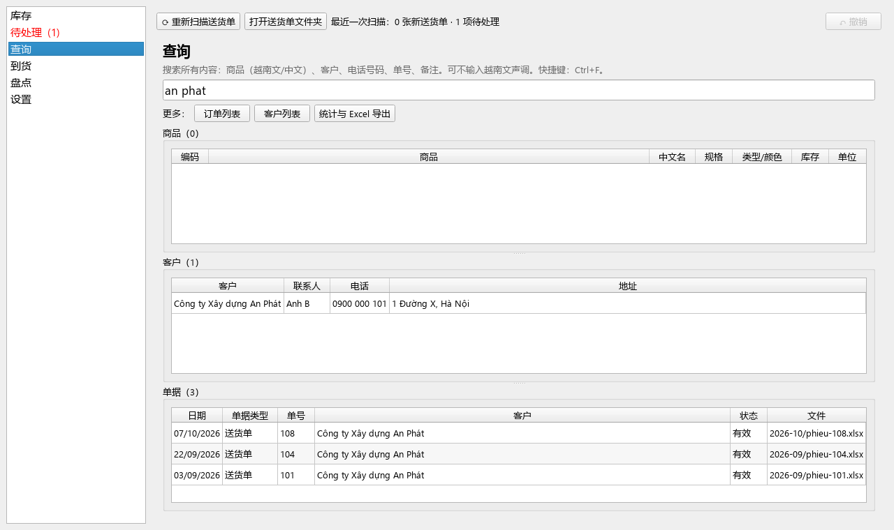
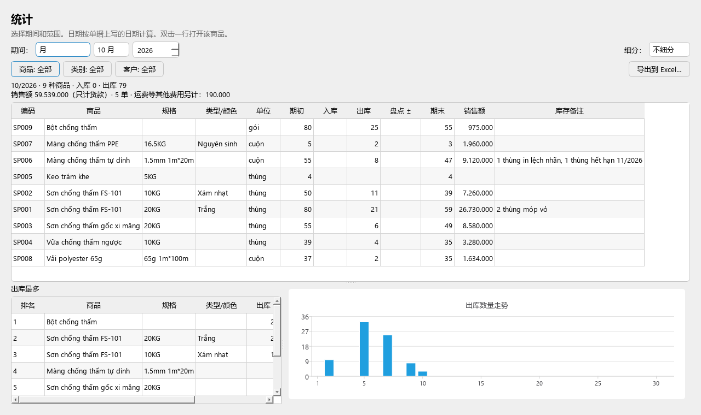
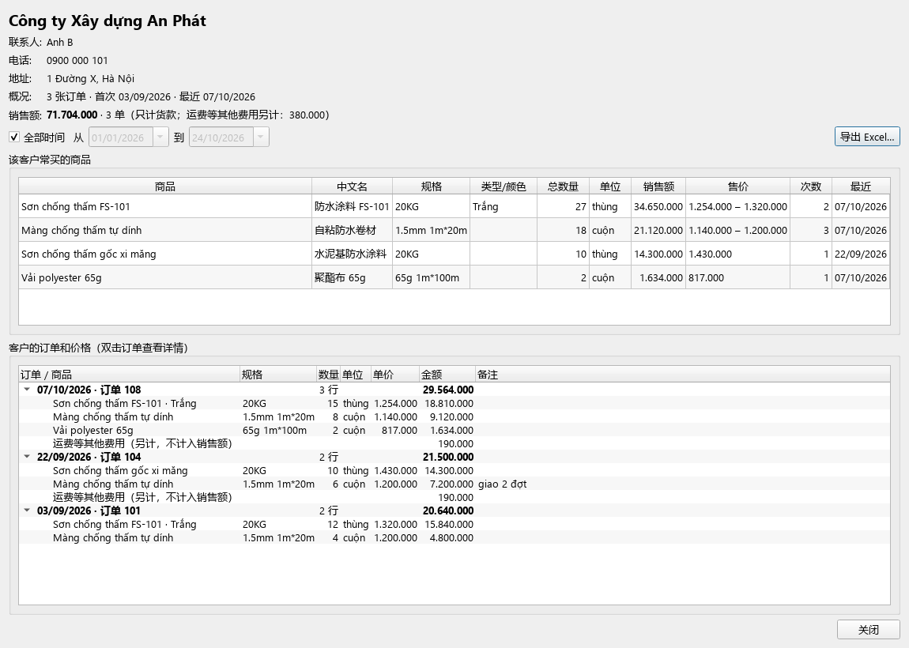

<div align="center">


# DiBeKho

[English](README.md) · [Tiếng Việt](README.vi.md) · **中文**

**根据 Excel 送货单自动跟踪库存：在自己的电脑上运行，无需联网，零运行成本。**

[](https://github.com/Friendzoner49/DiBeKho/releases/latest/download/DiBeKho-windows-setup.exe)
[](https://github.com/Friendzoner49/DiBeKho/releases/latest/download/DiBeKho-mac-arm64.dmg)



</div>

---

**目录：** [功能](#dibekho-能做什么) · [下载与安装](#下载与安装) · [第一天](#第一天) · [使用指南](#使用指南) · [操作失误或出错](#操作失误或出错) · [常见问题](#常见问题) · [开发者](#开发者)

## DiBeKho 能做什么

把 Excel 送货单放进一个文件夹，应用会自动读取、扣减库存，并记录订单和客户，不需要重复录入。

- 📦 **查看库存**：每种商品的库存；快没货的显示黄色，负库存显示红色。
- 📥 **登记到货**：在一个窗口中完成，来源可以是口岸 / 母公司，或客户退货。
- 🔢 **盘点**：填写实盘数量，应用记录差额。
- 🔎 **查询**商品、客户、电话、单号；越南文可不输入声调，也支持中文。
- 💰 **按客户统计销售额：** 总额、最常买的商品、每张订单的单价和金额，可按期间筛选。
- 📊 **统计**：按日、月、季度、年统计，并 **导出到 Excel**。
- ↶ **撤销**：操作失误时，点一个按钮即可恢复。
- 💾 **每天自动备份**；用一个文件把数据 **迁移到另一台电脑**。
- 🌐 界面支持 **越南文、英文、中文**。

> 应用会读取送货单上的 **售价**（单价、金额、运费）来计算销售额；应用没有进价，所以不计算利润。数据保存在您自己的电脑上，不会发送到任何地方。

## 下载与安装

本指南中的按钮名称为中文界面中的名称。

### 需要

| | 要求 |
|---|---|
| **Windows** | Windows 10 或 11，64 位 |
| **Mac** | 使用 **Apple 芯片**（M1、M2、M3、M4…）的 Mac，macOS 13 或更高版本。**不支持** Intel 芯片的 Mac |

### 下载文件

所有文件都在 [**下载（Releases）**](https://github.com/Friendzoner49/DiBeKho/releases/latest) 页面。任选其一：

| 电脑 | 文件 | 何时使用 |
|---|---|---|
| Windows | [**安装程序** `DiBeKho-windows-setup.exe`](https://github.com/Friendzoner49/DiBeKho/releases/latest/download/DiBeKho-windows-setup.exe) | 默认（页面顶部的 **Windows** 按钮） |
| Windows | [压缩的安装程序 `DiBeKho-windows-setup.zip`](https://github.com/Friendzoner49/DiBeKho/releases/latest/download/DiBeKho-windows-setup.zip) | 浏览器拦截 `.exe` 时（见下文）。里面是同一个安装程序 |
| Mac | [`DiBeKho-mac-arm64.dmg`](https://github.com/Friendzoner49/DiBeKho/releases/latest/download/DiBeKho-mac-arm64.dmg) | 使用 Apple 芯片的 Mac（页面顶部的 **macOS** 按钮） |

### Windows

1. 点击页面顶部的 **Windows** 按钮，会下载安装程序 `DiBeKho-windows-setup.exe`。如果浏览器提示该文件“通常不会被下载”并取消下载：请下载上表中的 **`.zip`**，打开后双击其中的 `DiBeKho-windows-setup.exe`。
2. 打开安装程序。如果出现蓝色的“Windows 已保护你的电脑”窗口，点击 **更多信息** → **仍要运行**。（应用没有购买代码签名，所以 Windows 会提示；应用是安全的。）
3. 一直点击 **Next**，直到 **Finish**。不需要管理员权限。
4. 从“开始”菜单或桌面图标打开 **DiBeKho**。

### Mac

1. 点击页面顶部的 **macOS** 按钮，会下载 `DiBeKho-mac-arm64.dmg`。
2. 打开 `.dmg`，**把 DiBeKho 图标拖到“应用程序”文件夹**。
3. 在“应用程序”中打开 **DiBeKho**。第一次打开时 macOS 会拦截，因为应用未经 Apple 公证：
   - 打开 **系统设置 → 隐私与安全性**，向下滚动，点击 **仍要打开**，然后输入电脑密码。
   - 应用请求访问 **文稿** 文件夹时，点击 **允许**。
4. **Mac 一直显示“移到废纸篓 / 完成”，没有“仍要打开”按钮？** 打开 **终端**（用聚焦搜索查找），粘贴下面的命令并按回车。它只会去掉 DiBeKho 的“从互联网下载”标记。每次安装新版本后执行一次。

   ```
   xattr -dr com.apple.quarantine /Applications/DiBeKho.app
   ```

### 更新

按上面的方法下载新版本，**直接安装在旧版本上**（Mac：拖到“应用程序”并选择 **替换**）。`文稿/DiBeKho` 中的数据会保留。

> 两台电脑之间互传数据时，**两台都必须安装最新版本**。新版应用能读取旧版的数据（自动转换），但旧版应用无法读取新版的数据。

### 卸载

- **Windows：** *设置 → 应用 → DiBeKho → 卸载*。卸载程序会询问是否同时删除数据文件夹（默认：不删除）。
- **Mac：** 在应用中选择 **设置 → 卸载…**。应用关闭后会自行从“应用程序”中删除。

## 第一天

按顺序完成以下 4 步，只需做一次。

**1. 打开应用。** 选择语言和 **工作文件夹**（使用默认的 `文稿/DiBeKho` 即可），点击 **开始**。不要选择 OneDrive、iCloud 或 Google Drive 中的文件夹：云同步可能损坏数据。

**2. 导入商品目录**（每月库存表，Excel）：
1. 在 **库存** 页面点击 **从 Excel 导入商品目录…**，选择文件。
2. 检查预览。双击单元格可修改；不需要的行取消勾选。
3. 保持勾选 **把文件中的库存（F 列）作为应用的库存，截至日期** 并选择日期。文件中的库存会成为应用中的库存。如果应用找不到库存列，会询问您是哪一列。
4. 点击 **导入所选行**。

**3. 核对期初库存。** 如果第 2 步没有库存数字：打开 **盘点**，选择日期，填写每种商品的实盘数量，点击 **保存盘点**。

**4. 读取第一批送货单：** 见下面的 [每天：送货单](#1-每天送货单)。

## 使用指南

### 1. 每天：送货单

1. 把当天的送货单（`.xlsx`）复制到 `phieu-giao-hang/` 文件夹（**打开送货单文件夹** 可直接打开）。可以按月建子文件夹。
2. 点击 **⟳ 重新扫描送货单**（或按 **F5**）。应用每次启动时也会自动扫描。
3. 商品名称已知的送货单会立即读取，库存随之减少。入账完成的送货单会移到 `phieu-giao-hang/da-xu-ly/`：还留在外面的就是尚未完成的。
4. 如果左侧 **待处理** 显示数字，说明有些行应用还不认识。这些行按订单分组，并显示订单的所有行（✓ = 已识别），方便与纸质单据核对。在 **对应商品** 中选择：

| 该行是 | 选择 |
|---|---|
| 已有的商品 | 建议中的某个商品；没有的话选 **🔍 选择其他商品…**，输入几个字搜索 |
| 新商品 | **＋ 新建商品**，并在 **期初库存** 中填写本送货单之前的现有库存 |
| 运费或服务费 | **✕ 不是货物**（通常已预先选好） |
| 不确定 | **⏸ 稍后（保留，暂不确认）**：其他行先入账，这一行等待 |

5. 点击 **应用并重新读取送货单**，检查汇总并确认。应用会记住选择，下次遇到相同名称会自动识别。

> 滚动鼠标滚轮 **不会** 改变选择或数字。同一名称出现在多张订单中时，在一张中选择，其他订单会跟着改变。

### 2. 到货



1. 打开 **到货**，点击 **＋ 登记到货…**。
2. 选择货物从哪里来：
   - **口岸 / 母公司**：输入供应商，或选择用过的名称。
   - **客户退货**：选择客户，知道的话再选订单号。
3. 应用预先建议 3 种商品。在每行填写 **数量**；未填数量的行会被忽略。
   - 更换商品：点击商品名称 → **🔍 从库存中选择商品…** 或 **★ 新商品（库中没有）…**。
   - 需要更多行：点击 **＋ 添加一行**。
4. 点击 **保存到货单**，核对汇总后确认。库存增加，到货单获得编号（HV001、HV002…），并在 `output/hang-ve/` 中保存一个 Excel 文件。

填错了？立即点击 **↶ 撤销**，或在列表中选中该单后点击 **修改所选…**。旧单保留在历史中，状态为“已替换”。

旧式到货文件（已填写的模板）仍可通过 **选择要导入的文件…** 导入。

### 3. 盘点

打开 **盘点**，选择日期，填写实盘数量，点击 **保存盘点**。应用只记录实盘数与应用数量的差额，历史清晰可查。

### 4. 查询

- **库存**：**红色** 行 = 负库存（缺少到货或盘点）；**黄色** 行 = 快没货了。双击商品可查看全部进出记录。
- **查询**（**Ctrl+F**）：一个搜索框即可搜索商品、客户、电话号码、单号和备注。下方按钮可打开 **订单列表**、**客户列表** 和 **统计与 Excel 导出**。
- 打开 **订单**：客户、带 **单价** 和 **金额** 的明细行、货款 + 其他费用 = 合计、**打开原始文件**、**重新读取送货单**、**作废单据**。
- 打开 **客户**：**销售额**、最常买的商品（销售额、售价），以及 **每张订单及其下方的完整价格**。取消勾选 **全部时间** 并选择 **从 … 到 …**，即可查看该期间客户买了什么、价格多少。
- 价格取自送货单的单价 / 金额列。送货单上没有价格的，该格留空（—），不计入销售额。

### 5. 统计与 Excel 导出

**查询 → 统计与 Excel 导出**：选择期间（日、月、季度、年，或起止日期）以及要统计的商品、类别或客户。表格显示期初库存、入库、出库、期末库存，以及畅销商品和图表。点击 **导出到 Excel…** 把文件保存到 `output/`。

### 6. 商品目录

**设置 → 商品**：
- **添加商品**、**编辑商品…**（或双击一行）：名称、规格、类型/颜色、类别、**低库存提醒值**。
- **删除商品** 只能删除未出现在任何单据中的商品。已使用的商品可改为 *停用*（不再显示在列表中，旧单据不变）。已删除商品的编码不会再次分配。
- 名称较长时：拖宽列标题的边线，或把鼠标停在单元格上查看完整名称。

### 7. 迁移到其他电脑

同一时间只用 **一台电脑** 工作，两台电脑需要相同的应用版本（见 [更新](#更新)）。

1. 在当前使用的电脑上：**设置 → 数据迁移与备份 → 导出数据**。`output/` 中会出现一个 `.dibekho` 文件。
2. 发送该文件（U 盘、Zalo、邮件等），复制到另一台电脑的 `input/` 文件夹。
3. 在那台电脑上：**待处理 → 导入数据**。该电脑的现有数据会先备份，然后被替换。

**Excel 基础数据**（商品、客户和库存；**不含** 订单）：
- **设置 → 数据迁移与备份 → 导出基础数据…** 生成一个包含 3 个工作表的 Excel 文件：商品、客户、库存。
- 如有需要，修改 **库存** 表中的数字，然后用 **导入基础数据…** 导入（在本机或其他电脑上）：商品保留原编码，应用中的库存与文件中的数字完全一致。
- 当应用不确定某行库存属于哪个商品时，会显示 **导入前核对库存**：黄色行需要您检查并选择正确的商品。

### 8. 备份

应用每天启动时备份一次，并在 `sao-luu/` 中保留最近 14 份。**设置 → 数据迁移与备份** 中有 **立即备份** 和 **恢复所选备份**。

### 9. 从头开始

**设置 → 常规 → 重置数据**（应用总会先备份）：
- **重置库存（保留商品）…**：保留商品目录和已学习的名称；删除送货单、到货、盘点和客户；立即重新读取所有送货单。
- **删除全部数据…**：应用如同刚安装（只保留语言、大小和工作文件夹）。

您自己的文件（送货单、`input/`、`output/`、备份）永远不会被删除。

## 操作失误或出错

| 情况 | 操作 |
|---|---|
| 刚刚做错了操作（应用、盘点、到货、修改/删除商品、导入…） | 点击右上角的 **↶ 撤销**：数据恢复到该操作之前的样子。再按一次可继续往前撤销（最多 20 步） |
| 很早以前某行对应错了商品 | **设置 → 商品 → 已学习的单据名称**：点击订单，在错误的行上点击 **忘记并重新读取…**。该送货单会回到 **待处理** 重新选择 |
| 某张送货单录入错误 | 打开该订单，点击 **作废单据**（库存冲回，历史保留）。删除文件 **不会** 作废单据 |
| 送货单文件被从文件夹中删除 | 库存不变。**待处理** 中可选择 **恢复文件**、**作废单据** 或 **忽略** |
| 送货单在读取后被修改 | **待处理** 中可选择 **使用新版本** 或 **保留旧版本** |
| 想回到前几天的状态 | **设置 → 数据迁移与备份**，选择一份备份，点击 **恢复所选备份** |

## 常见问题

**同一张送货单放进去两次，会扣两次吗？** 不会。应用按文件内容识别送货单，改名或移到其他文件夹也一样。

**应用读取后送货单又被修改了怎么办？** 应用会询问使用新版本还是保留旧版本，不会自行改动数字。

**为什么会出现负库存？** 应用不阻止负库存，因为送货单记录的是已经发生的事。通常是缺少到货单或还没有盘点。

**更改语言？** **设置 → 常规 → 语言**。

**Edge 提示“DiBeKho-windows-setup.exe 通常不会被下载”并取消下载？** 这是因为安装程序没有代码签名（应用是安全的）。最快的办法：下载 [下载文件](#下载文件) 表中的 **`.zip`**，打开后双击其中的安装程序。或者保留被拦截的文件：在 Edge 的下载列表中，把鼠标移到该文件上 → 点击 **…** → 选择保留（*Keep*）→ 显示更多（*Show more*）→ 仍然保留（*Keep anyway*）。

**文字和按钮太小或太大？** **设置 → 常规 → 文字和按钮大小**（100–150%），然后关闭并重新打开应用。

**数据保存在哪里？** 全部在一个文件夹中，默认为 `文稿/DiBeKho`：

```
DiBeKho/
├── phieu-giao-hang/   ← 把送货单放在这里
│   └── da-xu-ly/      ← 已入账的送货单
├── input/             ← 旧式到货文件，或来自其他电脑的数据包
│   └── da-xu-ly/      ← 已导入的文件
├── output/            ← Excel 报表、到货单（hang-ve/）、数据包
├── sao-luu/           ← 自动备份
└── data/              ← 应用自己的数据（不要手动修改）
```

## 截图

<table>
  <tr>
    <td width="50%"><br><b>待处理：</b>对应陌生商品名称，去掉运费行</td>
    <td width="50%"><br><b>查询：</b>在所有信息中搜索，可不输入声调</td>
  </tr>
  <tr>
    <td><br><b>统计：</b>按期间统计入库、出库和库存，导出 Excel</td>
    <td><br><b>客户详情：</b>销售额、常买商品、每张订单及价格</td>
  </tr>
</table>

<sub>截图使用模拟数据，不是真实客户数据。</sub>

## 开发者

[](https://www.python.org/)
[](https://doc.qt.io/qtforpython-6/)
[](https://www.sqlite.org/)

需要 [**uv**](https://docs.astral.sh/uv/)（它会把 Python 3.13 和依赖库下载到项目的 `.venv/` 中）。

```bash
uv sync                 # 安装环境
uv run dibekho          # 从源码运行
uv run pytest -q        # 运行测试
uv run ruff check src tests --select F,E9
```

- **构建与发布：** 推送 `v*` 标签 → GitHub Actions 构建 Mac 和 Windows 版本并发布到 **Releases**。在自己电脑上构建：[docs/chay-thu-va-build.md](docs/chay-thu-va-build.md)（越南文）。
- **源码：** `src/dibekho/` 包含 `db/`（SQLite、迁移）、`core/`（业务逻辑）、`excel/`（读写 Excel）、`ui/`（PySide6）和 `i18n/`。`core/`、`excel/`、`db/` 不导入 Qt，可以用 pytest 测试而无需打开窗口。
- **原则：** 库存 = 所有库存变动之和，从不直接修改；作废单据 = 记录相反的变动。
- **许可：** 更改依赖版本后运行 `uv run python scripts/make_licenses.py`（有测试检查版本）。
- **隐私：** 真实的客户 Excel 文件和 `.dibekho` 数据包永远不会提交（`samples/`、根目录的 `*.xlsx` 和 `*.dibekho` 已在 `.gitignore` 中）。

## 许可

DiBeKho 是采用 [MIT 许可](LICENSE) 的开源软件：可以自由使用、复制、修改和分享，只需保留版权声明。

应用附带的第三方软件遵循各自的许可，最重要的是 **Qt for Python（PySide6），采用 GNU LGPL v3**，另有 openpyxl（MIT）和 Python（PSF）。完整列表和许可全文见应用内（**设置 → 常规 → 开源许可…**）以及 [src/dibekho/licenses/LICENSES.txt](src/dibekho/licenses/LICENSES.txt)。
