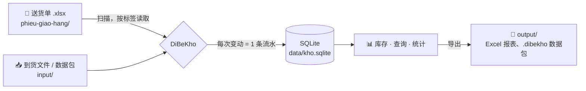

<div align="center">


# DiBeKho

[English](README.md) · [Tiếng Việt](README.vi.md) · **中文**

**根据 Excel 送货单自动跟踪库存：在自己的电脑上运行，无需联网，零运行成本。**

[](https://github.com/Friendzoner49/DiBeKho/releases/latest/download/DiBeKho-windows-setup.exe)
[](https://github.com/Friendzoner49/DiBeKho/releases/latest/download/DiBeKho-mac-arm64.dmg)
[](https://www.python.org/)
[](https://doc.qt.io/qtforpython-6/)
[](https://www.sqlite.org/)


</div>

---

## 简介

DiBeKho 是为一家销售防水材料的小企业制作的桌面应用。这家企业每天用 **Excel 开送货单**，以前要手工更新库存表。

使用 DiBeKho，只需把送货单文件放进一个文件夹。应用会自动读取送货单、扣减库存、记录订单和客户，并生成统计。无需重复录入，也不需要服务器。

> **不保存价格。** 应用只关心*数量*：每种货还剩多少、谁买了什么、什么卖得最好。

界面提供 **越南文**（默认）、**英文** 和 **简体中文**。越南文的文件夹名称（`phieu-giao-hang`、`input` 等）在所有语言下保持不变。

## 功能

| | |
|---|---|
| 📂 **自动读取送货单** | 读取文件夹及其子文件夹中的所有 `.xlsx` 文件。即使单元格位置偏移，也能找到单据上的标签。每张送货单只计算一次，即使文件被改名或移动。已完整入账的送货单会移到 `phieu-giao-hang/da-xu-ly/`，看文件夹就知道哪些还没处理完。 |
| 🧠 **学习商品名称** | 单据上的名称与商品目录不同？应用会推荐最接近的商品（依据中文名、型号和规格），并记住您的选择用于以后的送货单。 |
| ✂️ **删除费用行** | 自动识别运费、服务费，一键删除，库存保持正确。 |
| ↩️ **撤销错误选择** | 重新读取送货单，或“忘记”某个名称的对应关系并重新选择。旧的历史记录保留。 |
| 🛡️ **文件安全** | 删除送货单文件不会改变库存；应用会提供*恢复文件*、*作废单据*或*忽略*。送货单被修改后，应用会询问是否使用新版本。 |
| 📥 **到货** | 应用生成 Excel 模板；填写数量后放进 `input/`。 |
| 🔢 **盘点** | 输入实盘数量，应用记录差异。第一次盘点即为期初库存。 |
| 🔎 **全面查询** | 商品、客户、电话号码、单号、备注。不输入越南文声调也能搜到，也支持中文输入。 |
| 📊 **统计与 Excel 导出** | 按日、月、季度、年或任意时间范围；全部或指定商品、类别、客户。期初、入库、出库、期末库存、畅销商品和图表。 |
| 👥 **订单与客户** | 打开任意订单及其原始文件。查看每位客户最常买的商品。 |
| 🔁 **迁移到其他电脑** | 把全部数据导出为一个 `.dibekho` 文件，在另一台电脑上继续工作。 |
| 📑 **Excel 基础数据** | 把商品目录和客户名单导出到 Excel，并可在其他电脑上以相同编码导入。 |
| 💾 **自动备份** | 每天一份，保留最近 14 份；一键恢复。 |
| 🧹 **重置** | 从头开始：重置库存并重新读取所有送货单（保留商品），或删除全部数据。重置前总会先备份。 |
| 🌐 **越南文、英文和中文** | 在“设置”中切换。所有输入框都可以输入中文。 |

## 截图

<table>
  <tr>
    <td width="50%"><br><b>待处理：</b>对应未知名称，删除运费行</td>
    <td width="50%"><br><b>查询：</b>不区分声调，搜索所有内容</td>
  </tr>
  <tr>
    <td><br><b>统计：</b>按期间统计进、出、存，导出 Excel</td>
    <td><br><b>客户：</b>最常买的商品、全部订单</td>
  </tr>
</table>

<sub>截图使用虚构的演示数据（<code>scripts/readme_screenshots.py</code>），绝不使用真实客户数据。</sub>

## 工作原理



所有数据都在 **一个工作文件夹** 中，默认是 `Documents/DiBeKho`：

```
DiBeKho/
├── phieu-giao-hang/   ← 把送货单放在这里（可按需建子文件夹）
│   └── da-xu-ly/      ← 应用把已完整入账的送货单移到这里
├── input/             ← 到货文件，或来自其他电脑的数据包
│   └── da-xu-ly/      ← 应用把处理过的文件移到这里
├── output/            ← Excel 报表、到货模板、数据包
├── sao-luu/           ← 自动备份
└── data/              ← 数据库和送货单原件副本（请勿修改）
```

**流水账原则：** 应用从不直接改写库存数字。每次变动（送货、到货、盘点、作废）都是一条*流水*记录，**库存 = 流水之和**。每个数字都能追溯到来源。作废送货单会增加反向流水；历史记录永不删除。

## 安装

点击顶部的 **Windows** 或 **macOS** 徽章下载最新版本，或在 [**Releases**](https://github.com/Friendzoner49/DiBeKho/releases) 中查看所有版本。仓库是私有的，需要登录有访问权限的 GitHub 账号。

| | 安装方法 | 首次启动 |
|---|---|---|
| **macOS**（Apple Silicon，macOS 13+） | 打开 `DiBeKho-mac-arm64.dmg`，把 **DiBeKho** 拖到 **应用程序** | 因应用未经 Apple 公证会被拦截：*系统设置 → 隐私与安全性 → **仍要打开***。允许访问“文稿”文件夹。 |
| **Windows** 10/11 | 运行 `DiBeKho-windows-setup.exe` | 如果 SmartScreen 警告：*更多信息 → **仍要运行*** |

**Mac 每次打开仍显示“移到废纸篓 / 完成”？** 打开 **终端**，粘贴下面的命令并按回车（每次安装后执行一次）。它只会去掉 DiBeKho 的“从互联网下载”标记：

```
xattr -dr com.apple.quarantine /Applications/DiBeKho.app
```

更新时，直接把新版本安装在旧版本上。`Documents/DiBeKho` 中的数据会保留。

**卸载：**
- **Windows：** *设置 → 应用 → DiBeKho → 卸载*。卸载程序会询问是否同时删除数据文件夹。
- **macOS：** 在应用中选择 *设置 → 卸载…*。应用关闭后会自行从“应用程序”中删除。

## 使用指南

下面的按钮名称为中文界面中的名称；越南文界面见 [README.vi.md](README.vi.md#hướng-dẫn-sử-dụng)。

### 1. 首次启动

选择语言和 **工作文件夹**（默认 `Documents/DiBeKho`），然后点击 **开始**。不要选择 OneDrive、iCloud 或 Google Drive 中的文件夹：同步可能损坏正在使用的数据库。以后可以在 **设置 → 常规** 中更改语言。那里的 **文字和按钮大小** 可以缩放整个界面（默认 120%，可选 100–150%；关闭并重新打开应用后生效）。

### 2. 导入商品目录（只需一次）

1. 在 **库存** 页面点击 **从 Excel 导入商品目录…**，选择每月库存表。
2. 检查预览：双击单元格可修改，不需要的行取消勾选。已在目录中的行显示为灰色。
3. 保持勾选 **把文件中的库存（F 列）作为应用的库存，截至日期** 并选择日期：表中 *剩余库存* 列（F）的数字会作为该日期的应用库存，按一次盘点记录（G 列不使用）。如果文件格式不同、应用找不到该列，会先请您**选择库存数量列**（每列都显示标题和几个示例数值）；库存始终按与商品相同的行读取。如只想导入商品目录，请取消勾选。
4. 点击 **导入所选行**。重复导入同一文件只会添加新商品；勾选已存在的行可用较新的表更新其库存。

也可以在 **设置 → 商品 → 添加商品** 中逐个添加商品。选择一行后点击 **编辑商品…**（或双击）可修改名称、类型/颜色或类别；**删除商品** 只能删除未出现在任何单据中的商品，否则应用会建议改为*停用*（不再显示在列表中，旧单据不变）。名称较长时：拖宽列标题的边线，或把鼠标停在单元格上查看完整名称。

### 3. 期初库存

打开 **盘点**，选择日期，填写每种商品的实盘数量，点击 **保存盘点**。第一次盘点即为期初库存；以后的盘点只记录实盘数与应用中数量的差异。

### 4. 每天：送货单

1. 把当天的送货单（`.xlsx`）复制到 `phieu-giao-hang/`（**打开送货单文件夹** 可直接打开）。可以按月建子文件夹。
2. 点击 **⟳ 重新扫描送货单**（或按 **F5**）。应用每次启动时也会自动扫描。
3. 商品名称全部已知的送货单会立即读取，库存随之减少。
4. 如果 **待处理** 显示数字，说明有些行需要您决定：

| 该行是 | 操作 |
|---|---|
| 目录中的某个商品 | 在 **对应商品** 中选择；输入几个字（越南文或中文）即可搜索 |
| 目录中还没有的商品 | 保持 **＋ 新建商品**，并在 **期初库存** 中填写本送货单之前的现有库存；之后再扣减该送货单 |
| 运费或服务费 | 点击 **✕ 删除此行**（费用行通常已预先选好） |
| 不确定 | 选择 **⏸ 稍后**：该送货单的其他行先入账；这一行留待处理，确定后加入同一张订单 |

然后点击 **应用并重新读取送货单**，检查汇总并确认。应用会记住每个选择，以后的送货单上出现相同名称时会自动识别。

> 已完整入账的送货单会移到 `phieu-giao-hang/da-xu-ly/`（保留子文件夹），所以仍在 `phieu-giao-hang/` 中的就是还在等待的送货单。如果某张送货单需要重新决定（例如执行 **忘记并重新读取** 之后），它会被移回外面。`input/da-xu-ly/` 存放已处理的到货文件和数据包。

### 5. 到货（每季度 1–2 次）

1. **到货 → 生成到货模板**（商品按编码排列：SP001、SP002…），打开文件，填写到货日期和数量，保存。
2. 把文件复制到 `input/`（**打开 input 文件夹**）。
3. 在 **待处理** 中点击 **查看并导入**，检查列表后点击 **确认到货**。库存增加，文件移到 `input/da-xu-ly/`。

也可以不做第 2–3 步，直接在 **到货** 页面点击 **选择要导入的文件…**，从任何位置选择文件，甚至是 `input/da-xu-ly/` 中的文件。同一个按钮也可以导入每月商品目录表。放进 `input/` 的商品目录表也会被识别（在 **待处理** 中点击 **从 Excel 导入商品目录…**）。应用无法使用的文件不会被移动：**隐藏** 只是把它从列表中去掉。

### 6. 查询

- **库存**：红色行 = 负库存（缺少到货或盘点）；黄色行 = 等于或低于 **低库存提醒值**（在 **设置 → 商品** 中双击商品为每种商品设置）。双击商品查看完整历史。
- **查询**（**Ctrl+F**）：一个搜索框即可搜索商品、客户、电话号码、单号和备注；可不输入声调，也支持中文。下方按钮可打开 **订单列表**、**客户列表** 和 **统计与 Excel 导出**。
- **订单**：客户、明细行、备注、**打开原始文件**、**重新读取送货单**、**作废单据**。
- **客户**：该客户的全部订单和最常买的商品。

### 7. 统计与 Excel 导出

在 **查询 → 统计与 Excel 导出** 中选择期间（日、月、季度、年或自定义范围），可按日或按月细分，也可以限定部分商品、类别或客户。表格显示期初库存、入库、出库、盘点调整和期末库存，以及畅销商品和图表。**导出到 Excel…** 可选择要导出的工作表，文件保存在 `output/`。

### 8. 纠正错误

| 情况 | 操作 |
|---|---|
| 选错了商品，或误删了一行 | **设置 → 商品 → 已学习的单据名称**，选择该行，点击 **忘记并重新读取…**。相关送货单会回到 **待处理** |
| 需要用当前目录重新读取某张送货单 | 打开该订单，点击 **重新读取送货单** |
| 某张送货单录入错误 | 打开该订单，点击 **作废单据**（库存冲回，历史保留）。删除文件 **不会** 作废单据 |
| 送货单文件被从文件夹中删除 | **待处理** 中可选择 **恢复文件**、**作废单据** 或 **忽略** |
| 送货单在读取后被修改 | **待处理** 中可选择 **使用新版本** 或 **保留旧版本** |

### 9. 迁移到其他电脑

同一时间只用一台电脑工作。

1. 在当前使用的电脑上：**设置 → 数据迁移与备份 → 导出数据**。`output/` 中会出现一个 `.dibekho` 文件。
2. 发送该文件（U 盘、Zalo、邮件等），放进另一台电脑的 `input/`。
3. 在那台电脑上打开 **待处理 → 导入数据**。该电脑的现有数据会先备份，然后被替换。

**基础数据（Excel）：** **设置 → 数据迁移与备份 → 导出基础数据…** 会把商品目录（编码、名称、规格、类型、单位、类别、添加日期、低库存提醒值、是否使用中）和客户名单（名称、电话、联系人、地址、订单数）写入 `output/` 中的一个 Excel 文件。可用于核对应用数据，或在其他电脑上用 **导入基础数据…** 导入：那里会出现相同的商品（相同编码）和客户。第三个工作表 **库存** 像每月库存表一样列出所有商品：编码、名称、类别、类型/颜色和当前库存。可以直接在这里修改库存：**导入基础数据…** 会把应用中的库存设为与这些数字完全一致（按今天的一次盘点记录）。也可以把文件放进 `input/`，在 **待处理** 中导入。为其他类型复制的行即使连编码也复制了，仍会作为独立商品导入（应用会分配新编码并提示）。以 **库存** 表为准：名称相同但类别或类型/颜色不同的行是不同的商品；导入时商品的类别和类型/颜色按此表修改。库存表没有编码列的旧文件，应用会根据每行库存本身的内容（名称、中文名、规格、类别、类型/颜色，而不是行的顺序）找到对应商品，并先在 **导入前核对库存** 中显示；黄色行需要检查（“问题 / 变更”列说明原因，以及哪些商品会被修改），可以为任意一行重新选择正确的商品。文件中不含订单；如需迁移全部数据，请使用上面的 **导出数据**。

### 10. 备份

应用每天启动时备份一次，并在 `sao-luu/` 中保留最近 14 份。**设置 → 数据迁移与备份** 中有 **立即备份** 和 **恢复所选备份**。

### 11. 从头开始

**设置 → 常规 → 重置数据**（应用总会先备份，所以重置后仍可用 **恢复所选备份** 撤销）：

| 按钮 | 保留 | 删除 |
|---|---|---|
| **重置库存（保留商品）…** | 商品目录、已学习的单据名称、已删除的行 | 所有送货单、到货、盘点和客户：库存归零。`phieu-giao-hang/da-xu-ly/` 中的送货单移回 `phieu-giao-hang/` 并立即重新读取 |
| **删除全部数据…** | 只保留设置（语言、大小、工作文件夹） | 全部：应用如同刚安装。送货单移回 `phieu-giao-hang/`，在 **待处理** 中等待 |

您自己的文件（送货单、`input/`、`output/`、备份）永远不会被删除。

## 开发

需要 [**uv**](https://docs.astral.sh/uv/)。它会把 Python 3.13 和所有库下载到项目的 `.venv/` 中，不影响系统 Python。

```bash
uv sync                 # 搭建环境
uv run dibekho          # 从源码运行应用
uv run pytest -q        # 运行测试
uv run ruff check src tests --select F,E9
```

### 构建

| 平台 | 命令 | 结果 |
|---|---|---|
| Windows | `powershell -ExecutionPolicy Bypass -File packaging\build_windows.ps1` | `dist/DiBeKho-x.y.z-windows-setup.exe`（需要 [Inno Setup 6](https://jrsoftware.org/isinfo.php)）；没有则生成 `-portable.zip` |
| macOS | `bash packaging/build_mac.sh` | `dist/DiBeKho-x.y.z-mac-arm64.dmg` |
| GitHub | 推送 `v*` 标签（例如 `git tag v0.2.1 && git push origin v0.2.1`） | 生成以上两者，并发布到 **Releases**（下载徽章指向这里） |

PyInstaller 不能交叉编译：macOS 版本必须在 Mac 上构建（或在 GitHub Actions 的 Mac 运行器上）。每个构建脚本都会先运行测试，再对打包后的应用运行 `DiBeKho --self-test`。详细说明（越南文）：[docs/chay-thu-va-build.md](docs/chay-thu-va-build.md)。

### 源码结构

```
src/dibekho/
├── app.py          # 入口、首次启动对话框、--self-test
├── db/             # SQLite 连接、migrations/NNN_*.sql
├── core/           # 业务逻辑：库存、文件夹扫描、商品目录、统计、迁移、备份、重置
├── excel/          # 读取送货单、商品目录和到货文件；生成报表
├── ui/             # PySide6 界面，每个页面一个文件
└── i18n/           # vi.json、en.json、zh.json
tests/              # pytest：Excel 读取、库存逻辑、迁移、每个页面都能打开
packaging/          # PyInstaller spec、Windows/macOS 构建脚本、Inno Setup
scripts/            # 辅助工具（README 截图、对照工作簿）
```

`core/`、`excel/` 和 `db/` **不导入 Qt**，因此所有业务逻辑都可以用 pytest 测试，无需打开窗口。项目决策和工作规则见 [CLAUDE.md](CLAUDE.md)（越南文）。

## 数据与隐私

- 数据保存在用户的电脑上。应用不会向互联网发送任何内容。
- 真实客户的 Excel 文件（姓名、电话）**从不提交**到仓库：仓库根目录下的 `samples/` 和 `*.xlsx` 已列入 `.gitignore`。测试使用虚构的送货单；需要真实文件的测试在文件不存在时会自动跳过。

---

<div align="center">
<sub>使用 Python + PySide6 构建 · 您的数据留在您的电脑上</sub>
</div>
