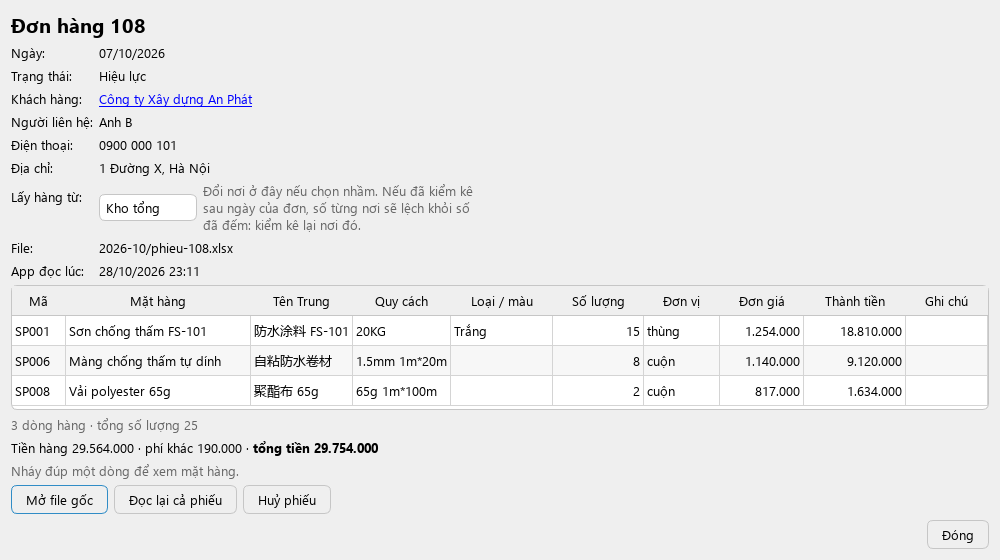

# Hướng dẫn sử dụng DiBeKho (chi tiết)

[English](user-guide.md) · **Tiếng Việt** · [中文](user-guide.zh.md) · [← Về trang chính](../README.vi.md)

Hướng dẫn này đi từng bước, theo đúng tên nút trên màn hình. Chưa cài app? Xem [Tải và cài đặt](../README.vi.md#tải-và-cài-đặt).

> **Làm nhầm cũng đừng lo.** Gần như mọi thao tác đều quay lại được bằng nút **↶ Hoàn tác** ở góc trên bên phải (xem [mục 11](#11-khi-làm-nhầm-hoàn-tác-sao-lưu)).

**Mục lục**
1. [Làm quen với màn hình](#1-làm-quen-với-màn-hình)
2. [Ngày đầu tiên](#2-ngày-đầu-tiên)
3. [Hằng ngày: đọc phiếu giao hàng](#3-hằng-ngày-đọc-phiếu-giao-hàng)
4. [Xem tồn kho, hàng sắp hết, ghi chú](#4-xem-tồn-kho-hàng-sắp-hết-ghi-chú)
5. [Hàng về](#5-hàng-về)
6. [Kiểm kê từng nơi](#6-kiểm-kê-từng-nơi)
7. [Chuyển hàng giữa Kho tổng và Văn phòng](#7-chuyển-hàng-giữa-kho-tổng-và-văn-phòng) · [Xuất dùng thử](#7b-xuất-dùng-thử)
8. [Khách hàng, doanh thu và giá bán](#8-khách-hàng-doanh-thu-và-giá-bán) · [Gộp khách hàng](#84-gộp-khách-hàng)
9. [Đơn hàng](#9-đơn-hàng)
10. [Thống kê và xuất Excel](#10-thống-kê-và-xuất-excel)
11. [Khi làm nhầm: Hoàn tác, sao lưu](#11-khi-làm-nhầm-hoàn-tác-sao-lưu)
12. [Danh mục mặt hàng và mức báo động](#12-danh-mục-mặt-hàng-và-mức-báo-động)
13. [Chuyển sang máy khác](#13-chuyển-sang-máy-khác)
14. [Xử lý tình huống thường gặp](#14-xử-lý-tình-huống-thường-gặp)

---

## 1. Làm quen với màn hình

Bên trái là **6 mục**. Bấm vào một mục để mở nó:

| Mục | Dùng để |
|---|---|
| **Tồn kho** | Xem còn bao nhiêu hàng, ở đâu, hàng nào sắp hết |
| **Cần xử lý** | Những việc app cần bạn quyết định. Có số trong ngoặc, ví dụ **Cần xử lý (2)**, là đang có việc chờ |
| **Tra cứu** | Tìm mọi thứ; mở **Danh sách đơn hàng**, **Danh sách khách hàng**, **Thống kê và xuất Excel** |
| **Hàng về** | Ghi hàng nhập về kho |
| **Kiểm kê** | Ghi số đếm thực tế; chuyển hàng giữa hai nơi |
| **Cài đặt** | Ngôn ngữ, cỡ chữ, danh mục mặt hàng, sao lưu, chuyển dữ liệu |

Phía trên cùng có 3 nút dùng chung:
- **⟳ Quét lại phiếu** (phím **F5**): đọc các phiếu giao hàng mới.
- **Mở thư mục phiếu giao hàng**: mở thư mục để chép phiếu vào.
- **↶ Hoàn tác** (góc phải): quay lại trước thao tác vừa làm.

**Màu trong bảng:**
- **Cam** + chữ **⚠ Sắp hết — nên đặt hàng**: hàng sắp hết, nên đặt thêm.
- **Đỏ**: tồn âm (app tính ra số nhỏ hơn 0, thường do thiếu phiếu hàng về hoặc chưa kiểm kê).
- **Vàng**: ô để bạn gõ số vào (ở Kiểm kê, Chuyển hàng).

**Hai nơi chứa hàng:** app chia số tồn theo **Kho tổng** và **Văn phòng**. Số "Tồn" là tổng của hai nơi.

**Mẹo:**
- Tên dài bị cắt? Rê chuột lên ô để xem đủ, hoặc kéo mép tiêu đề cột cho rộng ra.
- Lăn chuột để cuộn trang **không bao giờ** làm đổi lựa chọn hay con số trong bảng.
- Chữ quá nhỏ? **Cài đặt → Chung → Cỡ chữ và nút**, chọn 130% hoặc 150%, tắt và mở lại app.

---

## 2. Ngày đầu tiên

Chỉ làm một lần, theo thứ tự.

**Bước 1. Mở app lần đầu.**
1. Chọn ngôn ngữ.
2. Chọn **thư mục làm việc**: để mặc định `Tài liệu/DiBeKho` là được. **Không** chọn thư mục trong OneDrive, iCloud hay Google Drive (đồng bộ đám mây có thể làm hỏng dữ liệu).
3. Bấm **Bắt đầu**. App tạo sẵn các thư mục con (xem [mục 14](#dữ-liệu-nằm-ở-đâu)).

**Bước 2. Đưa dữ liệu vào.** Chọn **một** trong ba cách:

| Bạn đang có | Làm thế này |
|---|---|
| File `.dibekho` xuất từ máy khác đang dùng DiBeKho | Chép file vào thư mục `input/` → mục **Cần xử lý** → **Nhập dữ liệu**. Xong, bỏ qua bước 3 |
| File Excel thống kê tồn kho hằng tháng | Màn hình **Tồn kho** → **Nhập danh mục từ Excel…** → chọn file → xem bảng (nháy đúp ô để sửa, bỏ tick dòng không cần) → giữ tick **Ghi số tồn kho trong file… tính đến ngày**, chọn ngày → **Nhập các dòng đã chọn** |
| Chưa có gì | Bỏ qua. Mặt hàng sẽ được tạo dần khi đọc phiếu giao hàng ([mục 3](#3-hằng-ngày-đọc-phiếu-giao-hàng)) |

> Số tồn nhập từ file Excel được tính là ở **Kho tổng**. Nếu có hàng ở **Văn phòng**, làm thêm bước 3.

**Bước 3. Kiểm kê đầu kỳ.** Vào **Kiểm kê**, đếm hàng thật ở từng nơi và gõ vào 2 cột vàng ([mục 6](#6-kiểm-kê-từng-nơi)). Từ đây số trên app khớp với kho thật.

**Bước 4. (Nên làm) Xem mức báo động.** Mặc định app báo khi tồn **dưới 30**. Nếu nhiều mặt hàng thường chỉ có vài thùng, hãy hạ mức này ([mục 12](#12-danh-mục-mặt-hàng-và-mức-báo-động)).

---

## 3. Hằng ngày: đọc phiếu giao hàng

Mỗi phiếu giao hàng (file Excel) làm **giảm** tồn kho. App đọc tên hàng, quy cách, số lượng, ghi chú, đơn giá, thành tiền và phí vận chuyển trên phiếu.

### 3.1. Chép phiếu và quét

1. Bấm **Mở thư mục phiếu giao hàng**. Chép các file phiếu trong ngày vào đó (chia thư mục con theo tháng cũng được).
2. Bấm **⟳ Quét lại phiếu** (hoặc phím **F5**). Mỗi lần mở app cũng tự quét.
3. Phía trên hiện "Lần quét gần nhất: N phiếu mới".
   - Phiếu đã đọc xong được app **chuyển vào** `phieu-giao-hang/da-xu-ly/`. Phiếu nào còn nằm ngoài là phiếu **chưa xong**.
   - Bỏ cùng một phiếu vào hai lần, đổi tên file hay chuyển thư mục: app nhận ra, **không trừ hai lần**.

### 3.2. Chọn nơi lấy hàng cho đơn mới

Phiếu không ghi hàng lấy ở đâu, nên mỗi đơn mới hiện trong **Cần xử lý → Đơn chưa chọn nơi lấy hàng**.


1. Mở mục **Cần xử lý**.
2. Ở cột **Lấy hàng từ** của từng đơn, chọn **Kho tổng** hoặc **Văn phòng**.
3. Bấm **Lưu nơi lấy hàng**.

Trong lúc chưa chọn, hàng được **tạm trừ ở Kho tổng**, nên tổng tồn đã đúng ngay. Chọn nhầm? Mở đơn đó ([mục 9](#9-đơn-hàng)) và đổi ở ô **Lấy hàng từ**.

### 3.3. Dòng hàng app chưa nhận ra

Lần đầu gặp một tên hàng, app chưa biết nó là mặt hàng nào. Phiếu đó hiện trong **Cần xử lý → Tên hàng chưa có trong danh mục**, nhóm theo đơn. Mọi dòng của đơn đều hiện (dòng có ✓ là app đã nhận ra) để bạn so với phiếu giấy.

Ở cột **Là mặt hàng** của từng dòng, chọn:

| Dòng trên phiếu là | Chọn |
|---|---|
| Mặt hàng đã có trong kho | Mặt hàng trong gợi ý (app gợi ý 2–3 mặt hàng giống nhất). Không thấy: **🔍 Chọn mặt hàng khác…**, gõ vài chữ để tìm (gõ không dấu hay tiếng Trung đều được) |
| Mặt hàng mới, chưa từng có | **＋ Tạo mặt hàng mới**. Gõ số đang có trong kho **trước phiếu này** vào ô **Tồn ban đầu** (để trống = 0) |
| Phí ship, phí dịch vụ | **✕ Không phải hàng hoá…** (thường đã chọn sẵn). Tiền của dòng này được ghi là **phí riêng** của đơn |
| Chưa chắc | **⏸ Để sau (giữ lại, chưa duyệt)**. Các dòng khác của đơn vẫn được ghi, dòng này chờ |

Rồi bấm **Áp dụng và đọc lại phiếu**, đọc bảng tóm tắt và bấm đồng ý.

- App **nhớ** lựa chọn: lần sau gặp đúng tên đó sẽ tự nhận ra.
- Cùng một tên có ở nhiều đơn: chọn ở một đơn, các đơn kia theo luôn.
- Chọn nhầm từ lâu? Xem [mục 14](#14-xử-lý-tình-huống-thường-gặp), dòng "Chọn nhầm mặt hàng cho một dòng phiếu từ lâu".

### 3.4. Các thông báo khác trong Cần xử lý

| Thông báo | Ý nghĩa | Nên bấm |
|---|---|---|
| **Phiếu bị sửa** | File phiếu đã đọc bị sửa lại | **Dùng bản mới** (đọc lại theo file mới) hoặc **Giữ bản cũ** |
| **File đã bị xoá/di chuyển** | File phiếu biến mất khỏi thư mục. Tồn **không đổi** | **Khôi phục file** (app còn bản sao), **Huỷ phiếu**, hoặc **Bỏ qua** |
| **Không đọc được** | File không phải phiếu giao hàng, hoặc thiếu thông tin | Xem lý do; sửa file rồi quét lại, hoặc **Ẩn** |
| **Thư mục input** | Có gói dữ liệu, file hàng về cũ hoặc file danh mục chờ nhập | **Nhập dữ liệu** / **Xem và nhập** |

---

## 4. Xem tồn kho, hàng sắp hết, ghi chú


### 4.1. Đọc bảng Tồn kho

Thứ tự cột: Mã, Mặt hàng, Tên Trung, Quy cách, Loại/màu, Nhóm hàng, Đơn vị, Tồn, Ghi chú tồn kho, Kho tổng, Văn phòng, Xuất gần nhất.

| Cột | Ý nghĩa |
|---|---|
| **Tồn** | Tổng số hiện có (Kho tổng + Văn phòng) |
| **Ghi chú tồn kho** | Ghi chú riêng của mặt hàng (thùng lỗi, in lệch, hết hạn…); cột hẹp, rê chuột để xem hết |
| **Kho tổng**, **Văn phòng** | Số ở từng nơi |
| **Xuất gần nhất** | Ngày giao hàng gần nhất |

- Mặt hàng sắp hết (dưới mức báo động) tô **cam**; tồn âm tô **đỏ**. Dòng đầu trang cho biết có bao nhiêu mặt hàng sắp hết.
- Cột **Tồn tự dính vào mép trái** khi kéo bảng sang ngang quá nó (kéo thanh cuộn dưới bảng để xem Kho tổng/Văn phòng/Xuất gần nhất mà vẫn thấy tổng tồn).
- Ô **Lọc theo tên…**: gõ để tìm nhanh (không dấu cũng được). Ô **Nhóm hàng**: chỉ xem một nhóm.

### 4.2. Lập danh sách cần đặt hàng

Tick **Chỉ hiện hàng sắp hết**: bảng chỉ còn mặt hàng cam (sắp hết) và đỏ (tồn âm). Đây là danh sách nên đặt thêm.

### 4.3. Ghi chú cho một mặt hàng

Dùng để nhớ những việc như: "3 thùng in lệch", "2 thùng hết hạn 12/2026", "1 cuộn rách mép".

1. **Nháy đúp** vào ô **Ghi chú tồn kho** của mặt hàng (hoặc chọn ô rồi gõ luôn).
2. Gõ ghi chú, bấm **Enter**. Ghi chú được lưu ngay.
3. Muốn xoá ghi chú: nháy đúp, xoá hết chữ, bấm Enter.

Ghi chú này **dùng chung** với cột Ghi chú ở trang Kiểm kê, hiện trong chi tiết mặt hàng, trong Thống kê, trong file Excel, và **đi theo gói dữ liệu** sang máy khác.

### 4.4. Xem chi tiết một mặt hàng

**Nháy đúp** vào một dòng (chỗ nào cũng được, trừ ô ghi chú). Cửa sổ chi tiết cho biết:
- Tồn hiện tại và **Theo nơi: Kho tổng … + Văn phòng …**, ví dụ "Kho tổng 39 + Văn phòng 1".
- Ghi chú tồn kho (nếu có).
- **Lịch sử nhập, xuất**: từng lần giao hàng, hàng về, kiểm kê, chuyển hàng, kèm nơi và số tồn sau mỗi lần. Nháy đúp một dòng để mở phiếu đó.
- **Khách lấy nhiều nhất** mặt hàng này, kèm doanh thu.

---

## 5. Hàng về


1. Vào **Hàng về**, bấm **＋ Nhập hàng về…**.
2. Chọn hàng từ đâu về:
   - **Cửa khẩu / công ty mẹ**: gõ tên nhà cung cấp, hoặc chọn tên đã dùng.
   - **Khách hàng trả lại**: chọn khách, và mã đơn khách trả nếu biết.
3. Chọn **Ngày về** và **Nhập vào**: **Kho tổng** hoặc **Văn phòng**.
4. App gợi ý sẵn 3 mặt hàng (hàng hay về từ nhà cung cấp này, hoặc hàng sắp hết). Gõ **số lượng** cho từng dòng. Dòng để trống số lượng sẽ bị bỏ qua.
   - Đổi mặt hàng: bấm vào tên → **🔍 Chọn mặt hàng trong kho…**.
   - Hàng mới hoàn toàn: bấm vào tên → **★ Mặt hàng mới (chưa có trong kho)…**, điền tên, quy cách. Mặt hàng chỉ được tạo khi lưu phiếu.
   - Thêm dòng: **＋ Thêm dòng**. Xoá dòng: nút **✕** cuối dòng.
5. Bấm **Lưu phiếu hàng về**, đọc bảng tóm tắt rồi đồng ý.

Kết quả: tồn tăng ở nơi đã chọn, phiếu có mã **HV001, HV002…**, và một file Excel của phiếu được lưu trong `output/hang-ve/` (để in hoặc gửi).

- Nhập nhầm: bấm **↶ Hoàn tác** ngay, hoặc chọn phiếu trong danh sách → **Sửa phiếu đã chọn…** (phiếu cũ vẫn giữ trong lịch sử với trạng thái "đã thay").
- File hàng về dạng cũ (file mẫu đã điền) vẫn nhập được bằng **Chọn file để nhập…**.

---

## 6. Kiểm kê từng nơi

Kiểm kê = đếm hàng thật rồi ghi vào app. App chỉ ghi **phần chênh lệch** giữa số đếm và số trên app, nên lịch sử vẫn rõ ràng.


1. Vào **Kiểm kê**. Chọn **Ngày kiểm kê** (ngày bạn đếm).
2. Mỗi mặt hàng có:
   - Cột **Tên Trung** cạnh tên Việt, để phân biệt các mặt hàng trùng tên mà không nhớ mã SP.
   - **Theo app: Kho tổng / Văn phòng** và **Tồn theo app**: số app đang tính.
   - Hai cột vàng **Đếm được: Kho tổng** và **Đếm được: Văn phòng**: gõ số bạn đếm được.
3. Chỉ gõ những nơi đã đếm. **Ô để trống thì nơi đó giữ nguyên.** Ví dụ hôm nay chỉ đếm Văn phòng: chỉ điền cột Văn phòng.
4. Cột **Chênh lệch** hiện ngay: đỏ là lệch.
5. (Tuỳ chọn) gõ **Ghi chú** cho lần kiểm kê, ví dụ "kiểm kê cuối tháng".
6. Bấm **Lưu kiểm kê** và đồng ý.

**Ví dụ:** app ghi Kho tổng 25, Văn phòng 4. Bạn đếm được Kho tổng 20, Văn phòng 4. Gõ 20 và 4, lưu. App ghi −5 ở Kho tổng; tồn mới là 24 (20 + 4).

- Cột **Ghi chú tồn kho** ở cuối bảng giống hệt cột ở trang Tồn kho: nháy đúp để ghi thùng lỗi, hết hạn… trong lúc đếm. Ghi chú lưu ngay và **không** làm mất các số bạn đang gõ.
- App tự quét phiếu giao hàng trước khi hiện số, để phiếu đã có không bị tính hai lần.
- 2 nút **Phiếu chuyển hàng…** và **Phiếu kiểm kê…** ở đầu trang mở danh sách các lần đã làm trước đó (nháy đúp để xem lại).

---

## 7. Chuyển hàng giữa Kho tổng và Văn phòng

Dùng khi mang hàng từ nơi này sang nơi kia, ví dụ chở 5 thùng sơn từ Kho tổng lên Văn phòng. **Tổng tồn không đổi**, chỉ đổi số ở từng nơi.


1. Vào **Kiểm kê**, bấm **Chuyển hàng…** (góc phải).
2. Chọn **Ngày chuyển**, **Chuyển từ** và **Chuyển đến** (hai nơi luôn khác nhau).
3. Cột **Đang có ở nơi chuyển đi** cho biết số hiện có. Gõ số lượng vào cột vàng **Số lượng chuyển** cho từng mặt hàng mang đi. Bảng có thêm cột **Tên Trung** và **Nhóm hàng** để phân biệt các mặt hàng chỉ khác nhau ở tên Trung; hai cột **Đang có…** và **Số lượng chuyển** tự ghim bên phải khi kéo bảng sang ngang, tiện nhìn và nhập số.
4. (Tuỳ chọn) gõ **Ghi chú**.
5. Bấm **Lưu phiếu chuyển**, đọc tóm tắt và đồng ý. Phiếu có mã **CH001, CH002…**

Nơi chuyển đi không đủ hàng theo app? App vẫn cho lưu nhưng báo trước; số ở nơi đó sẽ âm cho tới lần kiểm kê sau.

Xem lại, sửa hoặc huỷ phiếu chuyển: **Kiểm kê → Phiếu chuyển hàng…** (hoặc **Tra cứu → Danh sách đơn hàng**, ở ô **Loại phiếu** chọn **Phiếu chuyển hàng**). Nháy đúp phiếu để xem chi tiết, có nút **Sửa phiếu…** (mở lại để sửa mặt hàng/số lượng, phiếu cũ vẫn giữ trong lịch sử) và **Huỷ phiếu**; trong danh sách còn có nút **Sửa phiếu đã chọn…** để sửa ngay phiếu đang bôi đen.

### 7b. Xuất dùng thử

Dùng khi mở hàng ra thử nghiệm/dùng nội bộ, **không bán cho khách** — thay cho việc tự lập một phiếu giao hàng khống để trừ tồn. Số lượng này **không** tính là xuất bán trong Thống kê.

1. Vào **Kiểm kê**, bấm **Xuất dùng thử…** (cạnh nút Chuyển hàng).
2. Chọn **Ngày xuất** và **Nơi xuất** (Kho tổng hoặc Văn phòng).
3. Gõ số lượng vào cột vàng **Số lượng dùng thử** cho từng mặt hàng. (Tuỳ chọn) gõ **Ghi chú** lý do dùng thử.
4. Bấm **Lưu phiếu dùng thử**, đọc tóm tắt và đồng ý. Phiếu có mã **DT001, DT002…**

Nhầm số lượng hoặc mặt hàng? Mở phiếu đó (Chi tiết đơn) và bấm **Huỷ phiếu**, rồi lập phiếu mới (hoặc dùng **↶ Hoàn tác** ngay sau khi lưu).

Xem lại phiếu dùng thử: **Kiểm kê → Phiếu dùng thử…** (hoặc **Tra cứu → Danh sách đơn hàng**, ở ô **Loại phiếu** chọn **Phiếu dùng thử**).

---

## 8. Khách hàng, doanh thu và giá bán

App lấy giá từ cột **đơn giá / thành tiền** trên phiếu giao hàng.

- **Doanh thu chỉ tính tiền hàng.** Phí vận chuyển và phí khác được ghi **riêng**, không cộng vào doanh thu.
- Phiếu không ghi giá: ô giá để trống (—) và không tính vào doanh thu; app báo số đơn thiếu giá.
- App không có giá nhập nên **không tính lãi**.

### 8.1. Xem một khách hàng

1. **Tra cứu → Danh sách khách hàng** (hoặc gõ tên, số điện thoại vào ô tìm ở trang Tra cứu).
   Danh sách có cột **Doanh thu** của mỗi khách.
2. **Nháy đúp** một khách. Cửa sổ chi tiết gồm:
   - Thông tin liên hệ, số đơn, đơn đầu tiên và gần nhất.
   - **Doanh thu**: tổng tiền hàng, số đơn; phí vận chuyển, phí khác ghi riêng bên cạnh.
   - **Mặt hàng khách hay mua**: tổng số lượng, **Doanh thu**, **Giá bán** (một giá, hoặc "thấp – cao" nếu giá thay đổi), số lần mua, lần mua gần nhất.
   - **Các đơn của khách và giá**: mỗi đơn (mới nhất trước) mở sẵn từng dòng với **Đơn giá**, **Thành tiền**, rồi dòng phí riêng (nếu có). Nháy đúp một đơn để xem chi tiết.


### 8.2. Xem trong một khoảng thời gian

1. Trong cửa sổ khách, **bỏ tick Mọi thời gian**.
2. Chọn **Từ** ngày … **đến** ngày …
3. Mọi thứ trong cửa sổ (doanh thu, mặt hàng, các đơn) chỉ tính trong khoảng đó.

### 8.3. Xuất Excel cho một khách

Bấm **Xuất Excel…** trong cửa sổ khách. File `KhachHang_<tên>_<kỳ>_….xlsx` được lưu trong `output/`, đúng theo khoảng thời gian đang chọn, gồm 2 trang:
- **Đơn hàng**: từng đơn (cũ → mới), mỗi dòng hàng với đơn giá, thành tiền; dòng **Tiền hàng của đơn** in đậm; dòng phí riêng in nghiêng.
- **Mặt hàng đã mua**: số lượng, doanh thu, giá thấp nhất, giá cao nhất, số lần mua.

Dùng để gửi khách đối chiếu, hoặc tính hoa hồng cho người bán.

### 8.4. Gộp khách hàng

Dùng để dọn các khách hàng trùng/thừa, ví dụ các "khách hàng" khống đã dùng để tự trừ tồn cho hàng dùng thử trước khi có tính năng Xuất dùng thử ([mục 7b](#7b-xuất-dùng-thử)) — gộp hết về một khách chung, ví dụ "Văn phòng DiBeKho".

1. **Tra cứu → Danh sách khách hàng.**
2. Chọn từ 2 khách trở lên (giữ **Ctrl** hoặc **Shift** khi bấm chọn), rồi bấm **Gộp khách hàng…**.
3. Gõ tên khách hàng chung (ví dụ "Văn phòng DiBeKho") hoặc chọn 1 trong các tên đang hiển thị, rồi bấm **Lưu**.
4. Đọc tóm tắt và đồng ý. Mọi đơn của các khách đã chọn chuyển sang khách chung; các khách cũ bị xoá (đơn và lịch sử vẫn giữ nguyên).

Gộp nhầm? Bấm **↶ Hoàn tác** ngay sau đó.

---

## 9. Đơn hàng

**Tra cứu → Danh sách đơn hàng**: mọi phiếu, mới nhất trước.
- Lọc theo **Loại phiếu** (Phiếu giao hàng, Phiếu hàng về, Phiếu kiểm kê, Phiếu chuyển hàng), khoảng ngày, khách, mặt hàng; tick **Gồm cả phiếu đã huỷ** để xem cả phiếu đã huỷ.
- Cột **Nơi**: nơi lấy hàng / nơi nhập ("(?)" = chưa chọn nơi). Cột **Tiền hàng** và **Phí riêng**.
- **Nhấn chuột phải vào một đơn** (phiếu giao hàng đang hiệu lực) → **Đọc lại cả phiếu**: xem mục 12.

**Nháy đúp một đơn** để mở chi tiết:



- Khách (bấm tên để mở khách), người liên hệ, số điện thoại, địa chỉ.
- Ô **Lấy hàng từ**: đổi Kho tổng / Văn phòng nếu chọn nhầm. (Nếu đã kiểm kê sau ngày của đơn, đổi nơi sẽ làm số từng nơi lệch khỏi số đã đếm: kiểm kê lại nơi đó.)
- Các dòng hàng với **Đơn giá**, **Thành tiền**; dòng "Tiền hàng · phí khác · tổng tiền" (tổng tiền khớp dòng "Tổng cộng" trên phiếu giấy).
- Nút **Mở file gốc** (mở bản sao chỉ đọc của phiếu), **Đọc lại cả phiếu** (xem mục 12), **Huỷ phiếu** (trả lại tồn, giữ lịch sử).

> **Xoá file phiếu không phải cách huỷ phiếu.** Muốn bỏ một đơn, mở đơn và bấm **Huỷ phiếu**.

---

## 10. Thống kê và xuất Excel


1. **Tra cứu → Thống kê và xuất Excel**.
2. Chọn **Kỳ**: Ngày, Tháng, Quý, Năm hoặc Khoảng tự chọn (từ ngày – đến ngày). Kỳ dài có thể **Chia theo** ngày hoặc tháng.
3. Chọn phạm vi bằng các nút **Mặt hàng**, **Nhóm hàng**, **Khách hàng** (mặc định: Tất cả).
4. Bảng hiện cho từng mặt hàng: tồn đầu kỳ, nhập, xuất, kiểm kê ±, tồn cuối kỳ, **Doanh thu**, **Ghi chú tồn kho**. Dòng phía trên ghi **doanh thu của kỳ (chỉ tiền hàng)** và phí vận chuyển, phí khác tính riêng. Bên dưới là mặt hàng xuất nhiều nhất và biểu đồ.
5. Bấm **Xuất Excel…**, chọn các trang cần, bấm xuất. File `ThongKe_….xlsx` nằm trong `output/`. App hỏi có mở file luôn không.

File Excel gồm:

| Trang | Nội dung |
|---|---|
| **Nhập-Xuất-Tồn** | Mỗi mặt hàng: tồn đầu, nhập, xuất, kiểm kê, tồn cuối, doanh thu, ghi chú tồn kho |
| **Chi tiết phiếu** | Mỗi lần nhập/xuất: ngày, loại, mã phiếu, khách, **nơi**, mặt hàng, số lượng, **đơn giá**, **thành tiền**, ghi chú |
| **Khách x Mặt hàng** | Khách × mặt hàng: tổng số lượng, doanh thu, số lần mua |
| **Xuất nhiều nhất** | Xếp hạng mặt hàng xuất nhiều, kèm doanh thu |

Ghi chú: chọn khách thì chỉ số **xuất** được lọc theo khách. Chuyển hàng giữa hai nơi không tính là nhập hay xuất.

---

## 11. Khi làm nhầm: Hoàn tác, sao lưu

**↶ Hoàn tác** (góc trên bên phải):
- Đưa dữ liệu về **đúng như trước** thao tác vừa làm. Tên thao tác hiện trên nút, ví dụ "↶ Hoàn tác: Kiểm kê".
- Bấm tiếp để lùi thêm, tối đa 20 bước.
- Dùng được cho: Áp dụng ở Cần xử lý, chọn nơi lấy hàng, kiểm kê, chuyển hàng, nhập/sửa hàng về, huỷ phiếu, đọc lại phiếu, thêm/sửa/xoá mặt hàng, ghi chú tồn kho, mức báo động, nhập dữ liệu…

**Sao lưu tự động:** mỗi ngày khi mở app, giữ **10 bản gần nhất** trong `sao-luu/`, bản nào quá **30 ngày** cũng tự xoá để đỡ tốn dung lượng (app tự dọn lại mỗi 2 tuần). Trong **Cài đặt → Chuyển dữ liệu và sao lưu**:
- **Sao lưu ngay**: tạo một bản sao lưu lúc này.
- **Khôi phục bản đã chọn**: quay về hẳn dữ liệu của ngày đó.
- **Khôi phục mặt hàng đã xoá…**: lỡ xoá nhầm một mặt hàng? App dò trong các bản sao lưu, liệt kê mặt hàng nào không còn trong danh mục hiện tại để bạn chọn khôi phục (còn trong bản sao lưu nào đó trong 30 ngày gần nhất). Nếu mặt hàng đó đã được tạo lại bằng tay, app sẽ hỏi có muốn **gộp thành 1** (chuyển mọi phiếu về mã nhỏ hơn) hay **giữ riêng**.

**Làm lại từ đầu:** **Cài đặt → Chung → Đặt lại dữ liệu** (app luôn sao lưu trước):
- **Đặt lại tồn kho (giữ mặt hàng)…**: giữ danh mục và tên đã học; xoá phiếu, hàng về, kiểm kê, khách; đọc lại mọi phiếu ngay. Các đơn đọc lại phải **chọn nơi lấy hàng lại**.
- **Xoá toàn bộ dữ liệu…**: app như vừa cài.

File của bạn (phiếu giao hàng, `input/`, `output/`, sao lưu) **không bao giờ** bị xoá.

---

## 12. Danh mục mặt hàng và mức báo động

**Cài đặt → Danh mục mặt hàng**:

**Mức báo động chung — Báo động khi tồn dưới** (mặc định **30**):
- Áp dụng cho **mọi mặt hàng**. Tồn **dưới** số này thì dòng tô cam và ghi "⚠ Sắp hết — nên đặt hàng".
- Đặt **0** để tắt.
- Mức này đi theo gói dữ liệu sang máy khác.

**Các nút khác:**
- **Thêm mặt hàng**, **Sửa mặt hàng…** (hoặc nháy đúp một dòng): tên Việt, tên Trung, quy cách, loại/màu, đơn vị, nhóm hàng. Khi **thêm mới**, nếu trông giống một mặt hàng đã có (so cả tên Việt lẫn tên Trung, quy cách), app hỏi lại trước khi tạo — tránh tạo trùng. Lời nhắc tương tự cũng hiện khi chọn "Tạo mặt hàng mới" ở Cần xử lý hoặc khi nhập hàng về.
- **Xoá mặt hàng**: chỉ xoá được mặt hàng chưa có trong phiếu nào. Mặt hàng đã dùng thì chuyển sang *Ngừng dùng* (ẩn khỏi danh sách, phiếu cũ giữ nguyên). Mã của mặt hàng đã xoá không bao giờ cấp lại.
- **Nhập danh mục từ Excel…**: nạp thêm mặt hàng từ file thống kê tháng.
- **Tên trên phiếu đã học**: danh sách tên hàng app đã học, nhóm theo đơn. Bấm vào đơn để xem; **Quên và đọc lại…** để chọn lại mặt hàng cho **một tên**.
- **Đọc lại cả phiếu**: muốn chọn lại **mọi dòng hàng** trong một đơn (không phải từng dòng một)? Nhấn **chuột phải vào tên đơn** — ở đây, hoặc ở Danh sách đơn hàng (mục 9), hoặc bấm nút cùng tên khi mở chi tiết đơn. App quên cách ghép tên cho mọi dòng trong đơn đó rồi đọc lại từ đầu; đơn (và mọi đơn khác đang dùng chung tên nào đó) hiện lại ở **Cần xử lý** để chọn lại. Lịch sử cũ vẫn giữ, bấm **↶ Hoàn tác** được nếu đổi ý.

---

## 13. Chuyển sang máy khác

Mỗi lúc chỉ **một máy** làm việc. Hai máy phải cùng cài **bản mới nhất** (bản cũ không đọc được dữ liệu của bản mới).

**Cách 1 — Gói dữ liệu (đầy đủ nhất):** đơn hàng, khách, tồn từng nơi, ghi chú, mức báo động, lịch sử…
1. Máy đang dùng: **Cài đặt → Chuyển dữ liệu và sao lưu → Xuất dữ liệu**. File `.dibekho` xuất hiện trong `output/`.
2. Gửi file đó (USB, Zalo, email…), chép vào thư mục `input/` của máy kia.
3. Máy kia: **Cần xử lý → Nhập dữ liệu**. Dữ liệu cũ trên máy đó được sao lưu trước rồi mới bị thay **toàn bộ**.

**Cách 2 — Dữ liệu gốc bằng Excel** (danh mục, khách hàng, số tồn, ghi chú; **không** có đơn hàng):
- **Xuất dữ liệu gốc…** tạo file Excel 3 trang: Mặt hàng, Khách hàng, Tồn kho. Trang **Tồn kho** có các cột Tồn, Kho tổng, Văn phòng, Ghi chú tồn kho.
- Sửa số **Tồn** hoặc **Ghi chú** trong trang Tồn kho nếu cần, rồi **Nhập dữ liệu gốc…**: mặt hàng giữ mã; tổng tồn trên app bằng số trong file (chênh lệch ghi ở Kho tổng); ghi chú được cập nhật. Cột Kho tổng / Văn phòng chỉ để xem.
- Khi app chưa chắc dòng tồn nào thuộc mặt hàng nào, app hiện hộp **Kiểm tra số tồn trước khi nhập**: dòng tô vàng cần bạn xem lại.

---

## 14. Xử lý tình huống thường gặp

| Tình huống | Cách làm |
|---|---|
| Vừa bấm nhầm | **↶ Hoàn tác** |
| Chọn nhầm mặt hàng cho một dòng phiếu từ lâu | **Cài đặt → Danh mục mặt hàng → Tên trên phiếu đã học**: bấm vào đơn, bấm **Quên và đọc lại…** ở dòng sai. Phiếu hiện lại ở **Cần xử lý** để chọn lại |
| Muốn chọn lại cả một đơn (nhiều dòng cùng lúc) | Nhấn chuột phải vào tên đơn (Đơn hàng, Tên trên phiếu đã học, hoặc chi tiết đơn) → **Đọc lại cả phiếu** ([mục 12](#12-danh-mục-mặt-hàng-và-mức-báo-động)) |
| Một đơn nhập nhầm | Mở đơn → **Huỷ phiếu** |
| Chọn nhầm nơi lấy hàng | Mở đơn → đổi ô **Lấy hàng từ** |
| Tồn ở một nơi bị âm | Thường do hàng thực ra lấy ở nơi kia, hoặc chưa ghi chuyển hàng. Sửa nơi lấy hàng của đơn, ghi **Chuyển hàng…**, hoặc kiểm kê nơi đó |
| Tổng tồn bị âm | Thiếu phiếu hàng về hoặc chưa kiểm kê |
| Quá nhiều hàng báo "Sắp hết" | Hạ **Báo động khi tồn dưới** ([mục 12](#12-danh-mục-mặt-hàng-và-mức-báo-động)) |
| Đơn không có giá (—) | Phiếu giấy không ghi đơn giá / thành tiền. Sửa file phiếu rồi **Dùng bản mới** ở Cần xử lý |
| Lỡ xoá file phiếu | Tồn không đổi. **Cần xử lý → Khôi phục file** |
| Lỡ xoá nhầm một mặt hàng | Bấm **↶ Hoàn tác** ngay nếu còn kịp; nếu không, **Cài đặt → Chuyển dữ liệu và sao lưu → Khôi phục mặt hàng đã xoá…** (mục 11) |
| Muốn quay về hẳn một ngày trước | **Cài đặt → Chuyển dữ liệu và sao lưu**, chọn bản sao lưu, **Khôi phục bản đã chọn** |
| Mở file gốc báo lỗi | File đang mở trong Excel: đóng Excel rồi thử lại |
| Xuất Excel báo file đang mở | Đóng file Excel cùng tên rồi xuất lại |

### Dữ liệu nằm ở đâu

Toàn bộ trong một thư mục, mặc định `Tài liệu/DiBeKho`:

```
DiBeKho/
├── phieu-giao-hang/   ← bỏ file phiếu giao hàng vào đây
│   └── da-xu-ly/      ← phiếu đã ghi xong
├── input/             ← gói dữ liệu từ máy khác, file hàng về cũ
│   └── da-xu-ly/      ← file đã nhập xong
├── output/            ← file Excel xuất ra, phiếu hàng về (hang-ve/), gói dữ liệu
├── sao-luu/           ← bản sao lưu tự động
└── data/              ← dữ liệu của app (không sửa tay)
```

<sub>Ảnh trong hướng dẫn dùng dữ liệu giả lập, không phải dữ liệu khách hàng thật.</sub>
