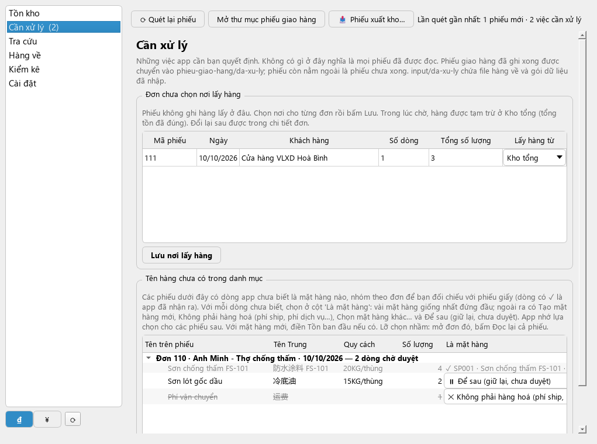
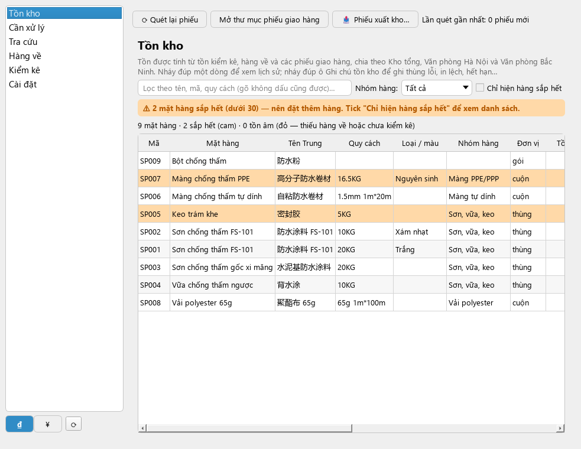
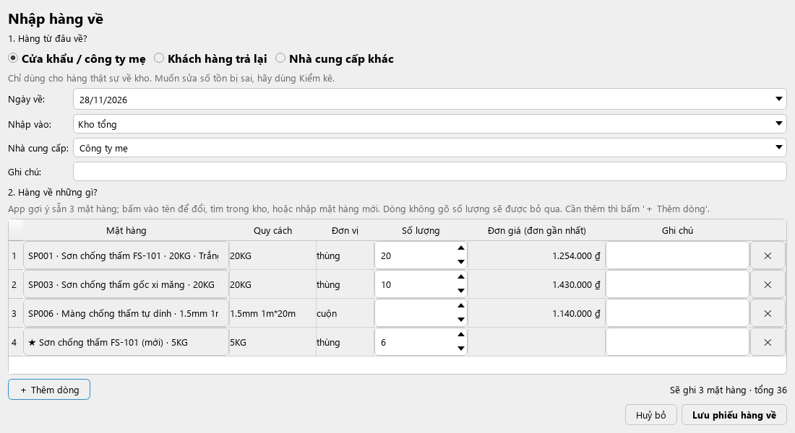
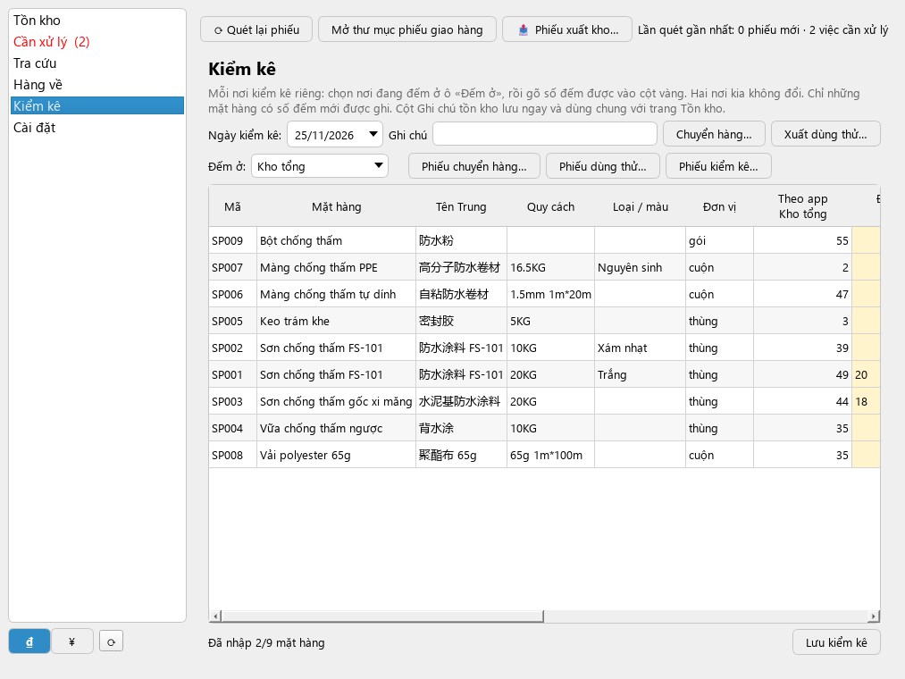
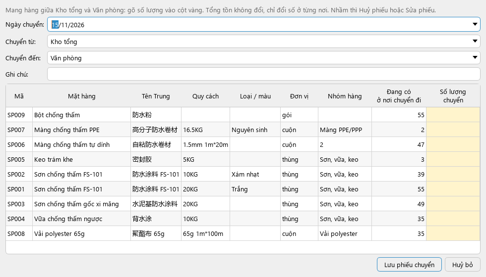
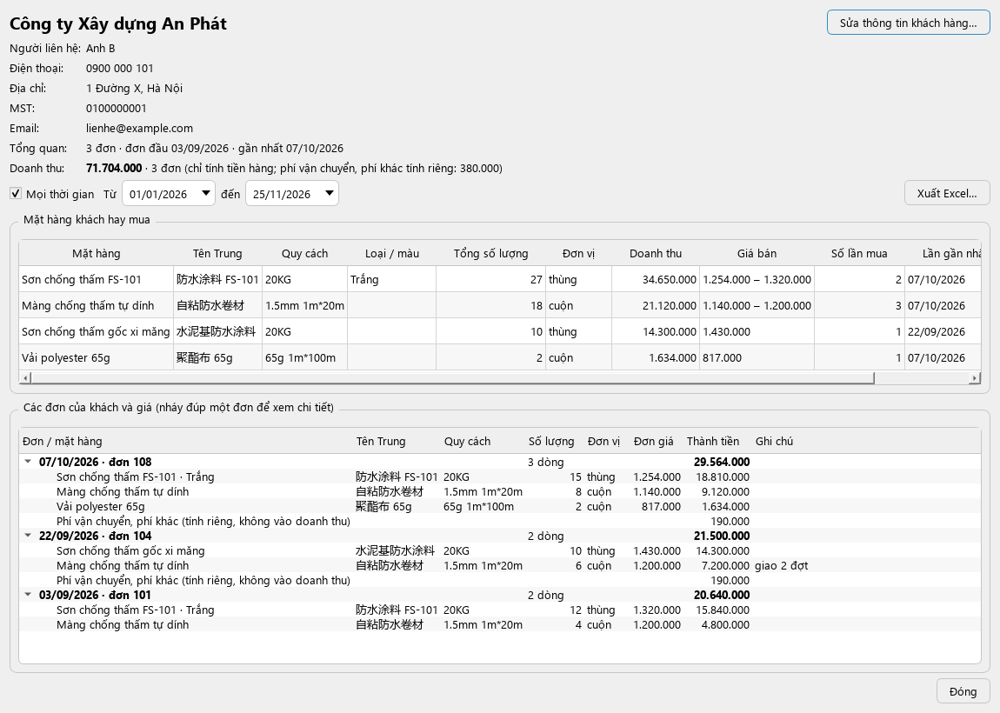
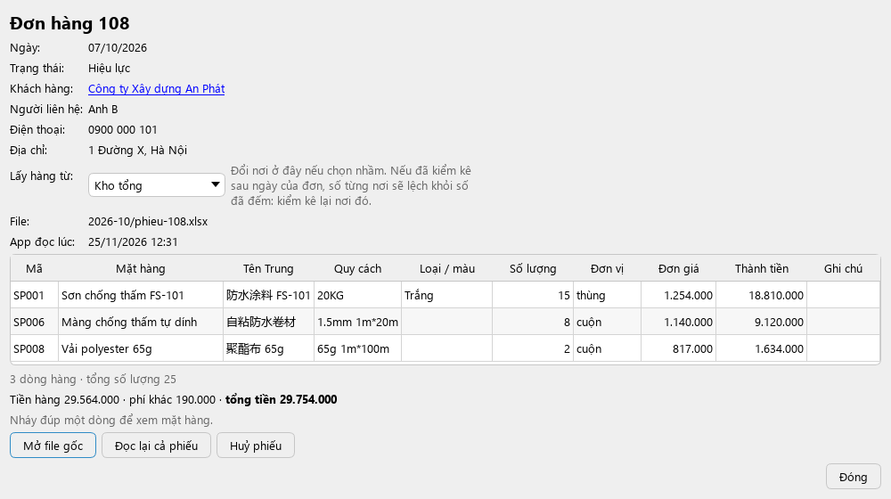
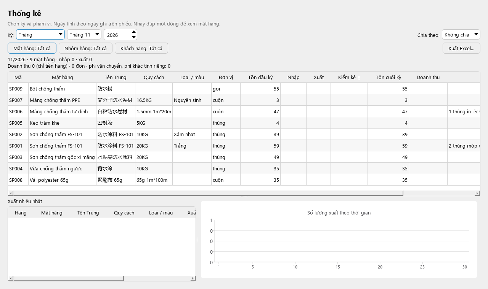

# Hướng dẫn sử dụng DiBeKho (chi tiết)

[English](user-guide.md) · **Tiếng Việt** · [中文](user-guide.zh.md) · [← Về trang chính](../README.vi.md)

Hướng dẫn này đi từng bước, theo đúng tên nút trên màn hình. Chưa cài app? Xem [Tải và cài đặt](../README.vi.md#tải-và-cài-đặt).

> **Làm nhầm cũng đừng lo.** Chọn nhầm mặt hàng thì **Đọc lại cả phiếu**; phiếu sai thì **Huỷ phiếu** (phiếu xuất: **Sửa phiếu xuất kho…** hoặc **Xoá hẳn**) rồi lập lại; app còn tự sao lưu mỗi ngày (xem [mục 11](#11-khi-làm-nhầm-sửa-lại-sao-lưu)).

**Mục lục**
1. [Làm quen với màn hình](#1-làm-quen-với-màn-hình)
2. [Ngày đầu tiên](#2-ngày-đầu-tiên)
3. [Hằng ngày: đọc phiếu giao hàng](#3-hằng-ngày-đọc-phiếu-giao-hàng) · [Phiếu xuất kho](#35-phiếu-xuất-kho) · [Xem tiền bằng VND hoặc nhân dân tệ](#36-xem-tiền-bằng-vnd-hoặc-nhân-dân-tệ)
4. [Xem tồn kho, hàng sắp hết, ghi chú](#4-xem-tồn-kho-hàng-sắp-hết-ghi-chú)
5. [Hàng về](#5-hàng-về)
6. [Kiểm kê từng nơi](#6-kiểm-kê-từng-nơi)
7. [Chuyển hàng giữa Kho tổng và các văn phòng](#7-chuyển-hàng-giữa-kho-tổng-và-các-văn-phòng) · [Xuất dùng thử](#7b-xuất-dùng-thử)
8. [Khách hàng, doanh thu và giá bán](#8-khách-hàng-doanh-thu-và-giá-bán) · [Gộp khách hàng](#84-gộp-khách-hàng)
9. [Đơn hàng](#9-đơn-hàng)
10. [Thống kê và xuất Excel](#10-thống-kê-và-xuất-excel)
11. [Khi làm nhầm: sửa lại, sao lưu](#11-khi-làm-nhầm-sửa-lại-sao-lưu)
12. [Danh mục mặt hàng và mức báo động](#12-danh-mục-mặt-hàng-và-mức-báo-động)
13. [Chuyển sang máy khác](#13-chuyển-sang-máy-khác)
14. [Xử lý tình huống thường gặp](#14-xử-lý-tình-huống-thường-gặp)
15. [Tài khoản và dữ liệu chung trên Cloud](#15-tài-khoản-và-dữ-liệu-chung-trên-cloud)

---

## 1. Làm quen với màn hình

Bên trái là **6 mục**. Bấm vào một mục để mở nó:

| Mục | Dùng để |
|---|---|
| **Tồn kho** | Xem còn bao nhiêu hàng, ở đâu, hàng nào sắp hết |
| **Cần xử lý** | Những việc app cần bạn quyết định. Có số trong ngoặc, ví dụ **Cần xử lý (2)**, là đang có việc chờ |
| **Tra cứu** | Tìm mọi thứ; mở **Danh sách đơn hàng**, **Danh sách khách hàng**, **Thống kê và xuất Excel**; tab **Danh mục mặt hàng** |
| **Hàng về** | Ghi hàng nhập về kho |
| **Kiểm kê** | Ghi số đếm thực tế; chuyển hàng giữa hai nơi |
| **Cài đặt** | Ngôn ngữ, cỡ chữ, tên trên phiếu đã học, sao lưu, chuyển dữ liệu |

Phía trên cùng có các nút dùng chung:
- **⟳ Quét lại phiếu** (phím **F5**): đọc các phiếu giao hàng mới.
- **Mở thư mục phiếu giao hàng**: mở thư mục để chép phiếu vào.
- **📤 Phiếu xuất kho…**: lập phiếu xuất cho khách (mục 3.5).
- Dòng trạng thái **Cloud** (góc phải): đã đồng bộ chưa, thay đổi nào đang chờ.

**Màu trong bảng:**
- **Cam** + chữ **⚠ Sắp hết — nên đặt hàng**: hàng sắp hết, nên đặt thêm.
- **Đỏ**: tồn âm (app tính ra số nhỏ hơn 0, thường do thiếu phiếu hàng về hoặc chưa kiểm kê).
- **Vàng**: ô để bạn gõ số vào (ở Kiểm kê, Chuyển hàng).

**Ba nơi chứa hàng:** app chia số tồn theo **Kho tổng**, **Văn phòng Hà Nội** và **Văn phòng Bắc Ninh**. Số "Tồn" là tổng của ba nơi.

**Mẹo:**
- Tên dài bị cắt? Rê chuột lên ô để xem đủ, hoặc kéo mép tiêu đề cột cho rộng ra.
- Lăn chuột để cuộn trang **không bao giờ** làm đổi lựa chọn hay con số trong bảng.
- Chữ quá nhỏ? **Cài đặt → Chung → Cỡ chữ và nút**, chọn 130% hoặc 150%, tắt và mở lại app.
- Bản mới: từ 0.5.7 app tự kiểm tra khi mở và hỏi **Cập nhật ngay?** (dữ liệu giữ nguyên). Tắt/bật hoặc kiểm tra bằng tay: **Cài đặt → Chung → Bản mới**.

---

## 2. Ngày đầu tiên

Chỉ làm một lần, theo thứ tự.

**Bước 1. Mở app lần đầu.**
1. Chọn ngôn ngữ.
2. Chọn **thư mục làm việc**: để mặc định `Tài liệu/DiBeKho` là được. **Không** chọn thư mục trong OneDrive, iCloud hay Google Drive (đồng bộ đám mây có thể làm hỏng dữ liệu).
3. Bấm **Bắt đầu**. App tạo sẵn các thư mục con (xem [mục 14](#dữ-liệu-nằm-ở-đâu)).
4. **Đăng nhập** bằng tài khoản và mật khẩu chủ cấp. App tự nối với dữ liệu chung trên Cloud (xem [mục 15](#15-tài-khoản-và-dữ-liệu-chung-trên-cloud)); máy đã có dữ liệu riêng thì app hỏi trước và sao lưu trước khi dùng dữ liệu trên Cloud.

**Bước 2. Đưa dữ liệu vào.** Chọn **một** trong ba cách:

| Bạn đang có | Làm thế này |
|---|---|
| Cửa hàng đã có dữ liệu trên Cloud (máy thứ hai, máy nhân viên, máy mới) | Không cần làm gì: đăng nhập ở bước 1 là app tải dữ liệu chung về. Bỏ qua bước 2 và 3 |
| File `.dibekho` xuất từ máy khác đang dùng DiBeKho | Chép file vào thư mục `input/` → mục **Cần xử lý** → **Nhập dữ liệu** (chỉ tài khoản chủ; thay dữ liệu chung cho mọi máy). Xong, bỏ qua bước 3 |
| File Excel thống kê tồn kho hằng tháng | Màn hình **Tồn kho** → **Nhập danh mục từ Excel…** → chọn file → xem bảng (nháy đúp ô để sửa, bỏ tick dòng không cần) → giữ tick **Ghi số tồn kho trong file… tính đến ngày**, chọn ngày → **Nhập các dòng đã chọn** |
| Chưa có gì | Bỏ qua. Mặt hàng sẽ được tạo dần khi đọc phiếu giao hàng ([mục 3](#3-hằng-ngày-đọc-phiếu-giao-hàng)) |

> Số tồn nhập từ file Excel được tính là ở **Kho tổng**. Nếu có hàng ở **Văn phòng Hà Nội** hoặc **Văn phòng Bắc Ninh**, làm thêm bước 3.

**Bước 3. Kiểm kê đầu kỳ.** Vào **Kiểm kê**, đếm hàng thật từng nơi và gõ vào cột vàng của nơi đó ([mục 6](#6-kiểm-kê-từng-nơi)). Từ đây số trên app khớp với kho thật.

**Bước 4. (Nên làm) Xem mức báo động.** Mặc định app báo khi tồn **dưới 30**. Nếu nhiều mặt hàng thường chỉ có vài thùng, hãy hạ mức này ([mục 12](#12-danh-mục-mặt-hàng-và-mức-báo-động)).

---

## 3. Hằng ngày: đọc phiếu giao hàng

Mỗi phiếu giao hàng (file Excel) làm **giảm** tồn kho. App đọc tên hàng, quy cách, số lượng, ghi chú, đơn giá, thành tiền và phí vận chuyển trên phiếu.

### 3.1. Chép phiếu và quét

1. Bấm **Mở thư mục phiếu giao hàng**. Chép các file phiếu trong ngày vào đó (chia thư mục con theo tháng cũng được).
2. Bấm **⟳ Quét lại phiếu** (hoặc phím **F5**). Mỗi lần mở app cũng tự quét.
3. Phía trên hiện "Lần quét gần nhất: N phiếu mới".
   - Phiếu đã đọc xong được app **chuyển vào** `phieu-giao-hang/da-xu-ly/`. Phiếu nào còn nằm ngoài là phiếu **chưa xong**.
   - Bỏ cùng một phiếu vào hai lần, đổi tên file hay chuyển thư mục: app nhận ra, **không trừ hai lần**.

### 3.2. Chọn nơi lấy hàng cho đơn mới

Phiếu không ghi hàng lấy ở đâu, nên mỗi đơn mới hiện trong **Cần xử lý → Đơn chưa chọn nơi lấy hàng**.



1. Mở mục **Cần xử lý**.
2. Ở cột **Lấy hàng từ** của từng đơn, chọn **Kho tổng**, **Văn phòng Hà Nội** hoặc **Văn phòng Bắc Ninh**.
3. Bấm **Lưu nơi lấy hàng**.

Trong lúc chưa chọn, hàng được **tạm trừ ở Kho tổng**, nên tổng tồn đã đúng ngay. Chọn nhầm? Mở đơn đó ([mục 9](#9-đơn-hàng)) và đổi ở ô **Lấy hàng từ**.

### 3.3. Dòng hàng app chưa nhận ra

Lần đầu gặp một tên hàng, app chưa biết nó là mặt hàng nào. Phiếu đó hiện trong **Cần xử lý → Tên hàng chưa có trong danh mục**, nhóm theo đơn. Mọi dòng của đơn đều hiện (dòng có ✓ là app đã nhận ra) để bạn so với phiếu giấy.

Ở cột **Là mặt hàng** của từng dòng, chọn:

| Dòng trên phiếu là | Chọn |
|---|---|
| Mặt hàng đã có trong kho | Mặt hàng trong gợi ý (app gợi ý 2–3 mặt hàng giống nhất). Không thấy: **🔍 Chọn mặt hàng khác…**, gõ vài chữ để tìm (gõ không dấu hay tiếng Trung đều được) |
| Mặt hàng mới, chưa từng có | **＋ Tạo mặt hàng mới**. Gõ số đang có trong kho **trước phiếu này** vào ô **Tồn ban đầu** (để trống = 0) |
| Phí ship, phí dịch vụ | **✕ Không phải hàng hoá…** (thường đã chọn sẵn). Tiền của dòng này được ghi là **phí riêng** của đơn |
| Chưa chắc | **⏸ Để sau (giữ lại, chưa duyệt)**. Các dòng khác của đơn vẫn được ghi, dòng này chờ |

Rồi bấm **Áp dụng và đọc lại phiếu**, đọc bảng tóm tắt và bấm đồng ý.

- App **nhớ** lựa chọn: lần sau gặp đúng tên đó sẽ tự nhận ra.
- Cùng một tên có ở nhiều đơn: chọn ở một đơn, các đơn kia theo luôn.
- Chọn nhầm từ lâu? Xem [mục 14](#14-xử-lý-tình-huống-thường-gặp), dòng "Chọn nhầm mặt hàng cho một dòng phiếu từ lâu".

### 3.4. Các thông báo khác trong Cần xử lý

| Thông báo | Ý nghĩa | Nên bấm |
|---|---|---|
| **Phiếu bị sửa** | File phiếu đã đọc bị sửa lại | **Dùng bản mới** (đọc lại theo file mới) hoặc **Giữ bản cũ** |
| **Phiếu bị sửa** kèm "có thể là ĐƠN KHÁC trùng mã" | Phiếu mới cùng mã đơn nhưng khác khách hàng, hoặc ngày cách xa đơn cũ: thường là một đơn khác dùng lại mã | **Nhập thành đơn riêng** (giữ nguyên đơn cũ). Chỉ bấm **Dùng bản mới** nếu đúng là sửa đơn cũ |
| **Đơn đọc sau lần kiểm kê** | Đơn có ngày trước (hoặc đúng) ngày kiểm kê nhưng app mới đọc sau khi kiểm kê | Lúc đếm hàng của đơn đã ra khỏi kho: **Giữ số đã kiểm kê** (không bị trừ 2 lần). Hàng lấy ra sau lúc đếm: **Trừ thêm đơn này** |
| **File đã bị xoá/di chuyển** | File phiếu biến mất khỏi thư mục. Tồn **không đổi** | **Khôi phục file** (app còn bản sao), **Huỷ phiếu**, hoặc **Bỏ qua** |
| **Không đọc được** | File không phải phiếu giao hàng, hoặc thiếu thông tin | Xem lý do; sửa file rồi quét lại, hoặc **Ẩn** |
| **Thư mục input** | Có gói dữ liệu, file hàng về cũ hoặc file danh mục chờ nhập | **Nhập dữ liệu** / **Xem và nhập** |


### 3.5. Phiếu xuất kho

Dùng khi giao hàng cho khách mà chưa có file phiếu giao hàng: app tạo phiếu thay bạn.

1. Bấm **📤 Phiếu xuất kho…** ở thanh trên cùng.
2. Chọn khách trong danh sách (điện thoại, người liên hệ, địa chỉ, MST, email tự điền). Gõ vài chữ của tên khách — không dấu cũng được, gõ mấy số điện thoại cũng được — thì những khách hợp hiện ra ngay dưới ô để chọn. Hoặc bấm **＋ Khách hàng mới…** để nhập đủ thông tin của khách mới: tên, điện thoại, người liên hệ, địa chỉ, **MST**, **email**. Nếu trùng tên hoặc số điện thoại với khách đã có, app hỏi có chọn khách đó không. Khách mới vào danh sách khi lưu phiếu; MST và email được in lên phiếu.
3. Mỗi dòng: bấm để chọn mặt hàng, rồi ghi số **Lấy ở Kho tổng**, **Lấy ở Văn phòng Hà Nội** và/hoặc **Lấy ở Văn phòng Bắc Ninh** (lấy ở nhiều nơi thì ghi nhiều ô). Cột **Đang có** cho biết mỗi nơi còn bao nhiêu; lấy nhiều hơn số đang có thì số hiện màu đỏ. Một mặt hàng bán **hai mức giá** (số lượng khác nhau giá khác nhau)? Ghi nó ở **hai dòng**, mỗi dòng một giá. Hàng **chưa có trong danh mục**: bấm vào ô mặt hàng → **★ Mặt hàng mới (chưa có trong kho)…**, ghi tên, quy cách, đơn vị. Lưu phiếu thì mặt hàng được thêm vào danh mục và tồn của nó thành **số âm**; khi hàng về, nhập ở **Hàng về** (chọn đúng mặt hàng đó) là tồn tự cân lại. Nếu tên trông giống mặt hàng đã có, app hỏi có dùng mặt hàng đó không, để khỏi tạo trùng.
4. **Đơn giá** tự điền theo đơn gần nhất của khách (khách mới: đơn gần nhất của mặt hàng đó). Sửa lại nếu giá khác. Công tắc góc trái dưới đang ở **¥** thì cột ghi **Đơn giá (¥)**: gõ giá bằng nhân dân tệ. Phiếu được lưu là **phiếu bằng nhân dân tệ**: file Excel ghi giá và tổng bằng ¥ (dòng bằng chữ ghi "… NHÂN DÂN TỆ"), doanh thu được cộng vào phần tiền tệ. Hộp hỏi trước khi lưu hiện số ¥ kèm số ₫ xấp xỉ. Áp dụng cho cả giao diện tiếng Việt lẫn tiếng Trung, chỉ cần công tắc ở **¥**. Sửa một phiếu đã lưu thì phiếu giữ đúng loại tiền lúc lưu, dù công tắc đang ở đâu.
5. Bấm **Lưu phiếu** → xem lại → **Có**. Tồn kho bị trừ **ngay**, đơn có trong **Đơn hàng** và doanh thu của khách.

App tạo file Excel `output/phieu-xuat/PhieuXuat_A160.xlsx` để in hoặc gửi. Mã phiếu là **A** + số tiếp theo sau mã đơn lớn nhất (đơn gần nhất là 159 thì phiếu mới là **A160**); phiếu tạo trên web có chữ **W** (W160). File có **cùng khuôn với phiếu giao hàng**: tên và địa chỉ công ty (app lấy từ phiếu giao hàng gần nhất đã đọc), khối thông tin khách, 7 cột STT · Tên hàng · Quy cách · Số lượng · Đơn giá · Thành tiền · Ghi chú, tổng tiền viết bằng chữ, chỗ ký. Chỉ khác tiêu đề: **PHIẾU XUẤT KHO**. Nơi lấy hàng không in trên phiếu: app tự nhớ. Bỏ lại file này (hay bản chép của nó) vào thư mục phiếu cũng **không bị trừ hai lần**; dòng dưới thanh trên cùng sẽ báo "… là bản chép của phiếu đã có". Sửa file trong Excel (vd. đổi số lượng) rồi bỏ vào thư mục thì app hỏi **Thay bằng bản mới?** như phiếu giao hàng. Nếu đã đổi số lượng của mặt hàng lấy ở cả hai nơi, app sẽ hỏi lại lấy hàng ở đâu. Phiếu xuất kho tạo trên trang web (nếu dùng Cloud) bằng **tài khoản chủ** được trừ tồn ngay khi lưu (mã W…); tạo bằng tài khoản nhân viên thì chỉ ra file, bỏ file đó vào thư mục phiếu giao hàng rồi **⟳ Quét lại phiếu** thì app mới trừ tồn. Làm nhầm: **Huỷ phiếu** trong Chi tiết đơn. Với phiếu xuất (mã A… hoặc W…), sau khi bấm Huỷ phiếu app hỏi thêm **Xoá hẳn phiếu?**: chọn Có thì phiếu biến mất, tồn trả lại và mã đó được dùng lại cho phiếu xuất tiếp theo, để số đơn không bị hụt khi tính doanh thu cuối quý.

**Sửa phiếu đã xuất** (giá, số lượng, mặt hàng, khách): mở đơn trong **Đơn hàng** → **Sửa phiếu xuất kho…** → sửa như lúc lập phiếu → **Lưu phiếu**. Phiếu giữ nguyên mã (A160 vẫn là A160), tồn kho được tính lại, file Excel được tạo lại; file cũ để trong `output/phieu-xuat/da-sua`. Chỉ phiếu do app hoặc web này lập (mã **A…**, **W…**) mới sửa được; phiếu giao hàng của cửa hàng thì sửa trong file Excel rồi để app đọc lại.

**Đơn nháp** (khách chưa chốt): lập phiếu như trên rồi bấm **Lưu nháp** thay cho Lưu phiếu. App chỉ tạo file Excel `output/phieu-xuat/nhap/PhieuXuat_NHAP_N1.xlsx` (tiêu đề ghi **(NHÁP)**, mã N1, N2…): **không trừ tồn kho, không tính doanh thu**, không thêm mặt hàng mới. Khi khách chốt: **📤 Phiếu xuất kho…** → **Xuất từ phiếu nháp…** → chọn file nháp. Cửa sổ mở đúng nội dung đơn nháp, sửa nếu cần rồi bấm **Lưu phiếu**: thành phiếu xuất kho thật (mã A… mới, trừ tồn, tính doanh thu); file nháp được chuyển vào `output/phieu-xuat/nhap/da-chot`. Còn sửa tiếp thì bấm **Lưu nháp** lần nữa (giữ mã N cũ). Lỡ bỏ file nháp vào thư mục phiếu giao hàng thì app không ghi nó vào kho, chỉ báo ở **Cần xử lý** là đơn nháp.

### 3.6. Xem tiền bằng VND hoặc nhân dân tệ

Ở góc trái dưới có công tắc **₫ | ¥**. Bấm **¥**: mọi số tiền trong app (doanh thu, đơn giá, thành tiền, Thống kê, Chi tiết đơn, Chi tiết khách…) hiện bằng nhân dân tệ theo **tỷ giá thị trường lúc này**, cả đơn cũ. Bấm **₫** để về tiền Việt. Dữ liệu và các file xuất ra (Excel thống kê, gói dữ liệu) vẫn ghi VND. Riêng **Phiếu xuất kho** làm khi công tắc ở ¥ là phiếu bằng nhân dân tệ: gõ giá bằng ¥ và file phiếu ghi bằng ¥ (mục 3.5). Dưới công tắc là tỷ giá đang dùng và giờ cập nhật; app tự lấy tỷ giá mới mỗi 10 phút khi đang hiện ¥, khi bấm **⟳** hoặc **⟳ Quét lại phiếu** (F5). Tỷ giá chỉ để tham khảo (không phải giá mua/bán của ngân hàng); máy không có mạng thì app dùng tỷ giá lấy lần trước. Trang web (nếu dùng Cloud) có cùng công tắc ở cùng chỗ.

**Đơn bán bằng nhân dân tệ.** Phiếu giao hàng ghi giá bằng tệ (ô giá định dạng CNY/¥, hoặc dòng tổng tiền bằng chữ ghi "nhân dân tệ") được app nhận là **đơn tệ**: số tiền giữ nguyên như trên phiếu, hiện kèm **¥**, và trong ngoặc là số quy đổi xấp xỉ ra ₫ theo tỷ giá lúc app đọc phiếu, ví dụ `¥4.800 (≈ 17.280.000 ₫)`. Doanh thu tệ **cộng riêng**, không cộng chung với tiền Việt: `2.100.000 ₫ + ¥4.800 (≈ 19.380.000 ₫)`. Trong **Đơn hàng**, tiền hàng của đơn tiền Việt và đơn tệ nằm ở hai cột riêng **Tiền hàng (VND)** và **Tiền hàng (CNY)**; ô lọc **Loại tiền** để xem riêng đơn tiền Việt hoặc đơn tệ. File Excel xuất ra có thêm cột **Doanh thu (¥)** khi kỳ đó có đơn tệ. Hàng khách trả lại từ đơn tệ được trừ vào doanh thu tệ.

---

## 4. Xem tồn kho, hàng sắp hết, ghi chú



### 4.1. Đọc bảng Tồn kho

Thứ tự cột: Mã, Mặt hàng, Tên Trung, Quy cách, Loại/màu, Nhóm hàng, Đơn vị, Tồn, Ghi chú tồn kho, Kho tổng, Văn phòng Hà Nội, Văn phòng Bắc Ninh, Xuất gần nhất.

| Cột | Ý nghĩa |
|---|---|
| **Tồn** | Tổng số hiện có (Kho tổng + Văn phòng Hà Nội + Văn phòng Bắc Ninh) |
| **Ghi chú tồn kho** | Ghi chú riêng của mặt hàng (thùng lỗi, in lệch, hết hạn…); cột hẹp, rê chuột để xem hết |
| **Kho tổng**, **Văn phòng Hà Nội**, **Văn phòng Bắc Ninh** | Số ở từng nơi |
| **Xuất gần nhất** | Ngày giao hàng gần nhất |

- Mặt hàng sắp hết (dưới mức báo động) tô **cam**; tồn âm tô **đỏ**. Dòng đầu trang cho biết có bao nhiêu mặt hàng sắp hết.
- Cột **Tồn tự dính vào mép trái** khi kéo bảng sang ngang quá nó (kéo thanh cuộn dưới bảng để xem Kho tổng/Văn phòng Hà Nội/Văn phòng Bắc Ninh/Xuất gần nhất mà vẫn thấy tổng tồn).
- Ô **Lọc theo tên…**: gõ để tìm nhanh (không dấu cũng được). Ô **Nhóm hàng**: chỉ xem một nhóm.

### 4.2. Lập danh sách cần đặt hàng

Tick **Chỉ hiện hàng sắp hết**: bảng chỉ còn mặt hàng cam (sắp hết) và đỏ (tồn âm). Đây là danh sách nên đặt thêm.

### 4.3. Ghi chú cho một mặt hàng

Dùng để nhớ những việc như: "3 thùng in lệch", "2 thùng hết hạn 12/2026", "1 cuộn rách mép".

1. **Nháy đúp** vào ô **Ghi chú tồn kho** của mặt hàng (hoặc chọn ô rồi gõ luôn).
2. Gõ ghi chú, bấm **Enter**. Ghi chú được lưu ngay.
3. Muốn xoá ghi chú: nháy đúp, xoá hết chữ, bấm Enter.

Ghi chú này **dùng chung** với cột Ghi chú ở trang Kiểm kê, hiện trong chi tiết mặt hàng, trong Thống kê, trong file Excel, và **đi theo gói dữ liệu** sang máy khác.

### 4.4. Xem chi tiết một mặt hàng

**Nháy đúp** vào một dòng (chỗ nào cũng được, trừ ô ghi chú). Cửa sổ chi tiết cho biết:
- Tồn hiện tại và **Theo nơi: Kho tổng … + Văn phòng Hà Nội … + Văn phòng Bắc Ninh …**, ví dụ "Kho tổng 39 + Văn phòng Hà Nội 1 + Văn phòng Bắc Ninh 0".
- Ghi chú tồn kho (nếu có).
- **Lịch sử nhập, xuất**: từng lần giao hàng, hàng về, kiểm kê, chuyển hàng, kèm nơi và số tồn sau mỗi lần. Nháy đúp một dòng để mở phiếu đó.
- **Khách lấy nhiều nhất** mặt hàng này, kèm doanh thu.

---

## 5. Hàng về



1. Vào **Hàng về**, bấm **＋ Nhập hàng về…**.
2. Chọn hàng từ đâu về:
   - **Cửa khẩu / công ty mẹ**: gõ tên nhà cung cấp, hoặc chọn tên đã dùng.
   - **Khách hàng trả lại**: chọn khách, và mã đơn khách trả nếu biết. Cột **Đơn giá trả lại** tự điền giá khách đã mua (theo đơn đã chọn, không chọn đơn thì lấy lần mua gần nhất); sửa được nếu hoàn tiền khác giá, để trống thì không trừ doanh thu.
   - **Nhà cung cấp khác**: gõ tên nhà cung cấp, hoặc bấm một trong 3 tên dùng gần nhất hiện ngay bên dưới.
3. Chọn **Ngày về** và **Nhập vào**: **Kho tổng**, **Văn phòng Hà Nội** hoặc **Văn phòng Bắc Ninh**.
4. App gợi ý sẵn 3 mặt hàng (hàng hay về từ nhà cung cấp này, hoặc hàng sắp hết). Gõ **số lượng** cho từng dòng. Dòng để trống số lượng sẽ bị bỏ qua.
   - Đổi mặt hàng: bấm vào tên → **🔍 Chọn mặt hàng trong kho…**. Ô tìm nhận **vài từ bất kỳ, không cần dấu, không cần gạch nối**, ví dụ `fs101 xam 10kg`; bảng có cột riêng cho Quy cách, Loại/màu, Tên Trung và Tồn để phân biệt các mặt hàng cùng tên. Chỉ còn một mặt hàng khớp thì bấm Enter là chọn.
   - Hàng mới hoàn toàn: bấm vào tên → **★ Mặt hàng mới (chưa có trong kho)…**, điền tên, quy cách. Mặt hàng chỉ được tạo khi lưu phiếu.
   - Thêm dòng: **＋ Thêm dòng**. Xoá dòng: nút **✕** cuối dòng.
   - Gõ xong một số lượng, bấm **Enter** để xuống dòng dưới (Enter không lưu phiếu).
   - Chọn một mặt hàng đã có ở dòng khác: app báo ngay và đưa con trỏ tới dòng đó để sửa số lượng.
5. Bấm **Lưu phiếu hàng về**, đọc bảng tóm tắt rồi đồng ý.
   - Ô nhà cung cấp là **nơi gửi hàng tới** (cửa khẩu, công ty mẹ), không phải "Kho tổng". **Muốn sửa số tồn bị sai thì dùng Kiểm kê**, không dùng Hàng về.

Đang nhập mà phải đóng cửa sổ (ví dụ để sang Tra cứu → Danh mục mặt hàng sửa tên một mặt hàng): phiếu chưa lưu **được giữ lại**. Bấm **＋ Nhập hàng về…** lần sau, chọn **Có** để nhập tiếp. Phiếu dở chỉ giữ tới khi tắt app.

Kết quả: tồn tăng ở nơi đã chọn, phiếu có mã **HV001, HV002…**, và một file Excel của phiếu được lưu trong `output/hang-ve/` (để in hoặc gửi).

- Nhập nhầm: chọn phiếu trong danh sách → **Sửa phiếu đã chọn…** (phiếu cũ vẫn giữ trong lịch sử với trạng thái "đã thay").
- File hàng về dạng cũ (file mẫu đã điền) vẫn nhập được bằng **Chọn file để nhập…**.

---

## 6. Kiểm kê từng nơi

Kiểm kê = đếm hàng thật rồi ghi vào app. App chỉ ghi **phần chênh lệch** giữa số đếm và số trên app, nên lịch sử vẫn rõ ràng.



1. Vào **Kiểm kê**. Chọn **Ngày kiểm kê** (ngày bạn đếm).
2. Ở ô **Đếm ở:** chọn nơi đang đếm: **Kho tổng**, **Văn phòng Hà Nội** hoặc **Văn phòng Bắc Ninh**. Mỗi nơi đếm riêng.
3. Mỗi mặt hàng có:
   - Cột **Tên Trung** cạnh tên Việt, để phân biệt các mặt hàng trùng tên mà không nhớ mã SP.
   - **Theo app: <nơi đang đếm>**: số app đang tính ở nơi đó.
   - Cột vàng **Đếm được: <nơi đang đếm>**: gõ số bạn đếm được.
4. Chỉ gõ những mặt hàng đã đếm. **Ô để trống thì mặt hàng đó giữ nguyên.**
5. Cột **Chênh lệch** hiện ngay: đỏ là lệch.
6. (Tuỳ chọn) gõ **Ghi chú** cho lần kiểm kê, ví dụ "kiểm kê cuối tháng".
7. Bấm **Lưu kiểm kê** và đồng ý.

Đổi **Đếm ở** khi đã gõ số mà chưa lưu? App hỏi có bỏ các số đó không (hộp hỏi ghi tên nơi). Bấm đồng ý thì các số đã gõ bị xoá.

**Ví dụ:** app đang ghi Kho tổng 25. Chọn **Đếm ở:** Kho tổng, gõ 20, lưu. App ghi −5 ở Kho tổng; tồn Kho tổng mới là 20. Sau đó chọn **Đếm ở:** Văn phòng Bắc Ninh để đếm nơi đó.

- Cột **Ghi chú tồn kho** ở cuối bảng giống hệt cột ở trang Tồn kho: nháy đúp để ghi thùng lỗi, hết hạn… trong lúc đếm. Ghi chú lưu ngay và **không** làm mất các số bạn đang gõ.
- App tự quét phiếu giao hàng trước khi hiện số, để phiếu đã có không bị tính hai lần.
- 2 nút **Phiếu chuyển hàng…** và **Phiếu kiểm kê…** ở đầu trang mở danh sách các lần đã làm trước đó (nháy đúp để xem lại).

---

## 7. Chuyển hàng giữa Kho tổng và các văn phòng

Dùng khi mang hàng từ nơi này sang nơi kia, ví dụ chở 5 thùng sơn từ Kho tổng lên Văn phòng Hà Nội. **Tổng tồn không đổi**, chỉ đổi số ở từng nơi.



1. Vào **Kiểm kê**, bấm **Chuyển hàng…** (góc phải).
2. Chọn **Ngày chuyển**, **Chuyển từ** và **Chuyển đến** (hai nơi luôn khác nhau; có thể là hai trong ba nơi bất kỳ).
3. Cột **Đang có ở nơi chuyển đi** cho biết số hiện có. Gõ số lượng vào cột vàng **Số lượng chuyển** cho từng mặt hàng mang đi. Bảng có thêm cột **Tên Trung** và **Nhóm hàng** để phân biệt các mặt hàng chỉ khác nhau ở tên Trung; hai cột **Đang có…** và **Số lượng chuyển** tự ghim bên phải khi kéo bảng sang ngang, tiện nhìn và nhập số.
4. (Tuỳ chọn) gõ **Ghi chú**.
5. Bấm **Lưu phiếu chuyển**, đọc tóm tắt và đồng ý. Phiếu có mã **CH001, CH002…**

Nơi chuyển đi không đủ hàng theo app? App vẫn cho lưu nhưng báo trước; số ở nơi đó sẽ âm cho tới lần kiểm kê sau.

Xem lại, sửa hoặc huỷ phiếu chuyển: **Kiểm kê → Phiếu chuyển hàng…** (hoặc **Tra cứu → Danh sách đơn hàng**, ở ô **Loại phiếu** chọn **Phiếu chuyển hàng**). Nháy đúp phiếu để xem chi tiết, có nút **Sửa phiếu…** (mở lại để sửa mặt hàng/số lượng, phiếu cũ vẫn giữ trong lịch sử) và **Huỷ phiếu**; trong danh sách còn có nút **Sửa phiếu đã chọn…** để sửa ngay phiếu đang bôi đen.

### 7b. Xuất dùng thử

Dùng khi mở hàng ra thử nghiệm/dùng nội bộ, **không bán cho khách** — thay cho việc tự lập một phiếu giao hàng khống để trừ tồn. Số lượng này **không** tính là xuất bán trong Thống kê.

1. Vào **Kiểm kê**, bấm **Xuất dùng thử…** (cạnh nút Chuyển hàng).
2. Chọn **Ngày xuất** và **Nơi xuất** (Kho tổng, Văn phòng Hà Nội hoặc Văn phòng Bắc Ninh).
3. Gõ số lượng vào cột vàng **Số lượng dùng thử** cho từng mặt hàng. (Tuỳ chọn) gõ **Ghi chú** lý do dùng thử.
4. Bấm **Lưu phiếu dùng thử**, đọc tóm tắt và đồng ý. Phiếu có mã **DT001, DT002…**

Nhầm số lượng hoặc mặt hàng? Mở phiếu đó (Chi tiết đơn) và bấm **Huỷ phiếu**, rồi lập phiếu mới.

Xem lại phiếu dùng thử: **Kiểm kê → Phiếu dùng thử…** (hoặc **Tra cứu → Danh sách đơn hàng**, ở ô **Loại phiếu** chọn **Phiếu dùng thử**).

---

## 8. Khách hàng, doanh thu và giá bán

App lấy giá từ cột **đơn giá / thành tiền** trên phiếu giao hàng.

- **Doanh thu chỉ tính tiền hàng.** Phí vận chuyển và phí khác được ghi **riêng**, không cộng vào doanh thu.
- **Hàng khách trả lại được trừ khỏi doanh thu** (theo Đơn giá trả lại, vào ngày trả). App ghi rõ "đã trừ hàng khách trả lại: …". Huỷ phiếu trả hàng thì doanh thu được cộng lại.
- Phiếu không ghi giá: ô giá để trống (—) và không tính vào doanh thu; app báo số đơn thiếu giá.
- App không có giá nhập nên **không tính lãi**.

### 8.1. Xem một khách hàng

1. **Tra cứu → Danh sách khách hàng** (hoặc gõ tên, số điện thoại vào ô tìm ở trang Tra cứu).
   Danh sách có cột **Doanh thu** của mỗi khách.
2. **Nháy đúp** một khách. Cửa sổ chi tiết gồm:
   - Thông tin liên hệ (người liên hệ, điện thoại, địa chỉ, **MST**, **email**), số đơn, đơn đầu tiên và gần nhất. Bấm **Sửa thông tin khách hàng…** (góc trên bên phải) để sửa. Thông tin đã sửa được giữ nguyên: phiếu đọc sau chỉ điền vào ô còn trống. Khách có từ trước chưa có MST, email: để trống cho tới khi bạn sửa hoặc một phiếu mới có ghi (phiếu giao hàng mẫu mới có ô **MST** và **email**).
   - **Doanh thu**: tổng tiền hàng, số đơn; phí vận chuyển, phí khác ghi riêng bên cạnh.
   - **Mặt hàng khách hay mua**: tổng số lượng, **Doanh thu**, **Giá bán** (một giá, hoặc "thấp – cao" nếu giá thay đổi), số lần mua, lần mua gần nhất.
   - **Các đơn của khách và giá**: mỗi đơn (mới nhất trước) mở sẵn từng dòng với **Đơn giá**, **Thành tiền**, rồi dòng phí riêng (nếu có). Nháy đúp một đơn để xem chi tiết.



### 8.2. Xem trong một khoảng thời gian

1. Trong cửa sổ khách, **bỏ tick Mọi thời gian**.
2. Chọn **Từ** ngày … **đến** ngày …
3. Mọi thứ trong cửa sổ (doanh thu, mặt hàng, các đơn) chỉ tính trong khoảng đó.

### 8.3. Xuất Excel cho một khách

Bấm **Xuất Excel…** trong cửa sổ khách. File `KhachHang_<tên>_<kỳ>_….xlsx` được lưu trong `output/`, đúng theo khoảng thời gian đang chọn, gồm 2 trang:
- **Đơn hàng**: từng đơn (cũ → mới), mỗi dòng hàng với đơn giá, thành tiền; dòng **Tiền hàng của đơn** in đậm; dòng phí riêng in nghiêng.
- **Mặt hàng đã mua**: số lượng, doanh thu, giá thấp nhất, giá cao nhất, số lần mua.

Dùng để gửi khách đối chiếu, hoặc tính hoa hồng cho người bán.

### 8.4. Gộp khách hàng

Dùng để dọn các khách hàng trùng/thừa, ví dụ các "khách hàng" khống đã dùng để tự trừ tồn cho hàng dùng thử trước khi có tính năng Xuất dùng thử ([mục 7b](#7b-xuất-dùng-thử)) — gộp hết về một khách chung, ví dụ "Văn phòng DiBeKho".

1. **Tra cứu → Danh sách khách hàng.**
2. Chọn từ 2 khách trở lên (giữ **Ctrl** trên Windows, **⌘ Command** trên Mac, hoặc **Shift** khi bấm chọn), rồi bấm **Gộp khách hàng…**.
3. Gõ tên khách hàng chung (ví dụ "Văn phòng DiBeKho") hoặc chọn 1 trong các tên đang hiển thị, rồi bấm **Lưu**.
4. Đọc tóm tắt và đồng ý. Mọi đơn của các khách đã chọn chuyển sang khách chung; các khách cũ bị xoá (đơn và lịch sử vẫn giữ nguyên).

Gộp rồi thì không tách lại được: xem kỹ trước khi bấm.

---

## 9. Đơn hàng

**Tra cứu → Danh sách đơn hàng**: mọi phiếu, mới nhất trước.
- Lọc theo **Loại phiếu** (Phiếu giao hàng, Phiếu hàng về, Phiếu kiểm kê, Phiếu chuyển hàng), khoảng ngày, khách, mặt hàng; tick **Gồm cả phiếu đã huỷ** để xem cả phiếu đã huỷ.
- Cột **Nơi**: nơi lấy hàng / nơi nhập ("(?)" = chưa chọn nơi). Tiền hàng của đơn tiền Việt ở cột **Tiền hàng (VND)**, của đơn tệ ở cột **Tiền hàng (CNY)** (kèm số ≈ ₫); cột **Phí riêng**. Ô lọc **Loại tiền** để xem riêng đơn tiền Việt hoặc đơn tệ.
- **Nhấn chuột phải vào một đơn** (phiếu giao hàng đang hiệu lực) → **Đọc lại cả phiếu**: xem mục 12.

**Nháy đúp một đơn** để mở chi tiết:



- Khách (bấm tên để mở khách), người liên hệ, số điện thoại, địa chỉ.
- Ô **Lấy hàng từ**: đổi Kho tổng / Văn phòng Hà Nội / Văn phòng Bắc Ninh nếu chọn nhầm. (Nếu đã kiểm kê sau ngày của đơn, đổi nơi sẽ làm số từng nơi lệch khỏi số đã đếm: kiểm kê lại nơi đó.)
- Các dòng hàng với **Đơn giá**, **Thành tiền**; dòng "Tiền hàng · phí khác · tổng tiền" (tổng tiền khớp dòng "Tổng cộng" trên phiếu giấy).
- Nút **Mở file gốc** (mở bản sao chỉ đọc của phiếu), **Đọc lại cả phiếu** (xem mục 12), **Huỷ phiếu** (trả lại tồn, giữ lịch sử).
- Máy này chưa có file gốc của đơn (đơn lập ở máy khác, hoặc máy mới): bấm **Mở file gốc** là app tự tải về rồi mở, có thanh tiến trình; hoặc bấm **Tải file gốc từ Cloud**. Muốn tải nhiều đơn một lúc: ở **danh sách đơn hàng**, bấm chọn các đơn (giữ Ctrl hoặc Shift) rồi bấm **Tải file gốc từ Cloud**. Chỉ tài khoản chủ.
- Báo **Chưa có trên Cloud**: máy đã lập đơn chưa gửi file lên. Mở DiBeKho trên máy đó, vào **Cài đặt → Cloud**, bấm **Đồng bộ ngay**, rồi tải lại. (App cũng tự gửi file sau mỗi lần đồng bộ.)

> **Xoá file phiếu không phải cách huỷ phiếu.** Muốn bỏ một đơn, mở đơn và bấm **Huỷ phiếu**.

---

## 10. Thống kê và xuất Excel



1. **Tra cứu → Thống kê và xuất Excel**.
2. Chọn **Kỳ**: Ngày, Tháng, Quý, Năm hoặc Khoảng tự chọn (từ ngày – đến ngày). Kỳ dài có thể **Chia theo** ngày hoặc tháng.
3. Chọn phạm vi bằng các nút **Mặt hàng**, **Nhóm hàng**, **Khách hàng** (mặc định: Tất cả).
4. Bảng hiện cho từng mặt hàng: tồn đầu kỳ, nhập, xuất, kiểm kê ±, tồn cuối kỳ, **Doanh thu**, **Ghi chú tồn kho**. Dòng phía trên ghi **doanh thu của kỳ (chỉ tiền hàng)** và phí vận chuyển, phí khác tính riêng. Bên dưới là mặt hàng xuất nhiều nhất và biểu đồ.
5. Bấm **Xuất Excel…**, chọn các trang cần, bấm xuất. File `ThongKe_….xlsx` nằm trong `output/`. App hỏi có mở file luôn không.

File Excel gồm:

| Trang | Nội dung |
|---|---|
| **Nhập-Xuất-Tồn** | Mỗi mặt hàng: tồn đầu, nhập, xuất, kiểm kê, tồn cuối, doanh thu, ghi chú tồn kho |
| **Chi tiết phiếu** | Mỗi lần nhập/xuất: ngày, loại, mã phiếu, khách, **nơi**, mặt hàng, số lượng, **đơn giá**, **thành tiền**, ghi chú |
| **Khách x Mặt hàng** | Khách × mặt hàng: tổng số lượng, doanh thu, số lần mua |
| **Xuất nhiều nhất** | Xếp hạng mặt hàng xuất nhiều, kèm doanh thu |

Ghi chú: chọn khách thì chỉ số **xuất** được lọc theo khách. Chuyển hàng giữa hai nơi không tính là nhập hay xuất.

---

## 11. Khi làm nhầm: sửa lại, sao lưu

App không còn nút Hoàn tác. Làm nhầm thì sửa đúng chỗ:
- Chọn nhầm mặt hàng cho một đơn: mở đơn → **Đọc lại cả phiếu** (chỉ đơn đó được đọc lại).
- Một đơn, phiếu hàng về, chuyển hàng, dùng thử, kiểm kê nhập nhầm: mở phiếu → **Huỷ phiếu** (hoặc **Sửa phiếu**) rồi lập lại. Phiếu xuất kho: **Sửa phiếu xuất kho…** (giữ mã), hoặc **Huỷ phiếu → Xoá hẳn**, mã được dùng lại.
- Sửa nhầm mặt hàng: **Sửa mặt hàng…** lần nữa.

**Sao lưu tự động:** mỗi ngày khi mở app, giữ **10 bản gần nhất** trong `sao-luu/`, bản nào quá **30 ngày** cũng tự xoá để đỡ tốn dung lượng (app tự dọn lại mỗi 2 tuần). Trong **Cài đặt → Chuyển dữ liệu và sao lưu**:
- **Sao lưu ngay**: tạo một bản sao lưu lúc này.
- **Khôi phục bản đã chọn**: quay về hẳn dữ liệu của ngày đó. ⚠ Thay dữ liệu chung cho **mọi máy**: chỉ tài khoản chủ, cần có mạng (mục 15).
- **Khôi phục mặt hàng đã xoá…**: lỡ xoá nhầm một mặt hàng? App dò trong các bản sao lưu, liệt kê mặt hàng nào không còn trong danh mục hiện tại để bạn chọn khôi phục (còn trong bản sao lưu nào đó trong 30 ngày gần nhất). Nếu mặt hàng đó đã được tạo lại bằng tay, app sẽ hỏi có muốn **gộp thành 1** (chuyển mọi phiếu về mã nhỏ hơn) hay **giữ riêng**.

**Thông tin công ty:** **Cài đặt → Chung → Thông tin công ty** có ô **Tên công ty** và **Địa chỉ**, in ở đầu Phiếu xuất kho và đơn nháp. Sửa rồi bấm **Lưu thông tin công ty** (chỉ tài khoản chủ; dùng chung mọi máy và trang web). Phiếu lập từ giờ in theo thông tin mới. Muốn đổi trên một phiếu đã lập (ví dụ A181): mở phiếu, bấm **Sửa phiếu xuất kho…** rồi **Lưu phiếu**.

**Làm lại từ đầu:** **Cài đặt → Chung → Đặt lại dữ liệu** (app luôn sao lưu trước; chỉ tài khoản chủ, áp dụng cho **mọi máy**):
- **Đặt lại tồn kho (giữ mặt hàng)…**: giữ danh mục và tên đã học; xoá phiếu, hàng về, kiểm kê, khách; đọc lại mọi phiếu ngay. Các đơn đọc lại phải **chọn nơi lấy hàng lại**.
- **Xoá toàn bộ dữ liệu…**: app như vừa cài.

File của bạn (phiếu giao hàng, `input/`, `output/`, sao lưu) **không bao giờ** bị xoá.

---

## 12. Danh mục mặt hàng và mức báo động

**Tra cứu → Danh mục mặt hàng** (tab thứ hai của trang Tra cứu, chiếm cả trang; bấm **Ctrl+F** (Mac: **⌘F**) để quay về ô tìm):

**Mức báo động chung — Báo động khi tồn dưới** (mặc định **30**):
- Áp dụng cho **mọi mặt hàng**. Tồn **dưới** số này thì dòng tô cam và ghi "⚠ Sắp hết — nên đặt hàng".
- Đặt **0** để tắt.
- Mức này đi theo gói dữ liệu sang máy khác.

**Các nút khác:**
- **Thêm mặt hàng**, **Sửa mặt hàng…** (hoặc nháy đúp một dòng): tên Việt, tên Trung, quy cách, loại/màu, đơn vị, nhóm hàng. Khi **thêm mới**, nếu trông giống một mặt hàng đã có (so cả tên Việt lẫn tên Trung, quy cách), app hỏi lại trước khi tạo — tránh tạo trùng. Lời nhắc tương tự cũng hiện khi chọn "Tạo mặt hàng mới" ở Cần xử lý hoặc khi nhập hàng về.
- **Gộp mặt hàng trùng…**: nếu một mặt hàng lỡ gõ thành hai dòng, bấm chọn một dòng, bấm nút này rồi chọn dòng còn lại trong danh sách. Mọi phiếu, số tồn và tên đã học chuyển sang mặt hàng có mã nhỏ hơn, mặt hàng kia biến mất. Gộp rồi không tách lại được.
- **Xoá mặt hàng**: chỉ xoá được mặt hàng chưa có trong phiếu nào. Mặt hàng đã dùng thì chuyển sang *Ngừng dùng* (ẩn khỏi danh sách, phiếu cũ giữ nguyên). Mã của mặt hàng đã xoá không bao giờ cấp lại.
- **Nhập danh mục từ Excel…**: nạp thêm mặt hàng từ file thống kê tháng.
- **Cài đặt → Tên trên phiếu đã học** (tab thứ hai của Cài đặt): danh sách tên hàng app đã học, nhóm theo đơn. Bấm vào đơn để xem; **Quên và đọc lại…** để chọn lại mặt hàng cho **một tên**.
- **Đọc lại cả phiếu**: muốn chọn lại **mọi dòng hàng** trong một đơn (không phải từng dòng một)? Nhấn **chuột phải vào tên đơn** — ở đây, hoặc ở Danh sách đơn hàng (mục 9), hoặc bấm nút cùng tên khi mở chi tiết đơn. App quên cách ghép tên cho mọi dòng trong đơn đó rồi đọc lại **riêng đơn đó** từ đầu; đơn hiện lại ở **Cần xử lý** để chọn lại, các đơn khác giữ nguyên. Lịch sử cũ vẫn giữ. (Còn **Quên và đọc lại…** ở một tên thì đọc lại **mọi** đơn có tên đó.)

---

## 13. Chuyển sang máy khác

**Thêm máy, đổi máy, máy cho nhân viên:** cài app (cùng bản mới nhất với các máy khác) rồi **đăng nhập**. App tự tải toàn bộ dữ liệu chung từ Cloud về, kể cả các file phiếu gốc; không cần chép file nào. Nhiều máy làm việc cùng lúc được (mục 15).

**Cách 1 — Gói dữ liệu `.dibekho` (đầy đủ nhất):** đơn hàng, khách, tồn từng nơi, ghi chú, mức báo động, lịch sử… Dùng để lưu trữ, hoặc nạp dữ liệu từ một máy chưa dùng Cloud.
1. **Cài đặt → Chuyển dữ liệu và sao lưu → Xuất dữ liệu**. File `.dibekho` xuất hiện trong `output/`.
2. Nạp gói: chép file vào thư mục `input/` → **Cần xử lý → Nhập dữ liệu**. ⚠ Dữ liệu chung của **mọi máy** bị thay **toàn bộ** bằng nội dung gói: chỉ tài khoản chủ làm được, app hỏi trước, sao lưu trước, cần có mạng.

**Cách 2 — Dữ liệu gốc bằng Excel** (danh mục, khách hàng, số tồn, ghi chú; **không** có đơn hàng):
- **Xuất dữ liệu gốc…** tạo file Excel 3 trang: Mặt hàng, Khách hàng, Tồn kho. Trang **Tồn kho** có các cột Tồn, Kho tổng, Văn phòng Hà Nội, Văn phòng Bắc Ninh, Ghi chú tồn kho. File xuất từ bản cũ (một cột Văn phòng) vẫn nhập được.
- Sửa số **Tồn** hoặc **Ghi chú** trong trang Tồn kho nếu cần, rồi **Nhập dữ liệu gốc…**: mặt hàng giữ mã; tổng tồn trên app bằng số trong file (chênh lệch ghi ở Kho tổng); ghi chú được cập nhật. Các cột Kho tổng, Văn phòng Hà Nội, Văn phòng Bắc Ninh chỉ để xem.
- Khi app chưa chắc dòng tồn nào thuộc mặt hàng nào, app hiện hộp **Kiểm tra số tồn trước khi nhập**: dòng tô vàng cần bạn xem lại.

---

## 14. Xử lý tình huống thường gặp

| Tình huống | Cách làm |
|---|---|
| Vừa chọn nhầm mặt hàng cho một đơn | Mở đơn → **Đọc lại cả phiếu** |
| Chọn nhầm mặt hàng cho một dòng phiếu từ lâu | **Cài đặt → Tên trên phiếu đã học**: bấm vào đơn, bấm **Quên và đọc lại…** ở dòng sai. Phiếu hiện lại ở **Cần xử lý** để chọn lại |
| Muốn chọn lại cả một đơn (nhiều dòng cùng lúc) | Nhấn chuột phải vào tên đơn (Đơn hàng, Tên trên phiếu đã học, hoặc chi tiết đơn) → **Đọc lại cả phiếu** ([mục 12](#12-danh-mục-mặt-hàng-và-mức-báo-động)) |
| Một đơn nhập nhầm | Mở đơn → **Huỷ phiếu** |
| Chọn nhầm nơi lấy hàng | Mở đơn → đổi ô **Lấy hàng từ** |
| Tồn ở một nơi bị âm | Thường do hàng thực ra lấy ở nơi kia, hoặc chưa ghi chuyển hàng. Sửa nơi lấy hàng của đơn, ghi **Chuyển hàng…**, hoặc kiểm kê nơi đó |
| Tổng tồn bị âm | Thiếu phiếu hàng về hoặc chưa kiểm kê |
| Quá nhiều hàng báo "Sắp hết" | Hạ **Báo động khi tồn dưới** ([mục 12](#12-danh-mục-mặt-hàng-và-mức-báo-động)) |
| Đơn không có giá (—) | Phiếu giấy không ghi đơn giá / thành tiền. Sửa file phiếu rồi **Dùng bản mới** ở Cần xử lý |
| Lỡ xoá file phiếu | Tồn không đổi. **Cần xử lý → Khôi phục file** |
| Lỡ xoá nhầm một mặt hàng | **Cài đặt → Chuyển dữ liệu và sao lưu → Khôi phục mặt hàng đã xoá…** (mục 11) |
| Muốn quay về hẳn một ngày trước | **Cài đặt → Chuyển dữ liệu và sao lưu**, chọn bản sao lưu, **Khôi phục bản đã chọn** |
| Mở file gốc báo lỗi | File đang mở trong Excel: đóng Excel rồi thử lại |
| Xuất Excel báo file đang mở | Đóng file Excel cùng tên rồi xuất lại |
| Cần xử lý báo "không đọc được số lượng" | Ô Số lượng của phiếu có chữ hoặc dấu chấm nghìn (vd. "3 thùng", "1.500"). Mở file phiếu, chỉ ghi số (1500 hoặc 2,5), lưu lại rồi bấm **⟳ Quét lại phiếu** |
| Phiếu ghi giá bằng nhân dân tệ nhưng đơn nằm ở cột **Tiền hàng (VND)** | Đợi khoảng một phút sau lần đăng nhập đầu (app tải phiếu gốc từ Cloud) rồi bấm **⟳ Quét lại phiếu**. Vẫn chưa đổi: mở app trên máy của chủ (máy có file phiếu gốc); app ở đó tự sửa và gửi lên Cloud cho mọi máy |
| Mở app báo chưa kết nối được Cloud | Lần đầu đăng nhập trên một máy cần có mạng: kiểm tra mạng (tắt/bật VPN), bấm **Đăng nhập** lại |
| Cần xử lý báo "File Excel đời cũ (.xls)" | Mở file bằng Excel → **Lưu thành** (Save As) kiểu *Excel Workbook (.xlsx)* → **⟳ Quét lại phiếu** |
| Mở app báo "Không thấy dữ liệu của DiBeKho" | Thư mục làm việc nằm trên ổ USB / ổ mạng chưa cắm, hoặc đã bị đổi tên. Cắm lại hoặc đổi lại tên cũ rồi mở app. Chỉ bấm **Tạo dữ liệu mới** khi muốn bắt đầu lại từ đầu |
| Mở app báo "DiBeKho đang mở rồi" | App đã mở ở một cửa sổ khác: tìm trên thanh tác vụ (Windows) hoặc Dock (Mac) |

### Dữ liệu nằm ở đâu

Toàn bộ trong một thư mục, mặc định `Tài liệu/DiBeKho`:

```
DiBeKho/
├── phieu-giao-hang/   ← bỏ file phiếu giao hàng vào đây
│   └── da-xu-ly/      ← phiếu đã ghi xong
├── input/             ← gói dữ liệu từ máy khác, file hàng về cũ
│   └── da-xu-ly/      ← file đã nhập xong
├── output/            ← file Excel xuất ra, phiếu hàng về (hang-ve/), gói dữ liệu
├── sao-luu/           ← bản sao lưu tự động
└── data/              ← dữ liệu của app (không sửa tay)
```

---

## 15. Tài khoản và dữ liệu chung trên Cloud

Dữ liệu trên Cloud (giống trang web) là **bản chuẩn**. App là nơi làm việc: mở app là phải **đăng nhập** (tài khoản + mật khẩu do chủ cấp), đăng nhập xong app tự nối với dữ liệu chung. Lần sau mở app không phải gõ lại; mất mạng vẫn mở và làm việc được, có mạng lại thì tự gửi.

**Hai loại tài khoản dùng app:**
- **Chủ** (vai trò máy chính): ghi thẳng vào dữ liệu chung.
- **Nhân viên**: làm việc trên máy như bình thường, nhưng thay đổi **chờ chủ duyệt**. Dòng trạng thái Cloud ghi "Chờ chủ duyệt: … thay đổi". Chủ từ chối thì dòng đó ghi lý do; sửa lại (app gửi lại) hoặc **Cài đặt → Cloud → Bỏ thay đổi chưa duyệt…** để lấy lại dữ liệu chung.
- Tài khoản **chỉ xem** chỉ dùng trên trang web.

**Chủ duyệt:** thay đổi của nhân viên hiện ở **Cần xử lý → Thay đổi của nhân viên chờ duyệt** (rê chuột vào cột Nội dung để xem từng phiếu, mặt hàng, khách). **Duyệt** ghi đúng những thay đổi đó vào dữ liệu chung; **Từ chối** gửi lý do cho nhân viên. Nếu chủ đã sửa đúng chỗ đó sau khi nhân viên gửi, app báo và không ghi đè; máy nhân viên tự cập nhật rồi gửi lại.

**Hằng ngày** vẫn làm như cũ. App tự gửi và nhận thay đổi khoảng mỗi phút, **kể cả khi mất mạng**. Dòng trạng thái ở trên cho biết tình hình, ví dụ "Cloud: đã đồng bộ lúc 09:30". Báo "bấm vào đây để gõ lại mật khẩu" (đổi mật khẩu hoặc Đăng xuất trên web): bấm vào dòng đó, gõ mật khẩu.

**Hai nơi sửa cùng một chỗ** (ví dụ cùng sửa ghi chú một mặt hàng): dòng trạng thái báo "⚠ … chỗ cần chọn bản giữ". Bấm vào dòng đó, chọn từng dòng rồi bấm **Giữ bản của máy này** hoặc **Lấy bản trên Cloud**.

**Cài đặt → Cloud:** tài khoản đang dùng, **Đăng xuất**, **Đồng bộ ngay**, **Khôi phục từ Cloud…** (chủ). **Khôi phục bản sao lưu**, **nhập gói dữ liệu**, **Đặt lại / Xoá toàn bộ dữ liệu** thay dữ liệu **cho mọi người**: chỉ tài khoản chủ làm được, app hỏi trước, sao lưu trước, cần có mạng.

**Sao lưu trên Cloud:** máy của chủ, mỗi lần bấm **Đồng bộ ngay** và khi tắt app, gửi một bản sao lưu đầy đủ lên Cloud (giữ 10 bản gần nhất, có nén cho nhẹ), kèm các file phiếu giao hàng gốc. Mỗi ngày app cũng chép một bản `DiBeKho_dulieu-chung_<ngày>.sqlite` vào `sao-luu/`.

**Trang web:** mở địa chỉ chủ gửi, đăng nhập bằng tên và mật khẩu của bạn. Chọn **Tiếng Việt** hoặc **中文** ngay ở trang đăng nhập (đổi lại ở góc phải trên hoặc **Cài đặt → Chung**). Màn hình xếp **giống app** (cùng tên nút, cùng chỗ). Trang web **chỉ để xem**: mọi việc ghi dữ liệu (hàng về, kiểm kê, sửa mặt hàng…) làm trên app. Trên web còn có:
- **Tổng quan** (chỉ tài khoản vai trò máy chính, mở ra là thấy trang này): doanh thu và số đơn của kỳ so với cùng kỳ trước, hàng sắp hết, tồn âm, doanh thu 12 tháng, mặt hàng bán chạy, khách mua nhiều, đơn gần nhất. Bấm một dòng để xem chi tiết.
- **📤 Phiếu xuất kho…** (vai trò máy chính và nhân viên): giống trên app. Tài khoản chủ bấm lưu là **trừ tồn ngay** (mã W…, trang tự tải lại) và tải file Excel về để in; tài khoản nhân viên chỉ tạo file, bỏ file vào thư mục phiếu giao hàng của máy chính thì app mới trừ tồn (mục 3.5). Nút **＋ Khách hàng mới** xoá các ô khách để nhập khách chưa có (có cả ô MST, email). Gõ tên chưa có trong danh sách là thành **★ mặt hàng mới**; khi trang đang ở **中文**, tên gõ vào là tên tiếng Trung và phải ghi thêm **tên tiếng Việt** ở ô ngay dưới. **Sửa phiếu đã xuất** (chỉ tài khoản chủ, phiếu mã A… hoặc W…): mở đơn trong **Đơn hàng** → **Sửa phiếu xuất kho…** → **Lưu phiếu đã sửa**; phiếu giữ nguyên mã, tồn kho tính lại và tải về file Excel mới. **Đơn nháp**: nút **Lưu nháp** tải về file nháp (không trừ tồn, không tính doanh thu); khách chốt thì **Xuất từ phiếu nháp…**, chọn file nháp (làm trên app hay trên web đều được) rồi **Lưu phiếu**.
- Công tắc **₫ | ¥** ở góc trái dưới (mục 3.6) và **Cài đặt → Sao lưu → Xuất dữ liệu** (tải toàn bộ dữ liệu chung về thành gói `.dibekho`).

**Trên điện thoại:** tài khoản chủ (vai trò máy chính) mở ra là **Tổng quan**: doanh thu của kỳ viết số to, số đơn, hàng sắp hết, tồn âm, doanh thu 12 tháng, đơn gần nhất, bán chạy, khách mua nhiều; nút **☰** ở góc trái mở **Tồn kho, Đơn hàng, Khách hàng, Thống kê** và **Đăng xuất**; ở các trang đó bấm **‹** để về Tổng quan. Tài khoản nhân viên và chỉ xem trên điện thoại chỉ xem Tồn kho. Máy tính bảng (iPad) có trang đầy đủ như máy tính.

**Chuyển nhanh giữa các trang:** trên điện thoại hoặc iPad **vuốt sang trái** để sang trang sau, **vuốt sang phải** để về trang trước (theo thứ tự trong menu); trên máy tính bấm **PgDn** / **PgUp**. Khi đang mở một hộp thoại thì không chuyển trang. Vuốt trên một bảng rộng hơn màn hình thì bảng cuộn trước; bảng đã cuộn hết về phía đó thì vuốt tiếp là chuyển trang.

**Tài khoản cho nhân viên, người quản lý:** tài khoản **maychinh** (máy chính) tự tạo ngay trên trang web; các tài khoản khác không làm được: **Cài đặt → Tài khoản → Tạo tài khoản…**, gõ tên đăng nhập, chọn vai trò (**Máy chính**, **Nhân viên** hoặc **Chỉ xem**), gõ mật khẩu. Ở đó cũng **Đổi vai trò…**, **Đặt lại mật khẩu…** và **Thu hồi quyền…** khi ai đó nghỉ việc.

**Nhật ký sử dụng:** app gửi lên Cloud các nút đã bấm, màn hình đã mở và lỗi gặp phải, để người phát triển sửa lỗi và cải thiện app. **Tên khách, tên file, số điện thoại, đường dẫn được che trước khi gửi**; chữ bạn gõ không bao giờ được gửi. Chỉ tài khoản **maychinh** xem được (trang web: **Cài đặt → Nhật ký**), các tài khoản chủ khác không thấy; giữ 30 ngày. Không muốn gửi: **Cài đặt → Cloud**, bỏ dấu ở **Gửi nhật ký sử dụng…**.

<sub>Ảnh trong hướng dẫn dùng dữ liệu giả lập, không phải dữ liệu khách hàng thật.</sub>
