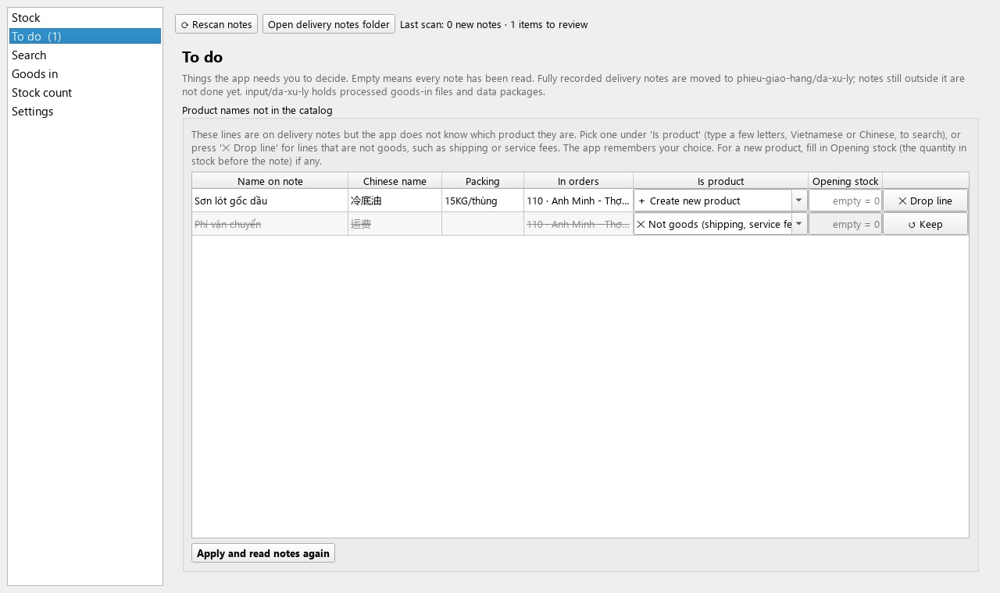
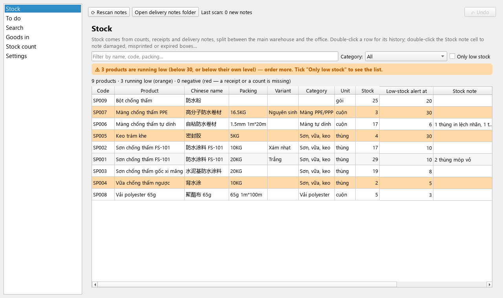
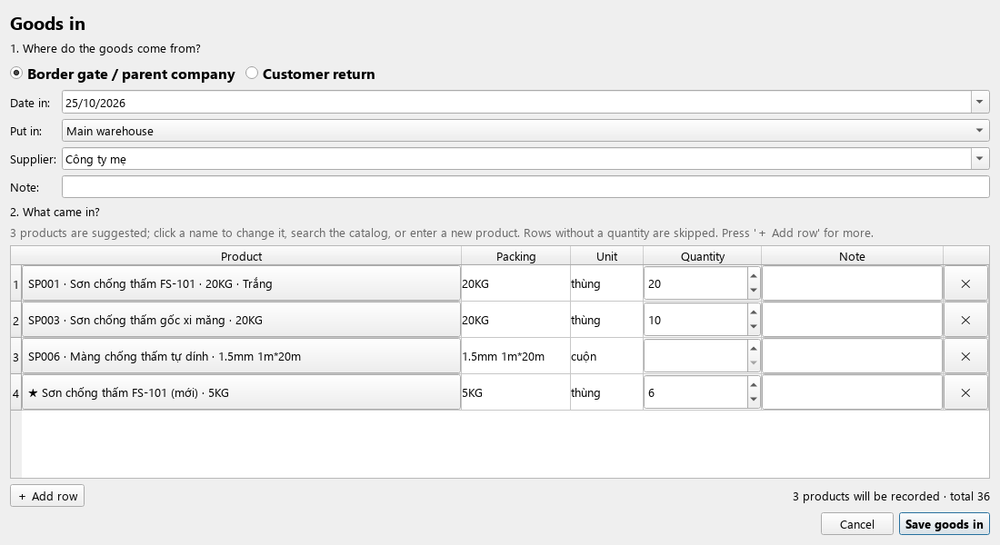
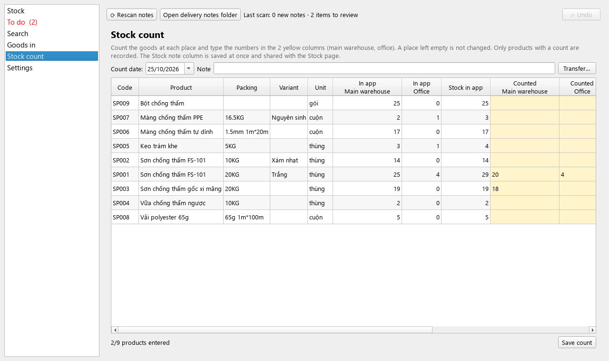
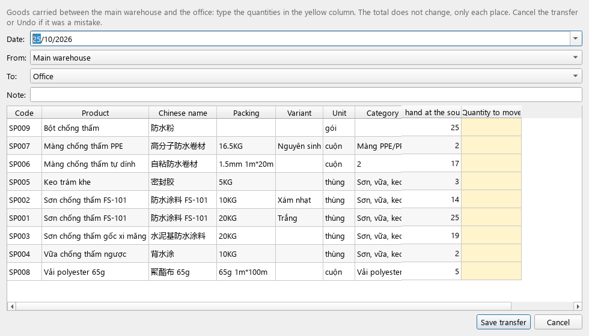
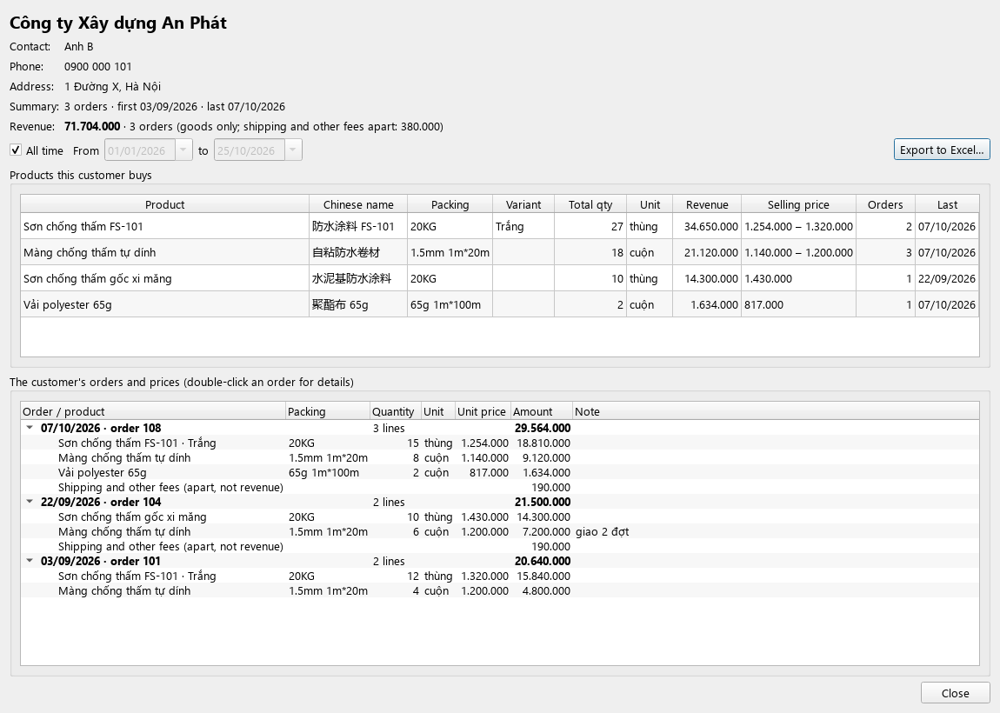
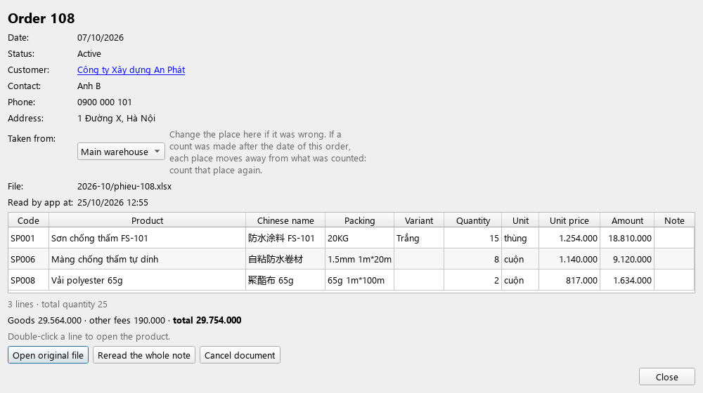
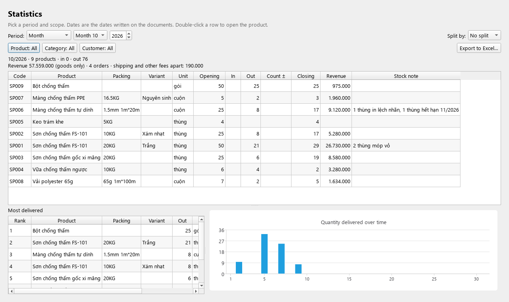

# DiBeKho user guide (detailed)

**English** · [Tiếng Việt](huong-dan-su-dung.md) · [中文](user-guide.zh.md) · [← Back to the main page](../README.md)

This guide goes step by step, using the exact button names on screen. Not installed yet? See [Download and install](../README.md#download-and-install).

> **Don't worry about mistakes.** Almost every action can be reversed with the **↶ Undo** button at the top right (see [section 11](#11-mistakes-undo-and-backups)).

**Contents**
1. [Getting to know the screen](#1-getting-to-know-the-screen)
2. [The first day](#2-the-first-day)
3. [Every day: reading delivery notes](#3-every-day-reading-delivery-notes)
4. [Stock, low stock and notes](#4-stock-low-stock-and-notes)
5. [Goods in](#5-goods-in)
6. [Counting stock at each place](#6-counting-stock-at-each-place)
7. [Moving goods between the main warehouse and the office](#7-moving-goods-between-the-main-warehouse-and-the-office)
8. [Customers, revenue and selling prices](#8-customers-revenue-and-selling-prices)
9. [Orders](#9-orders)
10. [Statistics and Excel export](#10-statistics-and-excel-export)
11. [Mistakes: Undo and backups](#11-mistakes-undo-and-backups)
12. [Product catalog and alert level](#12-product-catalog-and-alert-level)
13. [Moving to another computer](#13-moving-to-another-computer)
14. [Common situations](#14-common-situations)

---

## 1. Getting to know the screen

On the left are **6 items**. Click one to open it:

| Item | Used for |
|---|---|
| **Stock** | How much is left, where, and what is running low |
| **To do** | Things the app needs you to decide. A number in brackets, e.g. **To do (2)**, means something is waiting |
| **Search** | Find anything; opens the **Order list**, **Customer list**, **Statistics and Excel export** |
| **Goods in** | Record goods arriving |
| **Stock count** | Record what you counted; move goods between the two places |
| **Settings** | Language, text size, product catalog, backups, data transfer |

At the top are 3 buttons:
- **⟳ Rescan notes** (key **F5**): read new delivery notes.
- **Open delivery notes folder**: the folder to copy notes into.
- **↶ Undo** (right): go back to before the last action.

**Colours in the tables:**
- **Orange** + **⚠ Running low — order more**: the product is running low.
- **Red**: negative stock (usually a goods in or a stock count is missing).
- **Yellow**: cells for you to type in (Stock count, Transfer).

**Two places:** the app splits the stock between the **Main warehouse** and the **Office**. "Stock" is the total of both.

**Tips:**
- A long name is cut off? Hover over the cell, or drag the edge of the column header.
- Scrolling with the mouse wheel **never** changes a choice or a number.
- Text too small? **Settings → General → Text and button size**, choose 130% or 150%, then restart the app.

---

## 2. The first day

Do this once, in order.

**Step 1. Open the app for the first time.**
1. Choose the language.
2. Choose the **working folder**: the default `Documents/DiBeKho` is fine. Do **not** choose a folder in OneDrive, iCloud or Google Drive (cloud sync can damage the data).
3. Click **Start**. The app creates its sub-folders (see [section 14](#where-the-data-is)).

**Step 2. Bring your data in.** Choose **one** of these:

| You have | Do this |
|---|---|
| A `.dibekho` file exported from another computer running DiBeKho | Copy it into the `input/` folder → **To do** → **Import data**. Done; skip step 3 |
| The monthly stock spreadsheet (Excel) | **Stock** page → **Import catalog from Excel…** → choose the file → check the preview (double-click a cell to edit, untick rows you don't need) → keep **Use the stock in the file (column F)… as of** ticked and pick the date → **Import selected rows** |
| Nothing yet | Skip. Products are created as delivery notes are read ([section 3](#3-every-day-reading-delivery-notes)) |

> Stock imported from an Excel file counts as being in the **main warehouse**. If some goods are in the **office**, do step 3 too.

**Step 3. Opening count.** Open **Stock count**, count the goods at each place and type the numbers in the 2 yellow columns ([section 6](#6-counting-stock-at-each-place)). From now on the app matches the real stock.

**Step 4. (Recommended) Check the alert level.** By default the app warns when stock is **below 30**. If many products usually have only a few boxes, lower it or give products their own level ([section 12](#12-product-catalog-and-alert-level)).

---

## 3. Every day: reading delivery notes

Each delivery note (Excel file) **lowers** the stock. The app reads the product name, packing, quantity, note, unit price, amount and shipping fee on the note.

### 3.1. Copy the notes and scan

1. Click **Open delivery notes folder** and copy the day's notes into it (monthly sub-folders are fine).
2. Click **⟳ Rescan notes** (or **F5**). The app also scans each time it opens.
3. The top line shows how many new notes were read.
   - Notes fully recorded are **moved into** `phieu-giao-hang/da-xu-ly/`. A note still outside is **not finished**.
   - The same note dropped twice, renamed or moved: the app recognises it and **never subtracts it twice**.

### 3.2. Choose where each new order was taken from

A note does not say where the goods came from, so each new order shows in **To do → Orders without a place yet**.



1. Open **To do**.
2. In the **Taken from** column of each order, choose **Main warehouse** or **Office**.
3. Click **Save places**.

Until you choose, the goods are **taken from the main warehouse**, so the total is right at once. Chose wrong? Open the order ([section 9](#9-orders)) and change **Taken from**.

### 3.3. Lines the app does not recognise yet

The first time a product name appears, the app does not know which product it is. The note shows in **To do → Product names not in the catalog**, grouped by order. Every line of the order is shown (✓ = already recognised) so you can compare with the paper note.

In the **Is product** column of each line, choose:

| The line is | Choose |
|---|---|
| A product already in stock | One of the suggestions (2–3 closest products). Not there: **🔍 Choose another product…** and type a few letters (accents optional, Chinese works) |
| A new product | **＋ Create new product**. Type what was in stock **before this note** in **Opening stock** (empty = 0) |
| Shipping or service fee | **✕ Not goods…** (usually pre-selected). Its money is recorded as a **fee apart** of the order |
| Not sure | **⏸ Later (keep waiting)**. The other lines are recorded, this one waits |

Then click **Apply and read notes again**, read the summary and agree.

- The app **remembers**: next time it recognises that name by itself.
- The same name in several orders: choose it in one, the others follow.
- A wrong choice made long ago? See [section 14](#14-common-situations), "Wrong product chosen for a line long ago".

### 3.4. Other messages in To do

| Message | Meaning | Click |
|---|---|---|
| **Edited note** | A note already read was edited | **Use new version** or **Keep old version** |
| **File deleted/moved** | The note file is gone. Stock is **unchanged** | **Restore file** (the app keeps a copy), **Cancel document**, or **Ignore** |
| **Cannot read** | Not a delivery note, or information is missing | Read the reason; fix the file and rescan, or **Hide** |
| **Input folder** | A data package, an old goods-in file or a catalog file is waiting | **Import data** / **Review & import** |

---

## 4. Stock, low stock and notes



### 4.1. Reading the Stock table

Column order: Code, Product, Chinese name, Packing, Type/colour, Category, Unit, Stock, Low-stock alert at, Stock note, Main warehouse, Office, Last out.

| Column | Meaning |
|---|---|
| **Stock** | Total on hand (main warehouse + office) |
| **Low-stock alert at** | The alert level used for the product |
| **Stock note** | The product's own note (damaged, misprinted, expired boxes…); a narrow column, hover to read it in full |
| **Main warehouse**, **Office** | Stock at each place |
| **Last out** | Date of the last delivery |

- A product running low (below its alert level) is shaded **orange**; negative stock is **red**. The line at the top of the page says how many products are running low.
- The columns from Code through Stock **stay pinned** while you scroll the table sideways (drag the scrollbar under the table to see Main warehouse/Office/Last out without losing sight of the name and the total).
- The **Filter by name…** box finds products quickly. **Category** shows one group only.

### 4.2. Making the list to order

Tick **Only low stock**: only orange (running low) and red (negative) products remain. That is your list to order.

### 4.3. A note for a product

For things like "3 boxes misprinted", "2 boxes expire 12/2026", "1 roll torn".

1. **Double-click** the product's **Stock note** cell (or select it and start typing).
2. Type the note and press **Enter**. It is saved at once.
3. To clear it: double-click, delete the text, press Enter.

This note is **shared** with the note column on the Stock count page, and shows in the product window, Statistics, the Excel files, and **goes with the data package** to another computer.

### 4.4. A product's details

**Double-click** a row (anywhere except the note cell). The window shows:
- Current stock and **By place: Main warehouse … + Office …**, e.g. "Main warehouse 39 + Office 1".
- The stock note, if any.
- **History**: every delivery, goods in, count and transfer, with the place and the balance after each. Double-click a row to open that document.
- The **customers who take the most** of it, with revenue.

---

## 5. Goods in



1. Open **Goods in**, click **＋ Goods in…**.
2. Where the goods come from:
   - **Border gate / parent company**: type the supplier, or pick one used before.
   - **Customer return**: pick the customer, and the order if you know it.
3. Choose **Date in** and **Put in**: **Main warehouse** or **Office**.
4. Three products are suggested (what usually comes from this supplier, or what is running low). Type a **quantity** on each row; rows without a quantity are skipped.
   - Another product: click its name → **🔍 Choose a product from the catalog…**.
   - A brand-new product: click the name → **★ New product (not in the catalog)…**, fill in name and packing. It is created only when the receipt is saved.
   - More rows: **＋ Add row**. Remove a row: **✕** at its end.
5. Click **Save goods in**, read the summary and agree.

Result: the stock goes up at the chosen place, the receipt gets a code **HV001, HV002…**, and an Excel file of it is saved in `output/hang-ve/` (to print or send).

- A mistake: click **↶ Undo** right away, or select the receipt in the list → **Edit selected…** (the old one stays in the history as "replaced").
- Old goods-in files (the filled-in template) still import with **Choose a file to import…**.

---

## 6. Counting stock at each place

A stock count = count the real goods and record them. The app records only the **difference** between your count and its own number, so the history stays clear.



1. Open **Stock count**. Pick the **Count date** (the day you counted).
2. For each product there is:
   - **In app: Main warehouse / Office** and **Stock in app**: what the app has.
   - Two yellow columns **Counted: Main warehouse** and **Counted: Office**: type what you counted.
3. Fill only the places you counted. **An empty cell leaves that place as it is.** E.g. today you counted only the office: fill only the office column.
4. The **Difference** column updates at once; red means a difference.
5. (Optional) type a **Note** for the count, e.g. "end of month".
6. Click **Save count** and agree.

**Example:** the app has main warehouse 25, office 4. You count main warehouse 20, office 4. Type 20 and 4, save. The app records −5 at the main warehouse; the new stock is 24 (20 + 4).

- The **Stock note** column at the end is the same as on the Stock page: double-click to note damaged or expired boxes while counting. It is saved at once and does **not** clear the numbers you are typing.
- The app scans delivery notes before showing the numbers, so no note is counted twice.

---

## 7. Moving goods between the main warehouse and the office

For goods carried from one place to the other, e.g. 5 boxes of paint from the main warehouse to the office. **The total does not change**, only each place.



1. Open **Stock count**, click **Transfer…** (top right).
2. Choose the **Date**, **From** and **To** (always two different places).
3. **On hand at the source** shows what is there. Type the quantity in the yellow **Quantity to move** column for each product carried. The table also shows **Chinese name** and **Category**, to tell apart products that differ only in their Chinese name; the **On hand…** and **Quantity to move** columns stay pinned on the right while you scroll, so they are always easy to see and type into.
4. (Optional) type a **Note**.
5. Click **Save transfer**, read the summary and agree. Transfers get codes **CH001, CH002…**

The source does not have enough according to the app? You can still save, with a warning; that place goes negative until its next count.

To see or cancel a transfer: **Search → Order list**, set **Document type** to **Transfers**, double-click it → **Cancel document**.

---

## 8. Customers, revenue and selling prices

Prices come from the **unit price / amount** columns of the delivery notes.

- **Revenue counts the goods only.** Shipping and other fees are recorded **apart** and never added to revenue.
- A note without prices: the price cells stay empty (—) and do not count; the app says how many orders lack a price.
- The app has no purchase prices, so it **does not compute profit**.

### 8.1. A customer

1. **Search → Customer list** (or type a name or phone number in the Search box).
   The list has each customer's **Revenue**.
2. **Double-click** a customer. The window shows:
   - Contact details, number of orders, first and last order.
   - **Revenue**: goods total and number of orders; shipping and other fees apart next to it.
   - **Products this customer buys**: total quantity, **Revenue**, **Selling price** (one price, or "low – high" if it changed), times bought, last bought.
   - **The customer's orders and prices**: each order (newest first) open with every line's **Unit price** and **Amount**, then the fees apart (if any). Double-click an order for its details.



### 8.2. A period

1. In the customer window, **untick All time**.
2. Choose **From** … **to** …
3. Everything in the window (revenue, products, orders) covers that period only.

### 8.3. Excel file for one customer

Click **Export to Excel…** in the customer window. A file `KhachHang_<name>_<period>_….xlsx` is saved in `output/`, for the period chosen, with 2 sheets:
- **Orders**: each order (oldest first), every line with unit price and amount; **Goods of the order** in bold; fees apart in italics.
- **Products bought**: quantity, revenue, lowest and highest price, times bought.

Useful to send to the customer for checking, or to work out a salesperson's commission.

---

## 9. Orders

**Search → Order list**: every document, newest first.
- Filter by **Document type** (delivery notes, goods in, stock counts, transfers), dates, customer, product; tick **Include cancelled** to see cancelled ones.
- **Place** column: where goods were taken from / put in ("(?)" = not chosen yet). **Goods** and **Fees (apart)** columns.
- **Right-click an order** (an active delivery note) → **Reread the whole note**: see section 12.

**Double-click an order** for its details:



- Customer (click the name to open it), contact, phone, address.
- **Taken from**: change main warehouse / office if it was wrong. (If a count was made after the order's date, changing the place moves each place away from what was counted: count that place again.)
- Lines with **Unit price**, **Amount**; the line "Goods · other fees · total" (the total matches "Tổng cộng" on the paper note).
- **Open original file** (a read-only copy of the note), **Reread the whole note** (see section 12), **Cancel document** (gives the stock back, keeps the history).

> **Deleting a note file does not cancel it.** To drop an order, open it and click **Cancel document**.

---

## 10. Statistics and Excel export



1. **Search → Statistics and Excel export**.
2. Choose the **Period**: day, month, quarter, year or **Custom range**. A long period can be **Split by** day or month.
3. Narrow it with the **Product**, **Category** and **Customer** buttons (default: All).
4. For each product the table shows opening, in, out, count ±, closing, **Revenue** and **Stock note**. The line above it gives the **revenue of the period (goods only)** and the shipping and other fees apart. Below: the most delivered products and a chart.
5. Click **Export to Excel…**, choose the sheets, export. The file `ThongKe_….xlsx` is in `output/`; the app offers to open it.

The Excel file:

| Sheet | Content |
|---|---|
| **In-Out-Stock** | Each product: opening, in, out, count, closing, revenue, stock note |
| **Document lines** | Every in/out: date, type, code, customer, **place**, product, quantity, **unit price**, **amount**, note |
| **Customer x Product** | Total quantity, revenue, times bought |
| **Most delivered** | Ranking with revenue |

Choosing customers filters only the **out** quantities. Transfers between the two places are neither in nor out.

---

## 11. Mistakes: Undo and backups

**↶ Undo** (top right):
- Puts the data back **exactly as before** the last action. The action's name is on the button, e.g. "↶ Undo: Stock count".
- Click again to go further back, up to 20 steps.
- Works for: Apply in To do, places of orders, stock counts, transfers, goods in and its edits, cancelling, reading a note again, adding/editing/deleting products, stock notes, the alert level, data imports…

**Automatic backups:** every day when the app opens, the newest **10** are kept in `sao-luu/`, and anything over **30 days** old is dropped to save space (the app also tidies itself up every two weeks). In **Settings → Data transfer and backups**:
- **Back up now**.
- **Restore selected**: go back to that day's data.
- **Restore a deleted product…**: deleted a product by mistake? The app looks through the backups for one no longer in the catalog (it must still be in a backup from the last 30 days). If it was already re-created by hand, the app offers to **merge them into one** (every document moves onto the smaller code) or **keep them separate**.

**Start over:** **Settings → General → Reset data** (always backed up first):
- **Reset stock (keep products)…**: keeps the catalog and learned names; clears notes, goods in, counts, customers; reads every note again. The orders read again need their **places chosen again**.
- **Delete all data…**: the app as just installed.

Your own files (delivery notes, `input/`, `output/`, backups) are **never** deleted.

---

## 12. Product catalog and alert level

**Settings → Products**:

**Common alert level — Alert when stock is below** (default **30**):
- For every product **without** its own level. Stock **below** it turns the row orange with "⚠ Running low — order more".
- **0** turns it off.
- It goes with the data package to another computer.

**A product's own level:** select it → **Edit product…** → **Low-stock alert at**. E.g. 5 for something sold by the roll: at 5 or less it warns. A product's own level always wins over the common one.

**Other buttons:**
- **Add product**, **Edit product…** (or double-click a row): Vietnamese and Chinese name, packing, type/colour, unit, category.
- **Delete product**: only for products in no document. A product already used can be set *inactive* (hidden, old documents unchanged). Codes of deleted products are never given again.
- **Import catalog from Excel…**: add products from the monthly sheet.
- **Learned names on notes**: names the app has learned, grouped by order. Click an order to see them; **Forget and read again…** to choose the product for **one name** again.
- **Reread the whole note**: want to redo **every line** of an order at once instead of one at a time? Right-click its name here, in the Order list (section 9), or press the same button when an order is open. The app forgets the product match for every line of that order and reads it again from scratch; it (and any other active note sharing a name) shows up in To do to choose again. Old history stays, and ↶ Undo works if you change your mind.

---

## 13. Moving to another computer

Only **one computer** works at a time. Both must run the **latest version** (an older version cannot read a newer one's data).

**Option 1 — Data package (everything):** orders, customers, stock per place, notes, alert level, history…
1. Computer in use: **Settings → Data transfer and backups → Export data**. A `.dibekho` file appears in `output/`.
2. Send it (USB, chat app, email…) and copy it into the other computer's `input/` folder.
3. Other computer: **To do → Import data**. Its old data is backed up, then **replaced entirely**.

**Option 2 — Master data in Excel** (catalog, customers, stock, notes; **no** orders):
- **Export master data…** creates an Excel file with 3 sheets: Products, Customers, Stock. The **Stock** sheet has Stock, Main warehouse, Office and Stock note columns.
- Edit **Stock** or the **note** there if needed, then **Import master data…**: products keep their codes; the app's total stock becomes the file's (the difference at the main warehouse); notes are updated. The Main warehouse / Office columns are for reading only.
- When the app is unsure which product a stock row belongs to, it shows **Check the stock before importing**: yellow rows need you to check.

---

## 14. Common situations

| Situation | What to do |
|---|---|
| Just clicked something by mistake | **↶ Undo** |
| Wrong product chosen for a line long ago | **Settings → Products → Learned names on notes**: click the order, **Forget and read again…** on the wrong line. The note comes back in **To do** |
| Want to redo a whole order (several lines at once) | Right-click the order's name (Order list, Learned names on notes, or the order's own window) → **Reread the whole note** ([section 12](#12-product-catalog-and-alert-level)) |
| An order recorded by mistake | Open it → **Cancel document** |
| Wrong place for an order | Open it → change **Taken from** |
| Negative stock at one place | Usually the goods came from the other place, or a transfer was not recorded. Fix the order's place, record a **Transfer…**, or count that place |
| Negative total stock | A goods in or a stock count is missing |
| Too many "Running low" | Lower **Alert when stock is below**, or set products' own levels ([section 12](#12-product-catalog-and-alert-level)) |
| An order without prices (—) | The paper note has no unit price / amount. Fix the file, then **Use new version** in To do |
| A note file deleted by mistake | Stock unchanged. **To do → Restore file** |
| A product deleted by mistake | **↶ Undo** right away if you can; otherwise **Settings → Data transfer and backups → Restore a deleted product…** (section 11) |
| Go back to a day before | **Settings → Data transfer and backups**, choose the backup, **Restore selected** |
| Excel export says the file is open | Close the Excel file with that name and export again |

### Where the data is

All in one folder, by default `Documents/DiBeKho`:

```
DiBeKho/
├── phieu-giao-hang/   ← put delivery notes here
│   └── da-xu-ly/      ← notes fully recorded
├── input/             ← data packages from another computer, old goods-in files
│   └── da-xu-ly/      ← files already imported
├── output/            ← Excel exports, goods-in files (hang-ve/), data packages
├── sao-luu/           ← automatic backups
└── data/              ← the app's data (do not edit)
```

<sub>Screenshots use made-up data, not real customer data.</sub>
