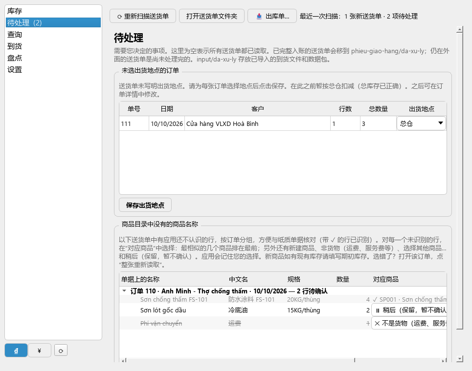
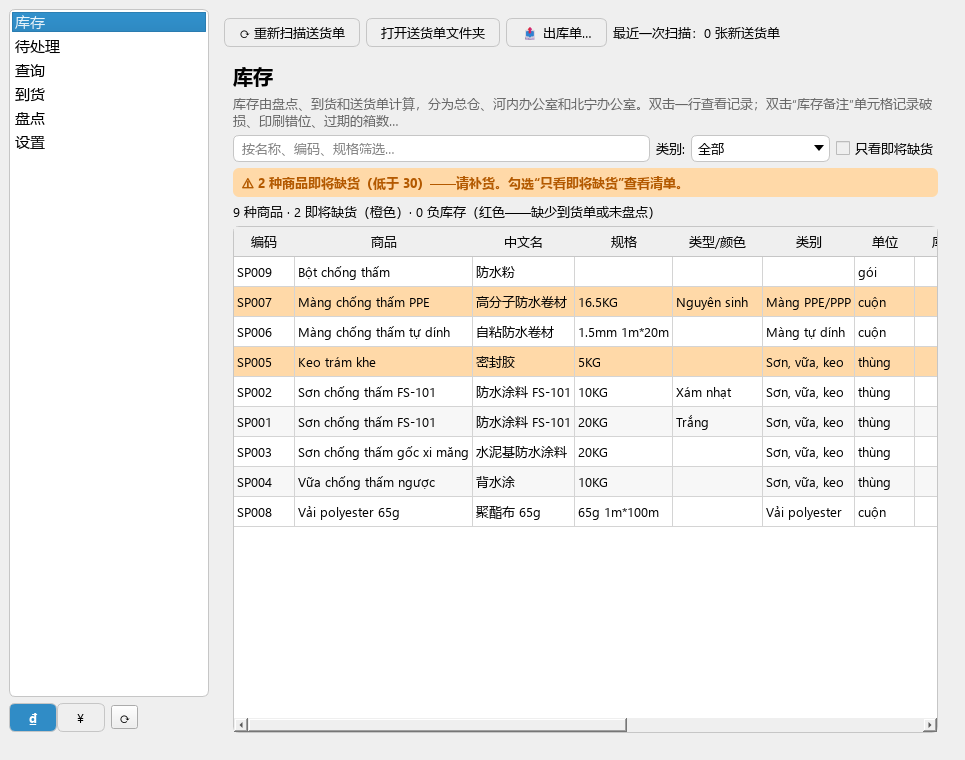
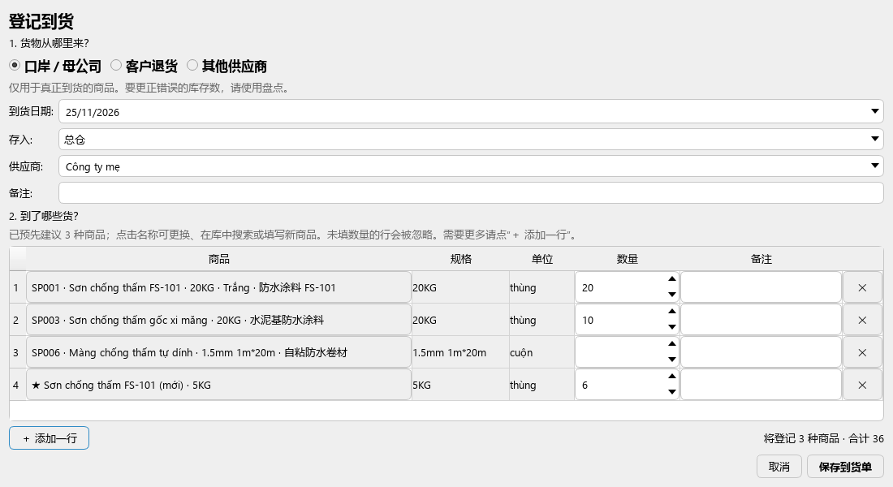
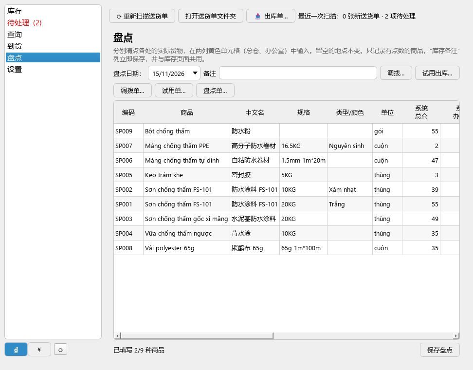
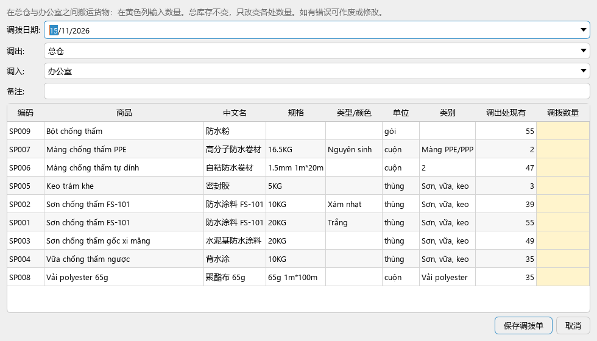
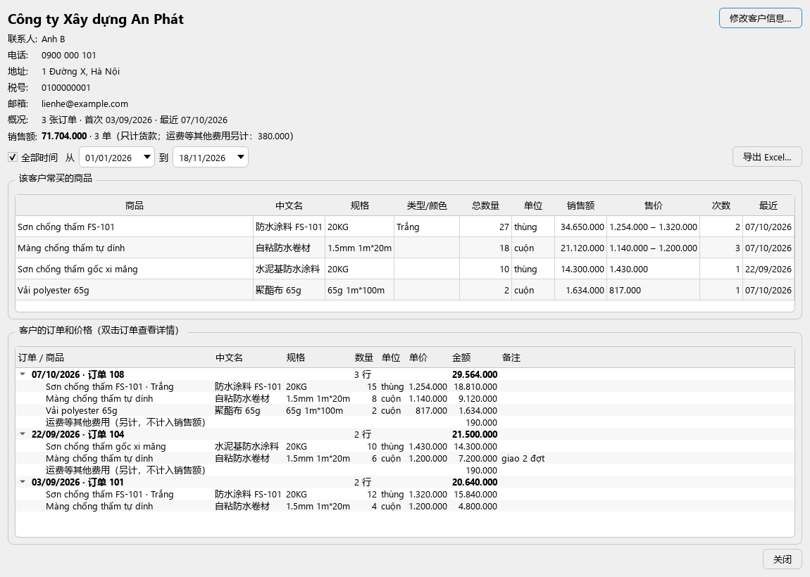
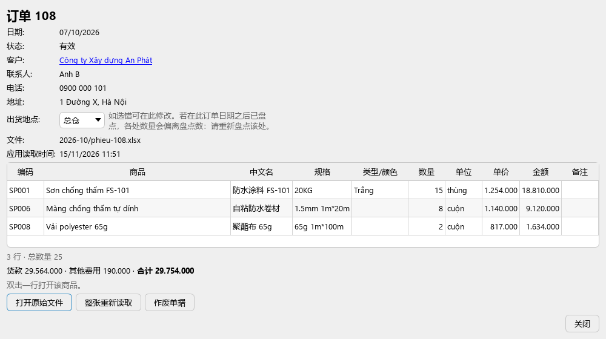
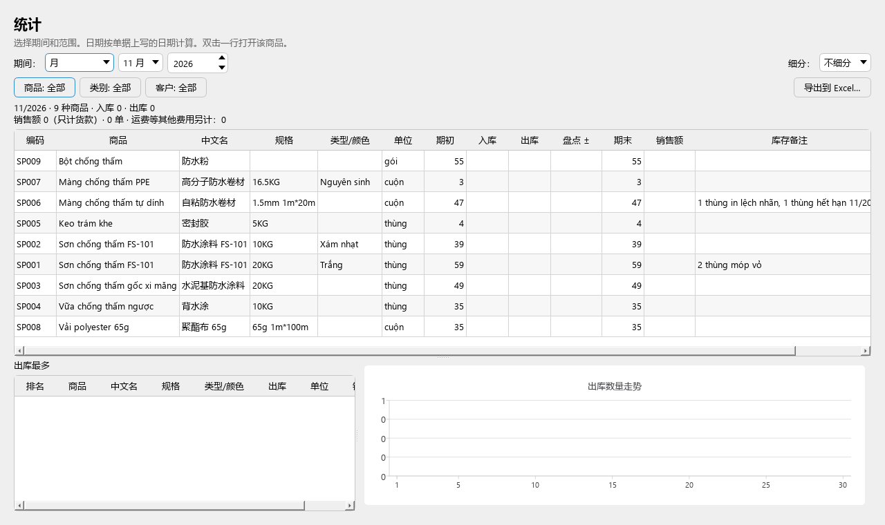

# DiBeKho 使用指南（详细版）

[English](user-guide.md) · [Tiếng Việt](huong-dan-su-dung.md) · **中文** · [← 返回主页](../README.zh.md)

本指南按步骤说明，按钮名称与界面一致。还没有安装？请看 [下载与安装](../README.zh.md)。

> **操作失误不用担心。** 商品选错了：**整张重新读取**；单据错了：**作废单据**（出库单：**修改出库单…** 或 **彻底删除**）后重新填写；应用每天还会自动备份（见 [第 11 节](#11-操作失误更正与备份)）。

**目录**
1. [认识界面](#1-认识界面)
2. [第一天](#2-第一天)
3. [每天：读取送货单](#3-每天读取送货单) · [出库单](#35-出库单) · [以越南盾或人民币显示金额](#36-以越南盾或人民币显示金额)
4. [库存、即将缺货与备注](#4-库存即将缺货与备注)
5. [到货](#5-到货)
6. [按存放处盘点](#6-按存放处盘点)
7. [总仓与各办公室之间调拨](#7-总仓与各办公室之间调拨) · [试用出库](#7b-试用出库)
8. [客户、销售额与售价](#8-客户销售额与售价) · [合并客户](#84-合并客户)
9. [订单](#9-订单)
10. [统计与 Excel 导出](#10-统计与-excel-导出)
11. [操作失误：更正与备份](#11-操作失误更正与备份)
12. [商品目录与提醒值](#12-商品目录与提醒值)
13. [转到另一台电脑](#13-转到另一台电脑)
14. [常见情况处理](#14-常见情况处理)
15. [账号与云端共享数据](#15-账号与云端共享数据)

---

## 1. 认识界面

左侧有 **6 个项目**，点击即可打开：

| 项目 | 用途 |
|---|---|
| **库存** | 还剩多少、在哪里、哪些即将缺货 |
| **待处理** | 需要您决定的事项。括号中有数字（如 **待处理 (2)**）表示有事项在等待 |
| **查询** | 查找任何信息；打开 **订单列表**、**客户列表**、**统计与 Excel 导出**；**商品目录** 标签 |
| **到货** | 登记到货 |
| **盘点** | 记录实点数量；在两处之间调拨 |
| **设置** | 语言、文字大小、已学习的单据名称、备份、数据迁移 |

顶部有 3 个按钮：
- **⟳ 重新扫描送货单**（**F5** 键）：读取新的送货单。
- **打开送货单文件夹**：打开存放送货单的文件夹。
- **📤 出库单…**：为客户开出库单（第 3.5 节）。
- **云端**状态栏（右侧）：是否已同步、哪些更改在等待。

**表格颜色：**
- **橙色** + **⚠ 即将缺货——请补货**：该商品即将缺货。
- **红色**：负库存（通常是缺少到货单或未盘点）。
- **黄色**：供您填写数字的单元格（盘点、调拨）。

**三个存放处：** 应用把库存分为 **总仓**、**河内办公室** 和 **北宁办公室**。“库存”是三处的合计。

**小技巧：**
- 名称太长被截断？把鼠标停在单元格上，或拖动列标题的边缘。
- 滚动鼠标滚轮 **不会** 改变任何选择或数字。
- 文字太小？**设置 → 常规 → 文字和按钮大小**，选择 130% 或 150%，然后重启应用。
- 新版本：从 0.5.7 起，应用打开时自动检查并询问 **现在更新吗？**（数据保持不变）。关闭或手动检查：**设置 → 常规 → 新版本**。

---

## 2. 第一天

只需做一次，按顺序进行。

**第 1 步：首次打开应用。**
1. 选择语言。
2. 选择 **工作文件夹**：默认的 `文档/DiBeKho` 即可。**不要** 选择 OneDrive、iCloud 或 Google Drive 中的文件夹（云同步可能损坏数据）。
3. 点击 **开始**。应用会创建各子文件夹（见 [第 14 节](#数据存放在哪里)）。
4. 用店主分配的账号和密码**登录**。应用会自动连接云端共享数据（见 [第 15 节](#15-账号与云端共享数据)）；本机已有自己的数据时，应用会先询问并先备份，然后改用云端数据。

**第 2 步：导入数据。** 任选 **一种**：

| 您手上有 | 操作 |
|---|---|
| 本店的数据已经在云端（第二台电脑、员工电脑、新电脑） | 无需操作：第 1 步登录后应用会下载共享数据。跳过第 2、3 步 |
| 另一台使用 DiBeKho 的电脑导出的 `.dibekho` 文件 | 复制到 `input/` 文件夹 → **待处理** → **导入数据**（仅限店主账号；会替换所有电脑的共享数据）。完成，跳过第 3 步 |
| 每月库存统计表（Excel） | **库存** 页面 → **从 Excel 导入商品目录…** → 选择文件 → 检查预览（双击单元格可修改，取消勾选不需要的行）→ 保持勾选 **把文件中的库存（F 列）作为应用的库存，截至日期** 并选择日期 → **导入所选行** |
| 什么都没有 | 跳过。读取送货单时会逐步建立商品（[第 3 节](#3-每天读取送货单)） |

> 从 Excel 文件导入的库存记在 **总仓**。如果办公室也有货，请完成第 3 步。

**第 3 步：期初盘点。** 打开 **盘点**，分别清点各处的实物，填入对应的黄色单元格（[第 6 节](#6-按存放处盘点)）。此后应用的数字与实际库存一致。

**第 4 步：（建议）检查提醒值。** 默认库存 **低于 30** 时提醒。如果很多商品通常只有几箱，请调低此值（[第 12 节](#12-商品目录与提醒值)）。

---

## 3. 每天：读取送货单

每张送货单（Excel 文件）都会 **减少** 库存。应用读取商品名称、规格、数量、备注、单价、金额和运费。

### 3.1. 复制送货单并扫描

1. 点击 **打开送货单文件夹**，把当天的送货单复制进去（可按月建子文件夹）。
2. 点击 **⟳ 重新扫描送货单**（或 **F5**）。每次打开应用也会自动扫描。
3. 顶部显示读取了多少张新单。
   - 已完成记录的送货单会被 **移入** `phieu-giao-hang/da-xu-ly/`。仍在外面的就是 **未完成** 的。
   - 同一张单放两次、改名或移动：应用能识别，**不会重复扣减**。

### 3.2. 为新订单选择出货地点

送货单上没有写货物从哪里出，所以每张新订单都会出现在 **待处理 → 未选出货地点的订单**。



1. 打开 **待处理**。
2. 在每张订单的 **出货地点** 列选择 **总仓**、**河内办公室** 或 **北宁办公室**。
3. 点击 **保存出货地点**。

选择之前，货物 **暂按总仓扣减**，所以总库存马上就是对的。选错了？打开该订单（[第 9 节](#9-订单)），修改 **出货地点**。

### 3.3. 应用尚未识别的商品行

第一次出现的商品名称，应用还不知道对应哪种商品。该送货单会出现在 **待处理 → 商品目录中没有的商品名称**，按订单分组，显示订单的所有行（✓ 表示已识别），方便与纸质单核对。

在每行的 **对应商品** 列中选择：

| 这一行是 | 选择 |
|---|---|
| 库中已有的商品 | 建议中的商品（2–3 个最接近的）。没有：**🔍 选择其他商品…**，输入几个字查找（可不输入声调，也支持中文） |
| 新商品 | **＋ 新建商品**。在 **期初库存** 中填写 **此单之前** 的库存（留空 = 0） |
| 运费、服务费 | **✕ 不是货物…**（通常已预选）。这一行的金额记为订单的 **另计费用** |
| 不确定 | **⏸ 稍后（保留，暂不确认）**。订单的其他行照常记录，这一行等待 |

然后点击 **应用并重新读取送货单**，查看汇总并确认。

- 应用会 **记住** 选择：下次遇到相同名称自动识别。
- 同一名称出现在多张订单中：在一张中选择，其他订单跟着改变。
- 很久以前选错了？见 [第 14 节](#14-常见情况处理)。

### 3.4. 待处理中的其他提示

| 提示 | 含义 | 点击 |
|---|---|---|
| **送货单已修改** | 已读取的送货单被修改过 | **使用新版本** 或 **保留旧版本** |
| **送货单已修改**，并提示 “có thể là ĐƠN KHÁC trùng mã” | 订单号相同，但客户不同，或日期与原订单相差很远：通常是另一张订单重复使用了单号 | **作为另一张订单导入**（原订单不变）。只有确实是修改原订单时才点 **使用新版本** |
| **盘点后才读取的订单** | 订单日期在盘点日之前（或当天），但软件在盘点之后才读取 | 盘点时货已出库：**保留盘点数**（避免重复扣减）。货在盘点之后才出库：**另外扣减此订单** |
| **文件已删除/移动** | 文件不见了，库存 **不变** | **恢复文件**（应用保存了副本）、**作废单据** 或 **忽略** |
| **无法读取** | 不是送货单，或缺少信息 | 查看原因；修改文件后重新扫描，或 **隐藏** |
| **input 文件夹** | 有数据包、旧到货文件或商品目录文件等待导入 | **导入数据** / **查看并导入** |


### 3.5. 出库单

给客户发货但还没有送货单文件时使用：由软件替您生成单据。

1. 点击顶部的 **📤 出库单…**。
2. 从列表中选择客户（电话、联系人、地址、税号、邮箱自动填写）。输入客户名称的几个字母（不带声调也可以，输入部分电话号码也可以），框下方会列出匹配的客户供选择。或点击 **＋ 新客户…** 填写新客户的全部信息：名称、电话、联系人、地址、**税号**、**邮箱**。如果名称或电话与已有客户相同，应用会询问是否选择该客户。保存单据时新客户加入列表；税号和邮箱会印在单据上。
3. 每一行：点击选择货品，然后填写 **从总仓取货**、**从河内办公室取货** 和/或 **从北宁办公室取货** 的数量（多处都取就多格都填）。**现有** 列显示每处的库存；超出现有数量时数字变红。同一货品按**两种价格**卖（数量不同价格不同）？把它填在**两行**，每行一个价格。**目录中还没有的货品**：点货品格 → **★ 新商品（库中没有）…**，填写名称、规格、单位。保存后它会加入商品目录，库存变成**负数**；到货后在 **到货** 中登记（选择这同一件商品），库存会自动平衡。如果名称看起来和已有商品相同，应用会询问是否改用已有商品，避免重复。
4. **单价** 按该客户最近一张订单自动填写（新客户：按该货品最近一张订单）。价格不同可以修改。左下角开关在 **¥** 时，该列显示 **单价（¥）**：按人民币填写。该单据保存为**人民币单据**：Excel 文件中的单价和合计以 ¥ 记录（大写金额为“… NHÂN DÂN TỆ”），销售额计入人民币部分。保存前的确认框显示 ¥ 金额及约合 ₫。越南语和中文界面都一样，只要开关在 **¥**。修改已保存的单据时，单据保持保存时的币种，与开关无关。
5. 点击 **保存** → 核对 → **是**。库存 **立即** 扣减，订单出现在 **订单** 和客户营业额中。

软件会生成 Excel 文件 `output/phieu-xuat/PhieuXuat_A160.xlsx`，可打印或发送。单号为 **A** + 最大订单号的下一个数字（最近的订单是 159，新出库单就是 **A160**）；在网页上生成的出库单以 **W** 开头（W160）。文件 **与送货单格式完全相同**：公司名称和地址（取自软件最近读取的送货单）、客户信息、7 列（编号 · 商品全名 · 规格 · 数量 · 单价 · 金额 · 备注）、大写总金额、签字栏，只是标题为 **出库单 PHIẾU XUẤT KHO**。取货地点不打印在单据上，由软件记住。把该文件（或其副本）再放回送货单文件夹 **不会重复扣减**，顶部栏下方会提示"…是已读单据的副本"。在 Excel 中修改文件（例如数量）后放回文件夹，软件会像送货单一样询问 **是否替换为新版本？**；如果改了从两处取货的商品数量，软件会重新询问取货地点。在网页上（使用云端时）用 **店主账号** 保存的出库单会立即扣减库存（单号 W…）；用员工账号只生成文件，要把文件放进送货单文件夹并点 **⟳ 重新扫描送货单** 后才扣减库存。操作有误：在订单详情中 **作废单据**。对于出库单（单号 A… 或 W…），点作废单据后软件还会询问 **是否彻底删除？**：选“是”则单据消失、库存恢复，该单号将用于下一张出库单，季末统计营业额时订单号不会有空缺。

**修改已开的出库单**（单价、数量、商品、客户）：在 **订单** 中打开该单 → **修改出库单…** → 像开单时那样修改 → **保存**。单号不变（A160 仍是 A160），库存重新计算，Excel 文件重新生成；旧文件保存在 `output/phieu-xuat/da-sua`。只有本应用或网页开的单据（单号 **A…**、**W…**）可以修改；店里自己的送货单请在 Excel 文件中修改后让应用重新读取。

**草稿**（客户尚未确认）：按上述步骤填写，然后点击 **保存草稿** 而不是“保存”。软件只生成 Excel 文件 `output/phieu-xuat/nhap/PhieuXuat_NHAP_N1.xlsx`（标题写有 **(NHÁP)**，单号 N1、N2…）：**不扣库存，不计营业额**，也不添加新商品。客户确认后：**📤 出库单…** → **从草稿出库…** → 选择草稿文件。窗口打开草稿的内容，需要时修改，然后点击 **保存**：成为正式出库单（新的 A… 单号，扣库存，计营业额），草稿文件移到 `output/phieu-xuat/nhap/da-chot`。若要继续修改，再次点击 **保存草稿**（单号 N 不变）。草稿文件误放进送货单文件夹也不会记入库存，**待处理** 中会提示这是草稿。

### 3.6. 以越南盾或人民币显示金额

左下角有 **₫ | ¥** 开关。点 **¥**：应用中的所有金额（销售额、单价、金额、统计、订单详情、客户详情…）按**当前市场汇率**以人民币显示，旧订单也一样。点 **₫** 恢复越南盾。数据和导出的文件（统计 Excel、数据包）仍为越南盾。只有在显示 ¥ 时开的**出库单**是人民币单据：按人民币填写单价，单据文件也以 ¥ 记录（第 3.5 节）。开关下方显示正在使用的汇率及其时间；显示 ¥ 时应用每 10 分钟自动获取新汇率，点 **⟳** 或 **⟳ 重新扫描送货单**（F5）时也会获取。汇率仅供参考（不是银行买入/卖出价）；没有网络时使用上次获取的汇率。网页（使用云端时）在同一位置也有这个开关。

**以人民币销售的订单。** 送货单的价格为人民币时（价格单元格为 CNY/¥ 格式，或大写合计写明“人民币 / nhân dân tệ”），应用将其识别为**人民币订单**：金额保持单据上的数字并带 **¥**，括号内为按读取单据时的汇率折算的越南盾约数，例如 `¥4.800 (≈ 17.280.000 ₫)`。人民币销售额**单独合计**，不与越南盾相加：`2.100.000 ₫ + ¥4.800 (≈ 19.380.000 ₫)`。**订单**页中越南盾订单和人民币订单的货款分列在**货款（越南盾）**和**货款（人民币）**两列；用**币种**筛选，可只看越南盾订单或人民币订单。该期间有人民币订单时，导出的 Excel 会多一列**收入 (¥)**。从人民币订单退回的货物从人民币销售额中扣除。

---

## 4. 库存、即将缺货与备注



### 4.1. 看懂库存表

列的顺序：编号、商品、中文名称、规格、类型/颜色、类别、单位、库存、库存备注、总仓、河内办公室、北宁办公室、最近出库。

| 列 | 含义 |
|---|---|
| **库存** | 现有合计（总仓 + 河内办公室 + 北宁办公室） |
| **库存备注** | 该商品的备注（破损、印刷错位、过期的箱数…）；列较窄，鼠标悬停可看全文 |
| **总仓**、**河内办公室**、**北宁办公室** | 各处数量 |
| **最近出库** | 最近一次送货日期 |

- 即将缺货（低于提醒值）的商品显示**橙色**；负库存显示**红色**。页面顶部一行说明有多少商品即将缺货。
- **库存** 一列在左右拖动表格**滚动过它之后会固定在左边**（拖动表格下方的滚动条即可在仍看到合计库存的同时查看总仓/河内办公室/北宁办公室/最近出库）。
- **筛选** 框可快速查找。**类别** 只看一组。

### 4.2. 列出需要补货的商品

勾选 **只看即将缺货**：表格只剩橙色（即将缺货）和红色（负库存）的商品，这就是补货清单。

### 4.3. 给商品写备注

例如：“3 箱印刷错位”、“2 箱 2026 年 12 月过期”、“1 卷边缘破损”。

1. **双击** 该商品的 **库存备注** 单元格（或选中后直接输入）。
2. 输入备注，按 **Enter**，立即保存。
3. 删除备注：双击，删掉文字，按 Enter。

此备注与盘点页面的备注列 **共用**，并显示在商品详情、统计和 Excel 文件中，还会 **随数据包** 转到其他电脑。

### 4.4. 查看商品详情

**双击** 一行（备注单元格除外）。窗口显示：
- 当前库存和 **按存放处：总仓 … + 河内办公室 … + 北宁办公室 …**，例如“总仓 39 + 河内办公室 1 + 北宁办公室 0”。
- 库存备注（如有）。
- **出入库历史**：每次送货、到货、盘点、调拨，含存放处及之后的结存。双击一行可打开该单据。
- **购买最多的客户** 及销售额。

---

## 5. 到货



1. 打开 **到货**，点击 **＋ 登记到货…**。
2. 选择货物来源：
   - **口岸 / 母公司**：输入供应商名称，或选择用过的名称。
   - **客户退货**：选择客户，知道的话再选退货的订单号。“退货单价”一栏会自动填入客户的购买价（按所选订单，未选则按最近一次购买）；退款金额不同时可修改，留空则不从销售额中扣除。
   - **其他供应商**：输入供应商名称，或点击下方显示的最近使用的 3 个名称之一。
3. 选择 **到货日期** 和 **存入**：**总仓**、**河内办公室** 或 **北宁办公室**。
4. 应用预先建议 3 种商品（该供应商常到的商品，或即将缺货的商品）。在每行填写 **数量**；没有数量的行会被忽略。
   - 换商品：点击名称 → **🔍 从库存中选择商品…**。搜索框可输入**任意几个词，不必带越南文声调或连字符**，例如 `fs101 xam 10kg`；规格、类型/颜色、中文名和库存各有一列，便于区分同名商品。只剩一个匹配时按 Enter 即可选中。
   - 全新商品：点击名称 → **★ 新商品（库中没有）…**，填写名称和规格。保存到货单时才创建。
   - 加行：**＋ 添加一行**。删行：行末的 **✕**。
   - 填完一个数量后按 **Enter** 跳到下一行（Enter 不会保存）。
   - 选了另一行已有的商品：软件会立即提示并跳到那一行。
5. 点击 **保存到货单**，查看汇总并确认。
   - 供应商一栏是**货物的来源**（口岸、母公司），不是“总仓”。**要更正错误的库存数，请用盘点**，不要用到货。

填写途中必须关闭窗口（例如去 查询 → 商品目录 改商品名称）？未保存的到货单**会被保留**：下次点 **＋ 登记到货…** 并选 **是** 即可继续。保留到关闭软件为止。

结果：所选地点库存增加，到货单编号 **HV001、HV002…**，并在 `output/hang-ve/` 保存一个 Excel 文件（可打印或发送）。

- 填错了：在列表中选中该单 → **修改所选…**（旧单在历史中标为“已替换”）。
- 旧格式到货文件（已填写的模板）仍可用 **选择要导入的文件…** 导入。

---

## 6. 按存放处盘点

盘点 = 清点实物并记录。应用只记录实点数与系统数的 **差额**，历史清晰。



1. 打开 **盘点**，选择 **盘点日期**（清点的那天）。
2. 在 **盘点地点：** 中选择正在盘点的地点：**总仓**、**河内办公室** 或 **北宁办公室**。每处单独盘点。
3. 每种商品有：
   - 越文名称旁的 **中文名称** 列，方便区分同名但不记得编码的商品。
   - **系统：<盘点地点>**：应用当前的数字。
   - 黄色 **实点：<盘点地点>** 列：填写您点到的数量。
4. 只填写已清点的商品。**留空的商品保持不变。**
5. **差额** 列立即更新，红色表示有差异。
6. （可选）填写本次盘点的 **备注**，例如“月底盘点”。
7. 点击 **保存盘点** 并确认。

在未保存时更改 **盘点地点：**？应用会询问是否清空已填的数字（提示中写明地点）。同意后这些数字被清空。

**例子：** 系统显示总仓 25。在 **盘点地点：** 选 **总仓**，填 20，保存。应用在总仓记 −5；新库存为 20。然后选 **盘点地点：北宁办公室** 去盘点那里。

- 表格末尾的 **库存备注** 列与库存页面相同：盘点时双击即可记录破损或过期的箱数。立即保存，**不会** 清掉正在填写的数字。
- 显示数字前应用会先扫描送货单，避免重复计算。
- 顶部的 **调拨单…** 和 **盘点单…** 两个按钮可打开以往记录的列表（双击查看）。

---

## 7. 总仓与各办公室之间调拨

把货物从一处搬到另一处时使用，例如从总仓搬 5 箱涂料到河内办公室。**总库存不变**，只改变各处数量。



1. 打开 **盘点**，点击右上方的 **调拨…**。
2. 选择 **调拨日期**、**调出** 和 **调入**（两处总是不同，可以是三处中的任意两处）。
3. **调出处现有** 列显示现有数量。在黄色 **调拨数量** 列中为搬走的商品填写数量。表格还加了 **中文名称** 和 **类别** 两列，方便区分只有中文名称不同的商品；**调出处现有** 和 **调拨数量** 两列会固定在右边，拖动表格时也方便查看和输入数字。
4. （可选）填写 **备注**。
5. 点击 **保存调拨单**，查看汇总并确认。调拨单编号 **CH001、CH002…**

系统显示调出处数量不足？仍可保存，但会先提示；该处将为负数，直到下次盘点。

查看、编辑或作废调拨单：**盘点 → 调拨单…**（或 **查询 → 订单列表**，**单据类型** 选 **调拨单**）。双击查看详情，有 **编辑…** 按钮（重新打开以修改商品/数量，旧单据保留在历史中）和 **作废单据**；列表中还有 **编辑所选…** 按钮，可直接编辑选中的那一行。

### 7b. 试用出库

用于拆开/拿出去试用、测试，**不卖给客户** 的货品——不用再自己开一张假送货单来扣库存。此数量统计中 **不算** 销售出库。

1. 进入 **盘点**，点击 **试用出库…**（在调拨按钮旁）。
2. 选择 **出库日期** 和 **出库地点**（总仓、河内办公室或北宁办公室）。
3. 在黄色 **试用数量** 栏为每个商品输入数量。（可选）输入 **备注** 说明试用原因。
4. 点击 **保存试用单**，确认汇总后同意。单号为 **DT001、DT002…**

数量或商品输错了？打开该单据（订单详情）点击 **作废单据**，再重新登记一张。

查看试用单：**盘点 → 试用单…**（或 **查询 → 订单列表**，**单据类型** 选 **试用单**）。

---

## 8. 客户、销售额与售价

价格取自送货单的 **单价 / 金额** 列。

- **销售额只计货款。** 运费和其他费用 **另计**，不计入销售额。
- **客户退货会从销售额中扣除**（按退货单价，计入退货当天）。软件会注明“已扣除客户退货：……”。作废退货单后，销售额会加回。
- 送货单上没有价格：价格格留空（—），不计入销售额；应用会提示有多少单缺价格。
- 应用没有进价，所以 **不计算利润**。

### 8.1. 查看客户

1. **查询 → 客户列表**（或在查询页面的搜索框输入名称、电话）。
   列表中有每位客户的 **销售额**。
2. **双击** 一位客户。窗口显示：
   - 联系信息（联系人、电话、地址、**税号**、**邮箱**）、订单数、第一单和最近一单。点击右上角的 **修改客户信息…** 进行修改。修改过的信息会保留：之后读取的单据只填写空白项。以前的客户没有税号和邮箱，直到您补上或新单据上写有（新的送货单模板有 **MST 税号** 和 **email 邮箱** 两格）。
   - **销售额**：货款合计、订单数；旁边另列运费等其他费用。
   - **该客户常买的商品**：总数量、**销售额**、**售价**（一个价格，或价格变动时显示“最低 – 最高”）、购买次数、最近购买。
   - **客户的订单和价格**：每张订单（最新在前）展开显示每行的 **单价**、**金额**，以及另计费用（如有）。双击订单查看详情。



### 8.2. 查看某段期间

1. 在客户窗口中 **取消勾选 全部时间**。
2. 选择 **从** … **到** …
3. 窗口中的所有内容（销售额、商品、订单）只统计该期间。

### 8.3. 导出某位客户的 Excel

在客户窗口点击 **导出 Excel…**。文件 `KhachHang_<名称>_<期间>_….xlsx` 保存在 `output/`，按当前所选期间，共 2 页：
- **订单**：每张订单（从旧到新），每行含单价、金额；**订单货款** 行加粗；另计费用行为斜体。
- **所购商品**：数量、销售额、最低价、最高价、购买次数。

可发给客户核对，或用于计算销售员提成。

### 8.4. 合并客户

用于整理重复或不需要的客户——例如在试用出库功能上线前，用来自己扣库存试用货品的虚构“客户”（见 [7b 节](#7b-试用出库)）。将它们都合并成一个共用客户，例如“DiBeKho 办公室”。

1. **查询 → 客户列表。**
2. 选择 2 个以上客户（点击时按住 **Ctrl**（Windows）、**⌘ Command**（Mac）或 **Shift**），然后点击 **合并客户…**。
3. 输入合并后的客户名（例如“DiBeKho 办公室”）或选择列出的某个名字，再点击 **保存**。
4. 确认汇总后同意。所选客户的所有订单都会转到合并后的客户名下；旧客户会被删除（订单和历史保持不变）。

合并后无法再拆分：请先核对。

---

## 9. 订单

**查询 → 订单列表**：所有单据，最新在前。
- 可按 **单据类型**（送货单、到货单、盘点单、调拨单）、日期、客户、商品筛选；勾选 **包括已作废** 可看已作废的单据。
- **存放处** 列：出货 / 存入地点（“(?)” = 尚未选择）。越南盾订单的货款在 **货款（越南盾）** 列，人民币订单的在 **货款（人民币）** 列（附 ≈ ₫ 约数）；**另计费用** 列。用 **币种** 筛选可只看越南盾订单或人民币订单。
- **在订单上点右键**（生效中的送货单）→ **整张重新读取**：见第 12 节。

**双击订单** 查看详情：



- 客户（点击名称打开客户）、联系人、电话、地址。
- **出货地点**：选错时可在此改为总仓 / 河内办公室 / 北宁办公室。（如果在订单日期之后已盘点，修改地点会使各处数量偏离盘点数：请重新盘点该处。）
- 明细行含 **单价**、**金额**；“货款 · 其他费用 · 合计”一行（合计与纸质送货单上的“Tổng cộng”一致）。
- **打开原始文件**（只读副本）、**整张重新读取**（见第 12 节）、**作废单据**（退回库存，保留历史）。

> **删除送货单文件并不能作废单据。** 要取消订单，请打开订单并点击 **作废单据**。

---

## 10. 统计与 Excel 导出



1. **查询 → 统计与 Excel 导出**。
2. 选择 **期间**：日、月、季度、年或 **自定义范围**。较长期间可按日或月 **细分**。
3. 用 **商品**、**类别**、**客户** 按钮缩小范围（默认：全部）。
4. 表格按商品显示期初、入库、出库、盘点 ±、期末、**销售额** 和 **库存备注**。表格上方显示 **该期间销售额（只计货款）** 以及另计的运费等其他费用。下方是出库最多的商品和图表。
5. 点击 **导出到 Excel…**，选择需要的工作表并导出。文件 `ThongKe_….xlsx` 在 `output/`，应用会询问是否打开。

Excel 文件包含：

| 工作表 | 内容 |
|---|---|
| **进出存** | 每种商品：期初、入库、出库、盘点、期末、销售额、库存备注 |
| **单据明细** | 每次出入库：日期、类型、单号、客户、**存放处**、商品、数量、**单价**、**金额**、备注 |
| **客户 x 商品** | 总数量、销售额、购买次数 |
| **出库最多** | 排名及销售额 |

选择客户时只筛选 **出库** 数量。两处之间的调拨不算入库也不算出库。

---

## 11. 操作失误：更正与备份

应用不再有撤销按钮。出错时在原处更正：
- 某张订单的商品选错：打开订单 → **整张重新读取**（只重新读取这一张）。
- 订单、到货、调拨、试用、盘点录错：打开单据 → **作废单据**（或**修改**）后重新填写。出库单：**修改出库单…**（单号不变），或 **作废单据 → 彻底删除**，单号会被重新使用。
- 商品改错：再次 **修改商品…**。

**自动备份：** 每天打开应用时备份，保留最近 **10** 份在 `sao-luu/`，超过 **30 天** 的会自动删除以节省空间（应用每两周还会自动整理一次）。在 **设置 → 数据迁移与备份** 中：
- **立即备份**。
- **恢复所选备份**：回到那一天的数据。⚠ 会替换 **所有电脑** 的共享数据：仅限店主账号，需要联网（第 15 节）。
- **恢复已删除的商品…**：不小心删除了某个商品？应用会在备份中查找目前商品目录里已经没有的商品（必须还在最近 30 天内的某个备份中）。如果您已经手动重新建立过该商品，应用会询问是 **合并为一个**（所有单据转到较小的编号）还是 **分开保留**。

**重新开始：** **设置 → 常规 → 重置数据**（总是先备份；仅限店主账号，对 **所有电脑** 生效）：
- **重置库存（保留商品）…**：保留商品目录和已学习的名称；清除送货单、到货、盘点、客户；立即重新读取所有送货单。重新读取的订单需要 **重新选择出货地点**。
- **删除全部数据…**：应用恢复到刚安装时的状态。

您自己的文件（送货单、`input/`、`output/`、备份）**永远不会** 被删除。

---

## 12. 商品目录与提醒值

**查询 → 商品目录**（查询页面的第二个标签，占满整页；按 **Ctrl+F**（Mac：**⌘F**）回到搜索框）：

**通用提醒值 — 库存低于此数时提醒**（默认 **30**）：
- 适用于 **所有商品**。库存 **低于** 此数时该行变橙色并提示“⚠ 即将缺货——请补货”。
- 设为 **0** 则关闭。
- 此值随数据包转到其他电脑。

**其他按钮：**
- **添加商品**、**编辑商品…**（或双击一行）：越南文名、中文名、规格、类型/颜色、单位、类别。**新增商品** 时，如果看起来和已有商品是同一件（比对越南文名、中文名、规格），应用会先询问再创建，避免重复。在待处理中选择“新建商品”或录入到货时也会出现同样的提示。
- **合并重复商品…**：如果同一个商品被录入了两次，先选中其中一行，点此按钮，再在列表中选另一个。所有单据、库存和已学名称都会转到编码较小的商品，另一个消失。合并后无法再拆分。
- **删除商品**：只能删除未出现在任何单据中的商品。已使用的商品可设为 *停用*（隐藏，旧单据不变）。已删除商品的编号永不重复使用。
- **从 Excel 导入商品目录…**：从月度统计表添加商品。
- **已学习的单据名称**：应用学过的名称，按订单分组。点击订单查看；**忘记并重新读取…** 可为**某一个名称**重新选择商品。
- **整张重新读取**：想一次性重新选择**一整张订单的所有行**，而不是一行一行来？在这里、在订单列表（第 9 节），或打开订单时按同名按钮，在订单名称上点右键即可。应用会忘记该订单每一行的商品匹配，**只重新读取这一张订单**；它会出现在待处理中等您重新选择，其他订单保持不变。旧的历史记录保留。（对某个名称点“忘记并重新读取…”则会重新读取含该名称的**所有**订单。）

---

## 13. 转到另一台电脑

**增加电脑、更换电脑、给员工用的电脑：** 安装应用（与其他电脑相同的最新版本）并 **登录**。应用会从云端下载全部共享数据，包括原始送货单，无需复制任何文件。多台电脑可以同时工作（第 15 节）。

**方法 1 — `.dibekho` 数据包（最完整）：** 订单、客户、各处库存、备注、提醒值、历史… 用于存档，或导入从未使用云端的电脑的数据。
1. **设置 → 数据迁移与备份 → 导出数据**。`output/` 中出现 `.dibekho` 文件。
2. 导入：把文件复制到 `input/` 文件夹 → **待处理 → 导入数据**。⚠ **所有电脑** 的共享数据会被数据包 **全部替换**：仅限店主账号，应用会先询问、先备份，需要联网。

**方法 2 — Excel 基础数据**（商品目录、客户、库存、备注；**不含** 订单）：
- **导出基础数据…** 生成 3 页的 Excel 文件：商品、客户、库存。**库存** 页有库存、总仓、河内办公室、北宁办公室和库存备注列。旧版导出的文件（只有一列办公室）仍可导入。
- 如需要，修改库存页中的 **库存** 或 **备注**，然后 **导入基础数据…**：商品保留编号；应用的总库存等于文件中的数字（差额记在总仓）；备注会更新。总仓、河内办公室、北宁办公室列仅供查看。
- 应用不确定某行库存属于哪个商品时，会显示 **导入前核对库存**：黄色行需要您检查。

---

## 14. 常见情况处理

| 情况 | 处理方法 |
|---|---|
| 刚给某张订单选错商品 | 打开订单 → **整张重新读取** |
| 很久以前为某行选错了商品 | **设置 → 已学习的单据名称**：点击订单，在错误的行上点 **忘记并重新读取…**。该单会回到 **待处理** 重新选择 |
| 想一次性重新选择一整张订单（多行一起） | 在订单名称上点右键（订单列表、已学习的单据名称，或订单详情窗口）→ **整张重新读取**（[第 12 节](#12-商品目录与提醒值)） |
| 某张订单记错了 | 打开订单 → **作废单据** |
| 出货地点选错 | 打开订单 → 修改 **出货地点** |
| 某处库存为负 | 通常货物实际从另一处出，或没有登记调拨。修改订单的出货地点、登记 **调拨…**，或盘点该处 |
| 总库存为负 | 缺少到货单或未盘点 |
| 太多“即将缺货” | 调低 **库存低于此数时提醒**（[第 12 节](#12-商品目录与提醒值)） |
| 订单没有价格（—） | 纸质送货单没有单价 / 金额。修改文件后在待处理中点 **使用新版本** |
| 误删了送货单文件 | 库存不变。**待处理 → 恢复文件** |
| 不小心删除了某个商品 | 用 **设置 → 数据迁移与备份 → 恢复已删除的商品…**（第 11 节） |
| 想回到之前某一天 | **设置 → 数据迁移与备份**，选择备份，**恢复所选备份** |
| 导出 Excel 提示文件已打开 | 关闭同名的 Excel 文件后重新导出 |
| 待处理提示无法读取数量（“không đọc được số lượng”） | 送货单的数量格里有文字或千位点（如 “3 thùng”、“1.500”）。打开送货单文件，只写数字（1500 或 2,5），保存后点 **⟳ 重新扫描送货单** |
| 送货单以人民币计价，订单却在 **货款（越南盾）** 列 | 第一次登录后等约一分钟（应用从云端下载原始送货单），然后点 **⟳ 重新扫描送货单**。仍未改变：在店主的电脑（有原始送货单文件的那台）上打开应用，它会自动更正并通过云端同步到所有电脑 |
| 打开软件时提示连接不上云端 | 在一台电脑上第一次登录需要联网：检查网络（关闭/打开 VPN），再点 **登录** |
| 待处理提示 “File Excel đời cũ (.xls)” | 用 Excel 打开该文件 → **另存为** *Excel 工作簿 (.xlsx)* → **⟳ 重新扫描送货单** |
| 打开软件时提示“找不到 DiBeKho 的数据” | 工作文件夹在未连接的 U 盘 / 网络驱动器上，或文件夹被改名。重新连接或改回原名后再打开。只有想从头开始时才点 **新建数据** |
| 打开软件时提示“DiBeKho 已经打开” | 软件已在另一个窗口打开：在任务栏（Windows）或程序坞（Mac）中找到它 |

### 数据存放在哪里

全部在一个文件夹中，默认 `文档/DiBeKho`：

```
DiBeKho/
├── phieu-giao-hang/   ← 把送货单放在这里
│   └── da-xu-ly/      ← 已记录完成的送货单
├── input/             ← 来自其他电脑的数据包、旧到货文件
│   └── da-xu-ly/      ← 已导入的文件
├── output/            ← 导出的 Excel、到货单文件（hang-ve/）、数据包
├── sao-luu/           ← 自动备份
└── data/              ← 应用数据（请勿手动修改）
```

---

## 15. 账号与云端共享数据

云端数据（与网页相同）是**标准数据**。应用是工作的地方：打开应用必须**登录**（店主分配的账号和密码），登录后应用自动连接共享数据。以后打开无需再输入；断网时仍可打开和工作，恢复网络后自动发送。

**可使用应用的两类账号：**
- **店主**（“主电脑”角色）：直接写入共享数据。
- **员工**：在电脑上照常工作，但更改需**等待店主批准**。云端状态栏显示“等待店主批准：… 项更改”。店主拒绝时状态栏显示原因；修改后应用会重新发送，或用 **设置 → 云端 → 放弃未批准的更改…** 重新获取共享数据。
- **仅查看**账号只在网页上使用。

**店主审批：**员工的更改显示在 **待处理 → 待审批的员工更改**（鼠标停在“内容”列可查看每张单据、商品、客户）。**批准**会把这些更改写入共享数据；**拒绝**会把原因发回给员工。如果员工发送后店主改了同一处，应用会提示且不覆盖；员工电脑会自动更新后重新发送。

**日常使用**和以前一样。应用大约每分钟自动发送和接收更改，**断网时也能继续工作**。顶部的状态栏会显示情况，例如"云端：已于 09:30 同步"。提示“点此重新输入密码”（改了密码或在网页上退出）时：点击该提示，输入密码。

**两处修改了同一项**（例如同一商品的备注）：状态栏显示"⚠ … 处需要选择保留哪个版本"。点击状态栏，逐行选择后点击**保留本机版本**或**采用云端版本**。

**设置 → 云端：**当前账号、**退出登录**、**立即同步**、**从云端恢复…**（店主）。**恢复备份**、**导入数据包**、**重置/删除全部数据**会替换**所有人**的数据：只有店主账号可以操作，应用会先询问并先备份，并且需要联网。

**云端备份：**店主的电脑每次点击**立即同步**以及关闭应用时，会把一份完整备份上传到云端（保留最近 10 份，已压缩），并附带原始送货单文件。应用每天还会在 `sao-luu/` 中保存一份 `DiBeKho_dulieu-chung_<日期>.sqlite`。

**网页：**打开店主给您的网址，用您的用户名和密码登录。在登录页即可选择 **Tiếng Việt** 或 **中文**（之后可在右上角或 **设置 → 常规** 中切换）。网页布局**与应用相同**（按钮名称和位置一样）。网页**只用于查看**：所有录入数据的操作（到货、盘点、修改商品…）都在应用中进行。网页另外还有：
- **概览**（仅“主电脑”角色的账号，登录后首先看到这一页）：本期销售额和订单数与上一期同期对比、快缺货、负库存、最近 12 个月销售额、畅销商品、主要客户、最近订单。点击一行查看详情。
- **📤 出库单…**（“主电脑”角色和员工）：与应用中的相同。店主账号保存后 **立即扣减库存**（单号 W…，页面自动刷新）并下载 Excel 文件用于打印；员工账号只生成文件，把文件放进主电脑的送货单文件夹后，应用才扣减库存（第 3.5 节）。**＋ 新客户** 会清空客户各栏，用于填写列表中没有的客户（也有税号、邮箱栏）。输入列表中没有的商品名称即成为 **★ 新商品**；页面为 **中文** 时，输入的名称作为中文名，并须在下方的格子里再填写 **越南语名称**。 **修改已开的单据**（仅所有者账号，单号 A… 或 W…）：在 **订单** 中打开该单 → **修改出库单…** → **保存修改后的单据**；单号不变，库存重新计算，并下载新的 Excel 文件。 **草稿**：**保存草稿** 下载草稿文件（不扣库存，不计营业额）；客户确认后点 **从草稿出库…**，选择草稿文件（应用或网页生成的都可以），再点 **保存**。
- 左下角的 **₫ | ¥** 开关（第 3.6 节）和 **设置 → 备份 → 导出数据**（把全部共用数据下载为一个 `.dibekho` 数据包）。

**在手机上：** 店主账号（主电脑角色）打开就是 **概览**：本期营业额（大字）、订单数、快缺货、负库存、12 个月营业额、最近订单、畅销商品、主要客户；左上角 **☰** 打开 **库存、订单、客户、统计** 和 **退出登录**；在这些页面点 **‹** 返回概览。员工和只读账号在手机上只能查看库存。平板（iPad）显示与电脑相同的完整页面。

**快速切换页面：** 在手机或 iPad 上 **向左滑** 进入下一页，**向右滑** 回到上一页（按菜单顺序）；在电脑上按 **PgDn** / **PgUp**。打开了对话框时不会切换。在比屏幕宽的表格上滑动会先滚动表格；表格已滚到该方向的尽头时，再滑一次就会切换页面。

**员工和管理人员的账号：**只有主机账号 **maychinh** 能直接在网页上创建，其他人都不能：**设置 → 账号 → 创建账号…**，输入用户名、选择角色（**主电脑**、**员工**或**仅查看**）、输入密码。同一页还可以**更改角色…**、**重置密码…**，人员离职时**收回权限…**。

**使用日志：**软件会把点击的按钮、打开的页面和遇到的错误发送到云端，供开发人员修复问题、改进软件。**客户名称、文件名、电话号码和路径在发送前会被隐藏**；您输入的文字永远不会发送。只有 **maychinh** 账号可以查看（网页：**设置 → 日志**），其他老板账号看不到；保留 30 天。不想发送：**设置 → 云端**，取消勾选**发送使用日志…**。

<sub>指南中的截图使用模拟数据，不是真实客户数据。</sub>
