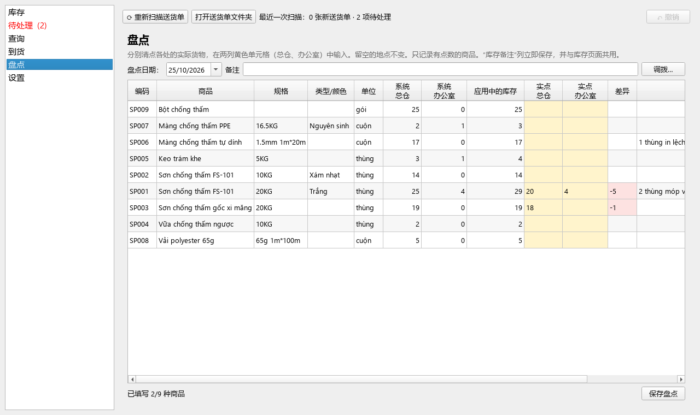
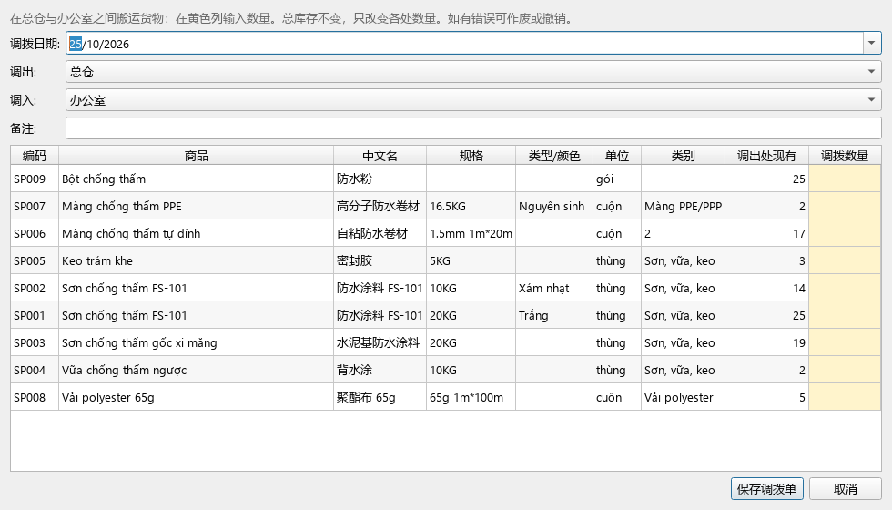
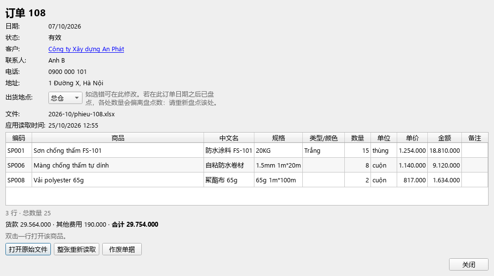

# DiBeKho 使用指南（详细版）

[English](user-guide.md) · [Tiếng Việt](huong-dan-su-dung.md) · **中文** · [← 返回主页](../README.zh.md)

本指南按步骤说明，按钮名称与界面一致。还没有安装？请看 [下载与安装](../README.zh.md)。

> **操作失误不用担心。** 几乎所有操作都可以用右上角的 **↶ 撤销** 按钮恢复（见 [第 11 节](#11-操作失误撤销与备份)）。

**目录**
1. [认识界面](#1-认识界面)
2. [第一天](#2-第一天)
3. [每天：读取送货单](#3-每天读取送货单)
4. [库存、即将缺货与备注](#4-库存即将缺货与备注)
5. [到货](#5-到货)
6. [按存放处盘点](#6-按存放处盘点)
7. [总仓与办公室之间调拨](#7-总仓与办公室之间调拨)
8. [客户、销售额与售价](#8-客户销售额与售价)
9. [订单](#9-订单)
10. [统计与 Excel 导出](#10-统计与-excel-导出)
11. [操作失误：撤销与备份](#11-操作失误撤销与备份)
12. [商品目录与提醒值](#12-商品目录与提醒值)
13. [转到另一台电脑](#13-转到另一台电脑)
14. [常见情况处理](#14-常见情况处理)

---

## 1. 认识界面

左侧有 **6 个项目**，点击即可打开：

| 项目 | 用途 |
|---|---|
| **库存** | 还剩多少、在哪里、哪些即将缺货 |
| **待处理** | 需要您决定的事项。括号中有数字（如 **待处理 (2)**）表示有事项在等待 |
| **查询** | 查找任何信息；打开 **订单列表**、**客户列表**、**统计与 Excel 导出** |
| **到货** | 登记到货 |
| **盘点** | 记录实点数量；在两处之间调拨 |
| **设置** | 语言、文字大小、商品目录、备份、数据迁移 |

顶部有 3 个按钮：
- **⟳ 重新扫描送货单**（**F5** 键）：读取新的送货单。
- **打开送货单文件夹**：打开存放送货单的文件夹。
- **↶ 撤销**（右侧）：恢复到上一次操作之前。

**表格颜色：**
- **橙色** + **⚠ 即将缺货——请补货**：该商品即将缺货。
- **红色**：负库存（通常是缺少到货单或未盘点）。
- **黄色**：供您填写数字的单元格（盘点、调拨）。

**两个存放处：** 应用把库存分为 **总仓** 和 **办公室**。“库存”是两处的合计。

**小技巧：**
- 名称太长被截断？把鼠标停在单元格上，或拖动列标题的边缘。
- 滚动鼠标滚轮 **不会** 改变任何选择或数字。
- 文字太小？**设置 → 常规 → 文字和按钮大小**，选择 130% 或 150%，然后重启应用。

---

## 2. 第一天

只需做一次，按顺序进行。

**第 1 步：首次打开应用。**
1. 选择语言。
2. 选择 **工作文件夹**：默认的 `文档/DiBeKho` 即可。**不要** 选择 OneDrive、iCloud 或 Google Drive 中的文件夹（云同步可能损坏数据）。
3. 点击 **开始**。应用会创建各子文件夹（见 [第 14 节](#数据存放在哪里)）。

**第 2 步：导入数据。** 任选 **一种**：

| 您手上有 | 操作 |
|---|---|
| 另一台使用 DiBeKho 的电脑导出的 `.dibekho` 文件 | 复制到 `input/` 文件夹 → **待处理** → **导入数据**。完成，跳过第 3 步 |
| 每月库存统计表（Excel） | **库存** 页面 → **从 Excel 导入商品目录…** → 选择文件 → 检查预览（双击单元格可修改，取消勾选不需要的行）→ 保持勾选 **把文件中的库存（F 列）作为应用的库存，截至日期** 并选择日期 → **导入所选行** |
| 什么都没有 | 跳过。读取送货单时会逐步建立商品（[第 3 节](#3-每天读取送货单)） |

> 从 Excel 文件导入的库存记在 **总仓**。如果办公室也有货，请完成第 3 步。

**第 3 步：期初盘点。** 打开 **盘点**，分别清点两处的实物，填入两列黄色单元格（[第 6 节](#6-按存放处盘点)）。此后应用的数字与实际库存一致。

**第 4 步：（建议）检查提醒值。** 默认库存 **低于 30** 时提醒。如果很多商品通常只有几箱，请调低此值或为商品单独设置提醒值（[第 12 节](#12-商品目录与提醒值)）。

---

## 3. 每天：读取送货单

每张送货单（Excel 文件）都会 **减少** 库存。应用读取商品名称、规格、数量、备注、单价、金额和运费。

### 3.1. 复制送货单并扫描

1. 点击 **打开送货单文件夹**，把当天的送货单复制进去（可按月建子文件夹）。
2. 点击 **⟳ 重新扫描送货单**（或 **F5**）。每次打开应用也会自动扫描。
3. 顶部显示读取了多少张新单。
   - 已完成记录的送货单会被 **移入** `phieu-giao-hang/da-xu-ly/`。仍在外面的就是 **未完成** 的。
   - 同一张单放两次、改名或移动：应用能识别，**不会重复扣减**。

### 3.2. 为新订单选择出货地点

送货单上没有写货物从哪里出，所以每张新订单都会出现在 **待处理 → 未选出货地点的订单**。


1. 打开 **待处理**。
2. 在每张订单的 **出货地点** 列选择 **总仓** 或 **办公室**。
3. 点击 **保存出货地点**。

选择之前，货物 **暂按总仓扣减**，所以总库存马上就是对的。选错了？打开该订单（[第 9 节](#9-订单)），修改 **出货地点**。

### 3.3. 应用尚未识别的商品行

第一次出现的商品名称，应用还不知道对应哪种商品。该送货单会出现在 **待处理 → 商品目录中没有的商品名称**，按订单分组，显示订单的所有行（✓ 表示已识别），方便与纸质单核对。

在每行的 **对应商品** 列中选择：

| 这一行是 | 选择 |
|---|---|
| 库中已有的商品 | 建议中的商品（2–3 个最接近的）。没有：**🔍 选择其他商品…**，输入几个字查找（可不输入声调，也支持中文） |
| 新商品 | **＋ 新建商品**。在 **期初库存** 中填写 **此单之前** 的库存（留空 = 0） |
| 运费、服务费 | **✕ 不是货物…**（通常已预选）。这一行的金额记为订单的 **另计费用** |
| 不确定 | **⏸ 稍后（保留，暂不确认）**。订单的其他行照常记录，这一行等待 |

然后点击 **应用并重新读取送货单**，查看汇总并确认。

- 应用会 **记住** 选择：下次遇到相同名称自动识别。
- 同一名称出现在多张订单中：在一张中选择，其他订单跟着改变。
- 很久以前选错了？见 [第 14 节](#14-常见情况处理)。

### 3.4. 待处理中的其他提示

| 提示 | 含义 | 点击 |
|---|---|---|
| **送货单已修改** | 已读取的送货单被修改过 | **使用新版本** 或 **保留旧版本** |
| **文件已删除/移动** | 文件不见了，库存 **不变** | **恢复文件**（应用保存了副本）、**作废单据** 或 **忽略** |
| **无法读取** | 不是送货单，或缺少信息 | 查看原因；修改文件后重新扫描，或 **隐藏** |
| **input 文件夹** | 有数据包、旧到货文件或商品目录文件等待导入 | **导入数据** / **查看并导入** |

---

## 4. 库存、即将缺货与备注


### 4.1. 看懂库存表

列的顺序：编号、商品、中文名称、规格、类型/颜色、类别、单位、库存、低库存提醒值、库存备注、总仓、办公室、最近出库。

| 列 | 含义 |
|---|---|
| **库存** | 现有合计（总仓 + 办公室） |
| **低库存提醒值** | 该商品当前使用的提醒值 |
| **库存备注** | 该商品的备注（破损、印刷错位、过期的箱数…）；列较窄，鼠标悬停可看全文 |
| **总仓**、**办公室** | 各处数量 |
| **最近出库** | 最近一次送货日期 |

- 即将缺货（低于提醒值）的商品显示**橙色**；负库存显示**红色**。页面顶部一行说明有多少商品即将缺货。
- 从「编号」到「库存」的几列在**左右拖动表格时会固定不动**（拖动表格下方的滚动条即可在仍看到名称和总库存的同时查看总仓/办公室/最近出库）。
- **筛选** 框可快速查找。**类别** 只看一组。

### 4.2. 列出需要补货的商品

勾选 **只看即将缺货**：表格只剩橙色（即将缺货）和红色（负库存）的商品，这就是补货清单。

### 4.3. 给商品写备注

例如：“3 箱印刷错位”、“2 箱 2026 年 12 月过期”、“1 卷边缘破损”。

1. **双击** 该商品的 **库存备注** 单元格（或选中后直接输入）。
2. 输入备注，按 **Enter**，立即保存。
3. 删除备注：双击，删掉文字，按 Enter。

此备注与盘点页面的备注列 **共用**，并显示在商品详情、统计和 Excel 文件中，还会 **随数据包** 转到其他电脑。

### 4.4. 查看商品详情

**双击** 一行（备注单元格除外）。窗口显示：
- 当前库存和 **按存放处：总仓 … + 办公室 …**，例如“总仓 39 + 办公室 1”。
- 库存备注（如有）。
- **出入库历史**：每次送货、到货、盘点、调拨，含存放处及之后的结存。双击一行可打开该单据。
- **购买最多的客户** 及销售额。

---

## 5. 到货


1. 打开 **到货**，点击 **＋ 登记到货…**。
2. 选择货物来源：
   - **口岸 / 母公司**：输入供应商名称，或选择用过的名称。
   - **客户退货**：选择客户，知道的话再选退货的订单号。
3. 选择 **到货日期** 和 **存入**：**总仓** 或 **办公室**。
4. 应用预先建议 3 种商品（该供应商常到的商品，或即将缺货的商品）。在每行填写 **数量**；没有数量的行会被忽略。
   - 换商品：点击名称 → **🔍 从库存中选择商品…**。
   - 全新商品：点击名称 → **★ 新商品（库中没有）…**，填写名称和规格。保存到货单时才创建。
   - 加行：**＋ 添加一行**。删行：行末的 **✕**。
5. 点击 **保存到货单**，查看汇总并确认。

结果：所选地点库存增加，到货单编号 **HV001、HV002…**，并在 `output/hang-ve/` 保存一个 Excel 文件（可打印或发送）。

- 填错了：马上点 **↶ 撤销**，或在列表中选中该单 → **修改所选…**（旧单在历史中标为“已替换”）。
- 旧格式到货文件（已填写的模板）仍可用 **选择要导入的文件…** 导入。

---

## 6. 按存放处盘点

盘点 = 清点实物并记录。应用只记录实点数与系统数的 **差额**，历史清晰。



1. 打开 **盘点**，选择 **盘点日期**（清点的那天）。
2. 每种商品有：
   - **系统：总仓 / 办公室** 和 **应用中的库存**：应用当前的数字。
   - 两列黄色 **实点：总仓** 和 **实点：办公室**：填写您点到的数量。
3. 只填写已清点的地点。**留空的地点保持不变。** 例如今天只点了办公室：只填办公室列。
4. **差额** 列立即更新，红色表示有差异。
5. （可选）填写本次盘点的 **备注**，例如“月底盘点”。
6. 点击 **保存盘点** 并确认。

**例子：** 系统显示总仓 25、办公室 4。您点到总仓 20、办公室 4。填 20 和 4，保存。应用在总仓记 −5；新库存为 24（20 + 4）。

- 表格末尾的 **库存备注** 列与库存页面相同：盘点时双击即可记录破损或过期的箱数。立即保存，**不会** 清掉正在填写的数字。
- 显示数字前应用会先扫描送货单，避免重复计算。

---

## 7. 总仓与办公室之间调拨

把货物从一处搬到另一处时使用，例如从总仓搬 5 箱涂料到办公室。**总库存不变**，只改变各处数量。



1. 打开 **盘点**，点击右上方的 **调拨…**。
2. 选择 **调拨日期**、**调出** 和 **调入**（两处总是不同）。
3. **调出处现有** 列显示现有数量。在黄色 **调拨数量** 列中为搬走的商品填写数量。表格还加了 **中文名称** 和 **类别** 两列，方便区分只有中文名称不同的商品；**调出处现有** 和 **调拨数量** 两列会固定在右边，拖动表格时也方便查看和输入数字。
4. （可选）填写 **备注**。
5. 点击 **保存调拨单**，查看汇总并确认。调拨单编号 **CH001、CH002…**

系统显示调出处数量不足？仍可保存，但会先提示；该处将为负数，直到下次盘点。

查看或作废调拨单：**查询 → 订单列表**，**单据类型** 选 **调拨单**，双击 → **作废单据**。

---

## 8. 客户、销售额与售价

价格取自送货单的 **单价 / 金额** 列。

- **销售额只计货款。** 运费和其他费用 **另计**，不计入销售额。
- 送货单上没有价格：价格格留空（—），不计入销售额；应用会提示有多少单缺价格。
- 应用没有进价，所以 **不计算利润**。

### 8.1. 查看客户

1. **查询 → 客户列表**（或在查询页面的搜索框输入名称、电话）。
   列表中有每位客户的 **销售额**。
2. **双击** 一位客户。窗口显示：
   - 联系信息、订单数、第一单和最近一单。
   - **销售额**：货款合计、订单数；旁边另列运费等其他费用。
   - **该客户常买的商品**：总数量、**销售额**、**售价**（一个价格，或价格变动时显示“最低 – 最高”）、购买次数、最近购买。
   - **客户的订单和价格**：每张订单（最新在前）展开显示每行的 **单价**、**金额**，以及另计费用（如有）。双击订单查看详情。


### 8.2. 查看某段期间

1. 在客户窗口中 **取消勾选 全部时间**。
2. 选择 **从** … **到** …
3. 窗口中的所有内容（销售额、商品、订单）只统计该期间。

### 8.3. 导出某位客户的 Excel

在客户窗口点击 **导出 Excel…**。文件 `KhachHang_<名称>_<期间>_….xlsx` 保存在 `output/`，按当前所选期间，共 2 页：
- **订单**：每张订单（从旧到新），每行含单价、金额；**订单货款** 行加粗；另计费用行为斜体。
- **所购商品**：数量、销售额、最低价、最高价、购买次数。

可发给客户核对，或用于计算销售员提成。

---

## 9. 订单

**查询 → 订单列表**：所有单据，最新在前。
- 可按 **单据类型**（送货单、到货单、盘点单、调拨单）、日期、客户、商品筛选；勾选 **包括已作废** 可看已作废的单据。
- **存放处** 列：出货 / 存入地点（“(?)” = 尚未选择）。**货款** 和 **另计费用** 列。
- **在订单上点右键**（生效中的送货单）→ **整张重新读取**：见第 12 节。

**双击订单** 查看详情：



- 客户（点击名称打开客户）、联系人、电话、地址。
- **出货地点**：选错时可在此改为总仓 / 办公室。（如果在订单日期之后已盘点，修改地点会使各处数量偏离盘点数：请重新盘点该处。）
- 明细行含 **单价**、**金额**；“货款 · 其他费用 · 合计”一行（合计与纸质送货单上的“Tổng cộng”一致）。
- **打开原始文件**（只读副本）、**整张重新读取**（见第 12 节）、**作废单据**（退回库存，保留历史）。

> **删除送货单文件并不能作废单据。** 要取消订单，请打开订单并点击 **作废单据**。

---

## 10. 统计与 Excel 导出


1. **查询 → 统计与 Excel 导出**。
2. 选择 **期间**：日、月、季度、年或 **自定义范围**。较长期间可按日或月 **细分**。
3. 用 **商品**、**类别**、**客户** 按钮缩小范围（默认：全部）。
4. 表格按商品显示期初、入库、出库、盘点 ±、期末、**销售额** 和 **库存备注**。表格上方显示 **该期间销售额（只计货款）** 以及另计的运费等其他费用。下方是出库最多的商品和图表。
5. 点击 **导出到 Excel…**，选择需要的工作表并导出。文件 `ThongKe_….xlsx` 在 `output/`，应用会询问是否打开。

Excel 文件包含：

| 工作表 | 内容 |
|---|---|
| **进出存** | 每种商品：期初、入库、出库、盘点、期末、销售额、库存备注 |
| **单据明细** | 每次出入库：日期、类型、单号、客户、**存放处**、商品、数量、**单价**、**金额**、备注 |
| **客户 x 商品** | 总数量、销售额、购买次数 |
| **出库最多** | 排名及销售额 |

选择客户时只筛选 **出库** 数量。两处之间的调拨不算入库也不算出库。

---

## 11. 操作失误：撤销与备份

**↶ 撤销**（右上角）：
- 把数据恢复到上一次操作 **之前的样子**。按钮上显示操作名称，例如“↶ 撤销：盘点”。
- 再点一次可继续后退，最多 20 步。
- 适用于：待处理中的应用、选择出货地点、盘点、调拨、登记/修改到货、作废、重新读取送货单、添加/修改/删除商品、库存备注、提醒值、导入数据…

**自动备份：** 每天打开应用时备份，保留最近 **10** 份在 `sao-luu/`，超过 **30 天** 的会自动删除以节省空间（应用每两周还会自动整理一次）。在 **设置 → 数据迁移与备份** 中：
- **立即备份**。
- **恢复所选备份**：回到那一天的数据。
- **恢复已删除的商品…**：不小心删除了某个商品？应用会在备份中查找目前商品目录里已经没有的商品（必须还在最近 30 天内的某个备份中）。如果您已经手动重新建立过该商品，应用会询问是 **合并为一个**（所有单据转到较小的编号）还是 **分开保留**。

**重新开始：** **设置 → 常规 → 重置数据**（总是先备份）：
- **重置库存（保留商品）…**：保留商品目录和已学习的名称；清除送货单、到货、盘点、客户；立即重新读取所有送货单。重新读取的订单需要 **重新选择出货地点**。
- **删除全部数据…**：应用恢复到刚安装时的状态。

您自己的文件（送货单、`input/`、`output/`、备份）**永远不会** 被删除。

---

## 12. 商品目录与提醒值

**设置 → 商品**：

**通用提醒值 — 库存低于此数时提醒**（默认 **30**）：
- 适用于 **没有** 单独提醒值的所有商品。库存 **低于** 此数时该行变橙色并提示“⚠ 即将缺货——请补货”。
- 设为 **0** 则关闭。
- 此值随数据包转到其他电脑。

**单个商品的提醒值：** 选中商品 → **编辑商品…** → **低库存提醒值**。例如按卷销售的商品设为 5：剩 5 或更少时提醒。单独提醒值总是优先于通用提醒值。

**其他按钮：**
- **添加商品**、**编辑商品…**（或双击一行）：越南文名、中文名、规格、类型/颜色、单位、类别。
- **删除商品**：只能删除未出现在任何单据中的商品。已使用的商品可设为 *停用*（隐藏，旧单据不变）。已删除商品的编号永不重复使用。
- **从 Excel 导入商品目录…**：从月度统计表添加商品。
- **已学习的单据名称**：应用学过的名称，按订单分组。点击订单查看；**忘记并重新读取…** 可为**某一个名称**重新选择商品。
- **整张重新读取**：想一次性重新选择**一整张订单的所有行**，而不是一行一行来？在这里、在订单列表（第 9 节），或打开订单时按同名按钮，在订单名称上点右键即可。应用会忘记该订单每一行的商品匹配，从头重新读取；该订单（以及其他使用相同名称的单据）会出现在待处理中等您重新选择。旧的历史记录保留，如果改变主意可按 ↶ 撤销。

---

## 13. 转到另一台电脑

同一时间只有 **一台电脑** 工作。两台电脑都必须安装 **最新版本**（旧版本读不了新版本的数据）。

**方法 1 — 数据包（最完整）：** 订单、客户、各处库存、备注、提醒值、历史…
1. 正在使用的电脑：**设置 → 数据迁移与备份 → 导出数据**。`output/` 中出现 `.dibekho` 文件。
2. 发送该文件（U 盘、聊天软件、邮件…），复制到另一台电脑的 `input/` 文件夹。
3. 另一台电脑：**待处理 → 导入数据**。该电脑的旧数据先备份，然后被 **全部替换**。

**方法 2 — Excel 基础数据**（商品目录、客户、库存、备注；**不含** 订单）：
- **导出基础数据…** 生成 3 页的 Excel 文件：商品、客户、库存。**库存** 页有库存、总仓、办公室和库存备注列。
- 如需要，修改库存页中的 **库存** 或 **备注**，然后 **导入基础数据…**：商品保留编号；应用的总库存等于文件中的数字（差额记在总仓）；备注会更新。总仓 / 办公室列仅供查看。
- 应用不确定某行库存属于哪个商品时，会显示 **导入前核对库存**：黄色行需要您检查。

---

## 14. 常见情况处理

| 情况 | 处理方法 |
|---|---|
| 刚刚点错 | **↶ 撤销** |
| 很久以前为某行选错了商品 | **设置 → 商品 → 已学习的单据名称**：点击订单，在错误的行上点 **忘记并重新读取…**。该单会回到 **待处理** 重新选择 |
| 想一次性重新选择一整张订单（多行一起） | 在订单名称上点右键（订单列表、已学习的单据名称，或订单详情窗口）→ **整张重新读取**（[第 12 节](#12-商品目录与提醒值)） |
| 某张订单记错了 | 打开订单 → **作废单据** |
| 出货地点选错 | 打开订单 → 修改 **出货地点** |
| 某处库存为负 | 通常货物实际从另一处出，或没有登记调拨。修改订单的出货地点、登记 **调拨…**，或盘点该处 |
| 总库存为负 | 缺少到货单或未盘点 |
| 太多“即将缺货” | 调低 **库存低于此数时提醒**，或为商品单独设置提醒值（[第 12 节](#12-商品目录与提醒值)） |
| 订单没有价格（—） | 纸质送货单没有单价 / 金额。修改文件后在待处理中点 **使用新版本** |
| 误删了送货单文件 | 库存不变。**待处理 → 恢复文件** |
| 不小心删除了某个商品 | 如果还来得及，立即按 **↶ 撤销**；否则用 **设置 → 数据迁移与备份 → 恢复已删除的商品…**（第 11 节） |
| 想回到之前某一天 | **设置 → 数据迁移与备份**，选择备份，**恢复所选备份** |
| 导出 Excel 提示文件已打开 | 关闭同名的 Excel 文件后重新导出 |

### 数据存放在哪里

全部在一个文件夹中，默认 `文档/DiBeKho`：

```
DiBeKho/
├── phieu-giao-hang/   ← 把送货单放在这里
│   └── da-xu-ly/      ← 已记录完成的送货单
├── input/             ← 来自其他电脑的数据包、旧到货文件
│   └── da-xu-ly/      ← 已导入的文件
├── output/            ← 导出的 Excel、到货单文件（hang-ve/）、数据包
├── sao-luu/           ← 自动备份
└── data/              ← 应用数据（请勿手动修改）
```

<sub>指南中的截图使用模拟数据，不是真实客户数据。</sub>
